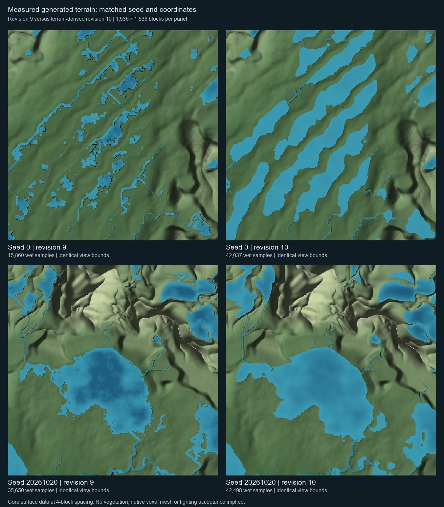

# Terrain-derived drainage — saved channel revision 10

The owner requires organic landforms governed by geography, rather than a fixed layout disguised with noise. Straight river reaches are valid where the terrain supports them; forcing every reach to meander would impose another pattern. Determinism remains required.

## Implementation

Revision 10 separates two responsibilities formerly combined in the priority-flood pass. Depression filling still establishes spill elevations and an acyclic escape order. A subsequent receiver pass compares actual drop per unit distance, including the longer diagonal distance. On true flats it retains the flood resolver's escape tree instead of inventing an uphill route.

Contributing runoff continues to accumulate over the entire receiver graph. A large accumulated area on a uniform plane is sheet runoff, not sufficient evidence for a separate channel at every grid row. Positive cross-gradient curvature admits channel heads in convergent hollows; admitted channels propagate downstream, and finite lake outlets also seed downstream continuation. Internal receiver edges inside the same finite lake are not drawn as submerged rivers.

Each admitted graph node gets one shared terrain-fitted path knot. Knots and cubic controls search bounded cross-slope corridors for lower terrain, with a displacement cost and the original position retained on ties. Connected reaches reuse the identical downstream knot. The new mode does not apply the old independent noise displacement.

Lakes use the actual fine-sampled terrain bed and elevation admission, with voxel wetness and outlet containment guards. They do not replace the bed with a normalized bowl or apply revision-9 shelf/margin sculpting. A nearby outlet's bank blend cannot reshape a submerged basin outside its channel corridor. Legacy fan deltas, crescent oxbows, periodic canyon benches and noise-authored braid bars are excluded from revision 10. Width/depth still use bounded hydraulic-geometry approximations based on catchment and grade.

New standard/deep presets select revision 10. Explicit delta presets remain revision 9 as legacy choices; they are not process-based delta generation. Saved revisions 0–9 retain their previous meaning. No retrogen, player-edit replacement or runtime recharge rule is introduced. New-world initial water coverage and volume can differ because the generated basin geometry differs.

## Evidence and reproduction

- `OrganicDrainageChecks` is registered in `coreChecks`. The focused suite passes 816,669 assertions: metric slope selection, flat escape, convergence, runoff conservation, acyclic/downhill stages, terrain bed retention, wet outlets, connected channel flags, wet reach samples, signed-coordinate/order replay and saved-world differential comparisons.
- Eight real engine seeds produce 4,916 reaches; 6,655 sampled reach centers retain a wet voxel, and 4,602 graph knots move toward lower terrain. These counts describe the checked corpus, not every possible seed.
- The diagnostic uniform plane previously produced 52,900 reaches from accumulated sheet runoff. Revision 10 produces zero while preserving runoff conservation. The sloping depression fixture retains 25,022 wet samples and 19,100 unmodified deep terrain-bed samples outside inlet/outlet incision.
- Separate-loader comparison against the pre-change terrain/watershed sources checks 640 columns and 6,400 bit-exact fields across saved revisions 0–9 and two seeds.
- The actual Minecraft 26.1.2 production generator codec passes 24 checks covering decode/encode/reopen for revisions 0–10 and rejection of −1/11. This is native codec validation, not a loader/world/client acceptance run.
- All production modules, including Vulkan, and the core/visual validation sources compile against the cached actual NeoForge 26.1.2.122 APIs. The complete core suite also passes using the current fully reconstructed sources and a writable test temporary directory.

For the diagnostic image, run `OrganicDrainageCapture <output-directory>` using the core-check classpath, then `python tools/render_organic_drainage.py <output-directory> docs/validation/organic-drainage/generated-terrain.png`. The matched maps use real engine seeds and coordinates, sampled every four blocks; they are not Minecraft screenshots and omit vegetation, native voxel meshing and native lighting.

## Qualification gate

The `Organic terrain qualification` workflow performs the full Linux build/check suite, creates an actual engine world through the native UI, verifies revision 10 and the owned biome palette, captures coast/headwater/river/lake/outlet/ridge views, and assembles a Windows Vulkan package with JarJar/native-DLL checks. It retains logs, screenshots and the resulting package as one commit-associated artifact for three days.

At source publication, native qualification is pending. Local Gradle execution is blocked by denied loopback sockets; direct compilation and the focused/native-codec checks are not presented as a successful full Gradle build or an in-game visual pass. Do not mark terrain or a release finalized solely because this document or workflow exists. Inspect the actual run, lifecycle, captures and package before closing acceptance.

## Remaining model limits

The routing grid is still 32 blocks with one receiver among eight neighbors. Terrain fitting and convergence admission remove specific artifacts; they do not implement continuous-angle/multiple-flow routing or prove complete removal of directional bias. Very small catchments, fine-scale basin connectivity and cross-region outlet exchange need further qualification. Geology remains the existing generated terrain input, not a complete erosion/history simulation. Dynamic meander migration, avulsion and process-generated deltas/oxbows are not implemented by this change.

Primary references informing the separation of responsibilities and the acknowledged grid limit: [Tarboton, continuous-angle flow directions (1997)](https://digitalcommons.usu.edu/cee_facpub/2507/) and [Barnes et al., Priority-Flood depression filling](https://rbarnes.org/sci/2014_barnes_depressions_published.pdf). Revision 10 is an engine approximation, not an implementation of Tarboton's D-infinity method.
