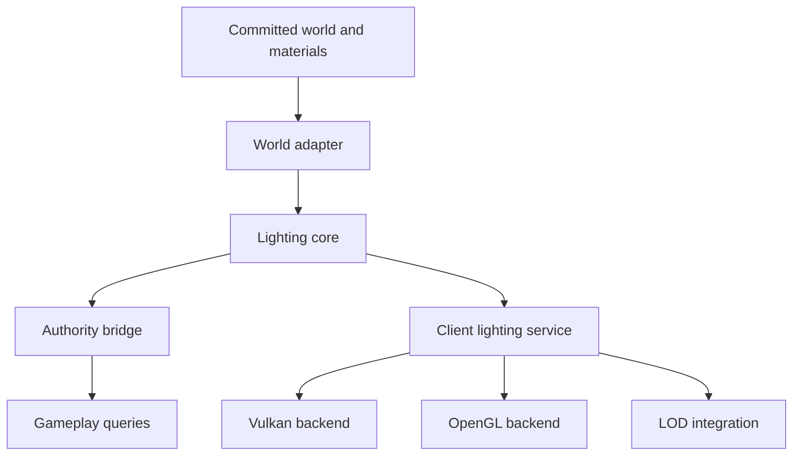
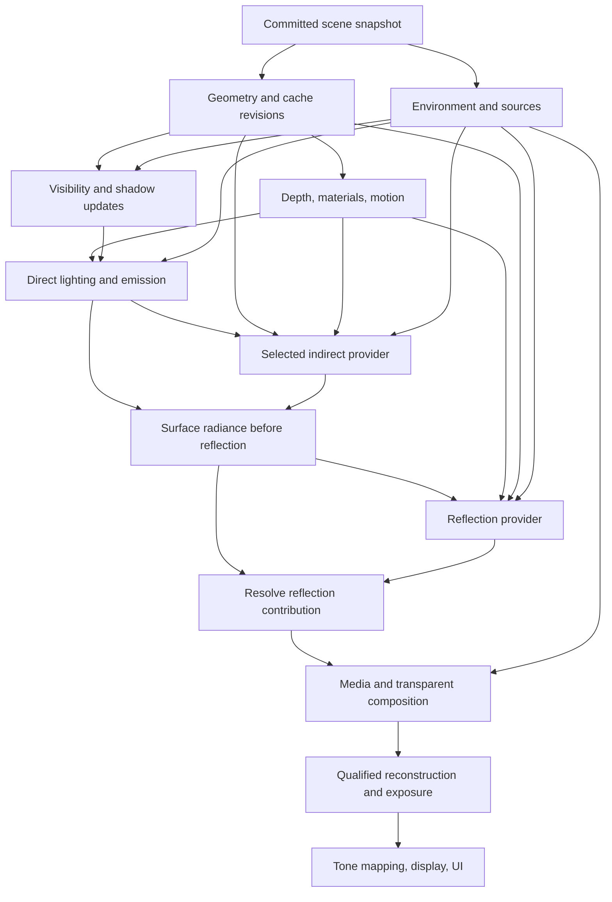

# Deep Primal Lighting Engine

**Version:** 0.3 — comparative research edition and proposed implementation specification  
**Date:** 2026-10-28  
**Scope:** World-light correctness, direct/indirect rendering, editable geometry, streaming, water/LOD, resource budgets, research decisions, and acceptance  
**Companions:** [WATER-ENGINE.md][water-spec] · [LIGHTING-RESEARCH-NOTES.md](LIGHTING-RESEARCH-NOTES.md)  
**Status:** Design and implementation handoff. No new lighting implementation or native performance result is claimed by this document.

## 0. Purpose and reading guide

Deep Primal needs lighting that makes its terrain readable, its caves convincingly dark, and its water and distant landscape visually continuous. The same system must survive excavation, construction, moving emitters, streaming, resource reloads, and save/reopen without light leaks, permanently dark sections, or long frame stalls.

Build a backend-independent world-lighting core, connected to the current host through a version-specific adapter. Let Vulkan and OpenGL consume the same lighting contract. Add richer shadows, atmosphere, and indirect illumination in stages after world correctness is established.

The proposed architecture separates three things:

1. **Gameplay illumination:** authoritative answers used by simulation and host compatibility.
2. **Voxel light fields:** cached sky and emitted-light information derived from committed world state.
3. **Rendered illumination:** the client's sun, shadows, colored light, exposure, water response, and optional effects.

Graphics settings must never change the first of these. A headless server must remain correct without a renderer.

### Status and precedence

| Label | Meaning |
| --- | --- |
| **CONTEXT** | A project constraint or source-document statement carried forward here. It is not a new implementation verification. |
| **PROPOSED** | A requirement or default recommended by this specification. It is not a previously approved owner decision or a completed feature. |
| **OPEN** | A choice that needs evidence or a later design decision before the affected milestone ships. |
| **GATE** | Evidence required to accept the corresponding implementation. |

Unless explicitly labeled CONTEXT, the architecture and requirements below are **PROPOSED**. Words such as “must” describe the proposed implementation contract. They do not mark work complete. Newer owner instructions and the actual saved-world contract take precedence over this document.

### 0.1 The recommended engine

The recommended design is a layered, editable-world lighting engine with a complete modest-cost mode and separately qualified enhancements. Its distinguishing feature should be that every visible result can explain its source, occlusion, age, cost, and fallback.

| Layer | Proposed starting point | Why it belongs |
| --- | --- | --- |
| World truth | Verified scalar sky/block semantics, deterministic edits, typed readiness | Caves, gameplay, saves, and multiplayer remain correct without a GPU |
| Visual baseline | Occlusion-aware sky and colored-emission approximation; calibrated materials and exposure | Every supported backend has a useful complete picture |
| Direct lighting | Bounded local-light assignment, stable sun cascades, cached local shadows | Shape, contact, and highlights improve without requiring dynamic GI |
| Indirect diffuse | Exactly one selected provider per contribution/domain | Prevents stacking several estimates of the same bounced light |
| Reflections | One resolved specular result using qualified screen/world sources | Water and polished materials have explicit miss behavior |
| Atmosphere | Shared sky state, aerial perspective, and bounded local media | Near terrain, distant terrain, clouds/fog, and water can compose coherently |
| Reconstruction | Signal-specific temporal/spatial filtering with invalidation | Stability cannot conceal old geometry or removed emitters |
| Evidence | Scalar oracle, matched reference renderer, recorded dynamic fixtures | Claims are tested against the behavior they actually promise |

**Build first:** authority and lifecycle; independently updated light pages; coherent materials; direct-light visibility; resource accounting. **Prototype next:** visibility-aware probes and sparse-distance-field GI under the same scenes and cost envelope. **Research separately:** full 3D Radiance Cascades, stochastic many-light sampling, and higher-end path transport.

This recommendation is our synthesis of the source survey in section 18. It is not a claim that one borrowed algorithm is universally best. The companion **LIGHTING-RESEARCH-NOTES.md** records the evidence, source limitations, and rejected shortcuts. Broad coverage includes voxel engines, production renderers, original transport research, reconstruction, and offline references; it does not pretend to include every proprietary or unpublished lighting system.

### 0.2 How to use this specification

Read sections 1–8 to implement world correctness; sections 9–14 to integrate rendering and runtime budgets; sections 15–17 to plan acceptance; sections 18–19 to understand research choices and experiments. Section 20 contains portable source links and the change history.

A task is ready for implementation when its owner, inputs, validity rules, fallback, resource limit, and acceptance evidence are defined. A task is accepted only when its runtime evidence passes. Every proposed numeric budget below remains unmeasured until the benchmark manifest and actual hardware results exist.

### Contents

- [1. Project constraints](#1-project-constraints)
- [2. Required player experience](#2-required-player-experience)
- [3. Architecture and authority](#3-architecture-and-authority)
- [4. Host integration and migration](#4-host-integration-and-migration)
- [5. Materials and voxel representation](#5-materials-and-voxel-representation)
- [6. Propagation and edits](#6-propagation-and-edits)
- [7. Streaming and job lifecycle](#7-streaming-and-job-lifecycle)
- [8. Terrain and water integration](#8-terrain-and-water-integration)
- [9. Rendering contract](#9-rendering-contract)
- [10. LOD and distant lighting](#10-lod-and-distant-lighting)
- [11. Persistence and multiplayer](#11-persistence-and-multiplayer)
- [12. Scheduling and performance](#12-scheduling-and-performance)
- [13. Settings and diagnostics](#13-settings-and-diagnostics)
- [14. Integration interfaces](#14-integration-interfaces)
- [15. Acceptance suite](#15-acceptance-suite)
- [16. Implementation milestones](#16-implementation-milestones)
- [17. Decisions and completion rules](#17-decisions-and-completion-rules)
- [18. Comparative research and engineering decisions](#18-comparative-research-and-engineering-decisions)
- [19. Experiments and promotion gates](#19-experiments-and-promotion-gates)
- [20. Sources and changelog](#20-sources-and-changelog)

## 1. Project constraints

**CONTEXT.** The documented prototype target is Minecraft 26.1.2, NeoForge 26.1.2.122, and Java 25 in the companion water specification. These identify that document's prototype baseline; the implementation must inspect the actual checkout before selecting native APIs. This design keeps the longer-term standalone engine direction possible through an independent core and replaceable host adapter. [Project source: water specification, introduction and architecture.][water-spec]

Carry forward these project constraints:

- Preserve saved V1–V7 geography and generator profiles. Lighting changes must not regenerate terrain.
- Keep V8 terrain explicitly opt-in. Native V8 materialization, lighting, and save/reopen remain separate acceptance gates.
- Prioritize Vulkan integration while retaining a supported OpenGL path.
- Treat Windows and the owner's AMD 8060S system as an acceptance target, with exact device, driver, and settings captured during testing.
- Preserve finite water, its composition, and its ownership rules regardless of visual settings.
- Keep full native builds and owner-hardware acceptance with the established owner workflow.

The reviewed October 28 audit records a source-level V8 preview and outstanding native/GPU gates. It does not establish a production-ready custom lighting engine. Its reported FPS observation is not a controlled lighting benchmark. [Project source: pinned audit.][audit]

The water specification already requires presentation to leave authoritative water unchanged and near/far water to share lighting, depth, alpha, and fade behavior. Those are integration constraints for this engine. [Project source: water specification, sections 14.1–14.4.][water-spec]

### Initial scope boundary

The first deliverable is correct lighting for the existing world lifecycle. Hardware ray tracing, dynamic GI, physically simulated light transport, and a replacement renderer are not prerequisites. Their optional interfaces can exist without delaying correct caves, edits, and chunk readiness.

## 2. Required player experience

| Situation | Required behavior |
| --- | --- |
| Surface travel | Stable daylight and coherent material response as terrain streams and LOD changes. |
| Entering a cave | Sky contribution falls according to actual openings and occlusion; exposure changes smoothly without making a sealed cave self-illuminating. |
| Torch or lamp placement | Nearby lighting updates promptly, including across section and chunk borders. |
| Removing a light | Its contribution disappears; overlapping surviving sources remain. |
| Mining through a roof | Sky exposure updates through the affected shaft and surrounding passages. |
| Building a wall | Light and shadows respect the new obstruction; stale bright history cannot persist. |
| Night, dawn, and weather | Sky color and intensity change continuously without relighting every loaded voxel each frame. |
| Flowing water | Lighting follows the moving surface, depth, and composition without flashes at page or near/far boundaries. |
| Long-distance views | Distant terrain shares the near world's time, atmosphere, and emission response. |
| Save, quit, and return | No phantom lights, unexplained bright borders, or permanently unlit sections. |

Suggested visual direction: natural daylight, warm localized firelight, readable terrain forms, and dark enclosed spaces. Biome identity should come from material, vegetation, moisture, and atmosphere inputs; avoid arbitrary biome-wide brightness steps.

The final darkness curve, exposure limits, and light colors need an art-calibration scene. They are not fixed by this draft.

## 3. Architecture and authority

### 3.1 Responsibilities

| Component | Owns | Must not own |
| --- | --- | --- |
| World/host adapter | Immutable world snapshots, committed edits, native scalar-light mapping, chunk lifecycle hooks | GPU resources or visual quality policy |
| Lighting core | Material lookup, propagation, dirty regions, border reconciliation, revisioned results | Terrain generation, fluid transport, or direct native writes from workers |
| Authority bridge | Selection of the single authoritative gameplay-light provider and query validity | Per-client exposure or shadow settings |
| Client lighting service | Render snapshots, visible light selection, light-volume upload requests, history invalidation | Server gameplay decisions |
| Vulkan/OpenGL backend | Resource lifetime, synchronization, shading, shadow passes | World simulation or changes to authoritative light |
| LOD integration | Derived coarse lighting inputs for delivered terrain | Invented unexplored geometry or authoritative gameplay light |



The authority bridge selects the host or a qualified custom provider according to the world profile. In host-authority mode, native light remains authoritative and the core may read it or calculate a non-authoritative comparison field.

### 3.2 Invariants

1. One authoritative provider answers gameplay-light queries for a world profile. Never run two competing native light writers.
2. The same committed geometry, materials, sources, bounds, and lighting profile converge to the same logical values, independent of worker count and task order.
3. Missing world data is unknown, not air, solid ground, or a valid sky opening.
4. A published result identifies all inputs that make it valid. A stale result cannot mark a section ready.
5. Bounded queues and bounded memory are mandatory. Reaching a limit defers work visibly; it never silently loses required invalidation.
6. Presentation settings cannot modify terrain, fluid quantity, salt, sediment, source state, or gameplay illumination.
7. Day/night rendering changes do not require a whole-world propagation pass.
8. Unsupported visual features have a tested fallback and an accurate UI state.

### 3.3 Contribution ownership and the energy ledger

Each render profile publishes an energy ledger. A provider declares the physical or artistic term it estimates, whether it includes direct sky/emissive transport, and whether it returns outgoing radiance, irradiance, or a pre-multiplied material response. Provider names alone are insufficient.

| Contribution | Baseline owner | Enhanced owner | Composition rule |
| --- | --- | --- | --- |
| Gameplay sky/block light | Authority bridge | Same bridge | Never derived from the rendered image |
| Visible emitter surface | Material emission | Same material contract | Visible appearance does not automatically create a second analytic source |
| Sky/environment diffuse | Structural sky access and calibrated ambient | Selected diffuse provider if it already includes environment transport | Replace or partition the represented term; do not add both in full |
| Sun/moon direct diffuse | Qualified directional visibility path, or disabled in diffuse-only baseline | Selected direct estimator | Partition any equivalent solar contribution in environment/GI inputs; evaluate the represented path once |
| Local diffuse illumination | Occlusion-aware voxel approximation | Qualified analytic/direct and indirect providers | The baseline is a complete approximation, not a physically separated bounce |
| Direct specular | Qualified analytic lights | Same direct provider or a selected stochastic substitute | Each source appears once in the chosen direct estimate |
| Indirect diffuse | Baseline approximation | One selected GI provider | Blend compatible complete estimates or explicitly partition transport |
| Indirect specular | Valid local/environment reflection | Resolved SSR, probe, or traced reflection | Select/blend overlapping estimates with bounded weights |
| Medium scattering and attenuation | Declared fog/water approximation | Selected volume integrator | Apply each path segment's attenuation once |
| AO and denoising | Optional modifiers/reconstruction | Signal-specific equivalents | Neither creates an additional illumination term |

The compact flood field uses maxima, so it cannot generally subtract one torch's contribution to make room for an analytic version of that torch. Do not invent a source-by-source decomposition after the maximum has discarded that information.

Use one of two explicit modes:

1. **Baseline approximation mode:** the voxel field supplies local diffuse lighting. Selected analytic lights may provide specular detail and separately justified directional detail only within a calibrated composition rule.
2. **Transport mode:** qualified direct lighting plus one indirect provider supplies local diffuse lighting over a declared valid domain. Crossfade the complete diffuse result against the baseline with weights summing to one. Do not leave the full baseline diffuse active underneath.

A hybrid partition needs its own proof of ownership and visibility. Spatial transitions must preserve darkness and source removal; a mathematically normalized blend does not repair an invalid bright input. Provider validity is tested before blending.

An emissive material that is both sampled as geometry and represented by an analytic proxy must declare how the direct estimator avoids counting it twice. GI injection receives the specified direct/emission signal, not an accidentally already-composed image. Multi-bounce feedback is a separate explicit mode with energy and history tests.

## 4. Host integration and migration

### 4.1 Rollout modes

| Mode | Gameplay authority | Custom work | Promotion requirement |
| --- | --- | --- | --- |
| `HOST` | Existing host lighting | Read native light; add qualified client visuals | Preserve existing gameplay and native lifecycle |
| `SHADOW_VALIDATE` | Existing host lighting | Run candidate solver against recorded inputs; compare compatible scalar semantics | Explain every mismatch; no native writes from candidate |
| `CUSTOM_OPT_IN` | Custom provider through the adapter | Publish scalar compatibility values and custom render data | Native integration, save/reopen, networking, and rollback gates pass |
| `STANDALONE` | Deep Primal simulation | Replace host adapter with standalone world services | Separate platform milestone; no automatic conversion of existing worlds |

Start in `HOST`. Enable `SHADOW_VALIDATE` per development profile. Do not silently promote existing saves to custom authority.

Exact parity testing is meaningful only when both solvers use the same scalar semantics. Colored transmission and artistic rendering changes belong in their own comparisons. The adapter must capture the target version's actual emission, opacity, face-occlusion, light-query, and chunk-readiness behavior; this document does not invent native method signatures.

### 4.2 Compatibility rules

- Maintain scalar skylight and block-light interfaces independently of RGB appearance.
- Inspect runtime material registrations, resource reloads, custom dimensions, and host-provided block shapes.
- Unknown material definitions use a documented safe adapter fallback and emit a diagnostic. They must not default silently to fully transparent.
- Third-party renderer or shader combinations require their own qualification. Detect conflicting light writers and select a supported mode.
- A temporary custom-provider fault must not switch providers independently per section. Suspend affected readiness and recover coherently under the saved world mode.
- Migration must leave a usable pre-migration save or recovery path. Reverting a cache must not revert player terrain edits.

## 5. Materials and voxel representation

### 5.1 Material contract

Resolve lighting properties from authoritative material/block state into immutable, versioned descriptors:

| Property | Purpose |
| --- | --- |
| `emissionLevel` | Scalar gameplay emission under the selected profile |
| `emissionRgb` | Optional colored emission for the visual voxel field |
| `skyAttenuation` and `blockAttenuation` | Profile-defined scalar transmission costs |
| `rgbAttenuation` or quantized transmission | Optional colored filtering |
| `faceOcclusion[6]` | Whether ordinary light can transmit across an adjacent face connection |
| `emittingFacePolicy` | Profile-defined escape of local source emission, distinct from through-transmission |
| `shapeClass` | Full block, partial geometry, foliage, liquid, or other supported approximation |
| `materialRevision` | Invalidates dependent caches after definitions change |
| `visualResponse` | Albedo interpretation, emissive appearance, roughness, and optional material effects |

Leaves, glass, water, slabs, stairs, and thin surfaces cannot all share a single transparent flag. The first implementation may use coarse face connectivity, provided its limits are documented and tested. More detailed coverage must be versioned rather than changing old-world gameplay silently.

Emissive artwork and gameplay emission are separate properties. A bright texture does not automatically create a world source or an expensive shadow-casting light.

### 5.2 Proposed baseline encoding

Keep host-compatible scalar channels independent from optional RGB color:

| Field | Proposed range/storage | Meaning |
| --- | --- | --- |
| `skyLevel` | 0–15, four bits | Discrete structural sky-light field; shader time-of-day strength is separate |
| `blockLevel` | 0–15, four bits | Discrete scalar emitted-light field for compatibility |
| `red`, `green`, `blue` | 0–15 each, packed into a 16-bit sidecar | Optional artistic colored-light levels; four remaining bits reserved and zeroed |
| Validity/revisions | Section metadata | Profile, content, material, sources, and boundary dependencies |

The RGB field is a coarse lighting approximation, not calibrated radiance. Use a versioned decode curve to produce linear shader values. Do not derive gameplay brightness from color luminance or `max(R,G,B)` unless a future explicitly selected profile defines and verifies that rule.

For a dense 16×16×16 section, the scalar payload is **4 KiB** and the optional RGB sidecar **8 KiB**: **12 KiB total** before borders, snapshots, metadata, queues, and allocator overhead. This is a storage calculation, not a measured memory result. One thousand dense sections would consume about 11.72 MiB of these payloads alone.

Use implicit uniform states for all-dark or uniform-sky sections. Allocate dense color only where required. Do not allocate full-resolution light over the entire distant-LOD radius. Track CPU resident, in-flight, temporary, and GPU bytes separately, including copies.

All coordinates are signed. Convert world coordinates to 16-unit section coordinates using floor division and floor modulus; truncation toward zero is wrong for negative positions. Test `-17`, `-16`, `-1`, `0`, `15`, and `16` on every axis.

### 5.3 Source range and encoding limits

The compact representation has deliberate limits. Under the baseline ordinary transfer rule, a level-15 source in unobstructed air gives `max(15 - d, 0)` at face-step distance `d`: level 1 at distance 14 and zero at 15. Extra attenuation can shorten that reach. The unattenuated direct-sky rule is a separate case. Per-channel maximum also means two identical sources do not add brightness in this field.

Changing the decode curve cannot extend spatial reach or make maximum blending additive. Document range, saturation, mixing, rounding, and decode behavior in the profile. Test gradient banding and directional bias before freezing the RGB encoding; higher precision or another visual representation remains a measured choice, not a requirement to expand every scalar page.

Source definitions separately declare scalar emission, RGB voxel emission, analytic visual intensity, radius/falloff, and shadow range. Visual distances use documented world units; intensity uses a named artistic scale unless an explicitly calibrated physical model exists. A large lamp or lava pool may use a qualified extended visual path while preserving scalar gameplay semantics. Its advertised reach must work through that path and respect occlusion. Do not silently clamp an authored large-range source into the compact field and describe the result as equivalent.

### 5.4 Sources, old state, and optical edit events

A committed light-affecting event carries stable world/dimension identity, transaction revision, affected bounds, old and new emission/occlusion descriptors or a retained snapshot reference, and the relevant source lifetime. Capture removal inputs before deleting the state needed to explain the previous field. A block rotation, chisel/shape edit, material reload, or water optical change can matter without changing the block's coarse type.

Maintain separate identities for the authoritative source, render proxy, and GPU allocation. A reused slot receives a new generation. Cluster lists, probes, shadow pages, and reservoirs cannot treat a recycled index as the old source.

A source descriptor declares its support domain, color convention, units, visible shape, direct-light proxy, shadow policy, indirect injection policy, and whether it is persistent, attached to an entity, or transient. Aggregate particles/fire sparks into bounded visual representations where appropriate; gameplay emission remains explicitly authored. Source selection must be stable as the camera moves.

## 6. Propagation and edits

### 6.1 Core propagation rule

For ordinary emitted-light channels, use a deterministic, monotone transfer rule over the six face neighbors. A baseline channel update is:

```text
candidate(v, channel) = max(
    localEmission(v, channel),
    max over valid face-neighbors u:
        transfer(u -> v, light(u, channel), material state)
)
```

An occluded ordinary transmission connection contributes zero. The profile separately defines source emission across an emitting boundary: an opaque emitter may illuminate permitted adjacent cells while continuing to block unrelated through-light. Resolve that rule through the verified host adapter or explicit custom profile, and use it in both oracle and optimized solver. Ordinary propagation loses at least one discrete level per step; extra attenuation may apply. This bounds emitted-light influence for a finite channel range and prevents zero-loss cycles. Do not sum every neighbor: that would repeatedly count the same source. Per-channel maximum permits mixed colors from different sources but does not reproduce additive radiometric lighting.

The authoritative host-compatible scalar rule is whatever the adapter has verified for that profile. Treat the equation above as a proposed core model, not proof that a native implementation uses identical rules.

Use an independent, simple full-region solver as the correctness oracle. Optimize the incremental solver against that result, including decrease operations and boundaries.

### 6.2 Skylight

Each dimension/profile declares a sky policy: sky-enabled, no-sky, or explicitly defined fixed environment light. Reaching maximum Y does not itself create a sky source. For a sky-enabled dimension, compute direct sky access from its declared sky boundary or a certified column-occlusion summary that reaches it. A heightmap can accelerate the scan, but cannot manufacture visibility through missing overhang, cave, or partial-shape information.

An unobstructed air column may preserve maximum direct sky according to the profile. Sideways or indirect propagation attenuates. Do not preserve full-strength direct sky after it turns a corner. Water, foliage, and filtering materials use their defined transmission rules.

Sky exposure and directional sunlight are distinct. Six-neighbor sky propagation represents ambient access; it is not a sun-direction visibility test. A cave mouth may receive diffuse sky while its rear wall has no direct sun.

A roof edit can affect the entire remaining column and lateral passages. Schedule a resumable column scan and subsequent local propagation. Do not assume that one edited voxel implies a small fixed amount of work.

### 6.3 Addition, removal, and overlapping sources

Support a decrease/invalidation phase followed by re-propagation, or a bounded affected-region rebuild with equivalent output. Re-evaluate surviving sources and alternate paths. A source's deletion cannot clear another source's contribution merely because their influence overlaps.

Track source identity and revision independently from the cached field. For RGB, validate each channel: removing red emission must leave a surviving blue source intact.

Bulk generation, explosions, and fill operations produce coalesced dirty regions or section masks. They must not allocate one heavyweight task object per changed voxel. Edits received during an active solve increase the target revision and invalidate or supersede the pending result.

### 6.4 Time and moving emitters

Changing sun angle, weather tint, or exposure updates render parameters; structural sky access changes only when relevant world/material state changes. If gameplay needs daytime brightness, combine structural sky with the authoritative simulation clock and profile, never with client exposure.

A moving held light is initially a **client visual feature**. If it is later intended to affect AI or another gameplay system, give it an explicit server source, bounded update cadence, and network contract. Do not implicitly change survival rules when a client enables dynamic lights.

Use stable source IDs and simulation-time inputs for flicker. Cosmetic flicker should not enqueue world-wide scalar relighting or rapid changes in gameplay light.

### 6.5 Environment state and physical quantities

A single environment-lighting service consumes the authoritative clock, dimension profile, and available weather state. It publishes a revisioned frame snapshot containing sky policy, sun/moon direction, sky color/intensity, weather attenuation, and any supported transient flash events. Terrain, sky rendering, shadows, water, reflections, atmosphere, and LOD consume the same frame identity. This contract does not claim that every consumer or weather feature already exists.

Client interpolation smooths presentation only. No-sky and fixed-light profiles explicitly define ambient and gameplay behavior; they must not inherit the surface world's sky defaults. Cloud shadows and other optional effects need declared visual-only or authoritative semantics rather than becoming simulation inputs accidentally.

Discrete light level, sky access, directional solar visibility, irradiance, and temperature are different quantities. A 0–15 level has no physical energy or temperature unit. Future evaporation, snowmelt, drying, plant, or solar-energy consumers use typed, versioned simulation inputs with declared units and validity. Unsupported quantities return unavailable. They are never inferred from exposure, GPU shadows, or screen brightness. Thermal behavior remains owned by its relevant simulation system; this interface does not require a new thermal solver.

### 6.6 Optimization strategy and oracle discipline

Prototype compact carried-value FIFO work items and level-bucketed queues against the same independent solver. Record position/index, channel or channel mask, propagated value, direction information where useful, and the snapshot/generation needed to reject obsolete work. Queue encoding is an internal format; it must not constrain supported signed world coordinates.

Separate correctness from optimization:

- During decrease, discover values that depended on changed transport or removed sources, and collect alternate sources for re-increase.
- Before applying a carried re-increase value, verify that its source/current state is still compatible. An intervening removal must not resurrect light.
- Initialize direct skylight from certified source spans, then propagate attenuated influence.
- Use early value checks to avoid expensive material/shape work only where equivalence to the declared transfer rule is proven.
- Keep per-face unresolved dependency state distinct from all-dark, all-sky, absent, and allocated-but-uninitialized pages.
- Admit snapshot bytes before copying. Bounded snapshots and spatial read ownership are alternative designs to evaluate, not permissions for overlapping mutable writes.

The queue and ownership alternatives are motivated by Starlight, Luanti, and Voxel Tools; their source-specific observations are recorded in VX-01, VX-03, and VX-05. Historical performance ratios are not requirements. [VX-01][VX-01] [VX-03][VX-03] [VX-05][VX-05]

The independent oracle starts from the committed fixture and computes the complete fixed point without reusing the optimized solver's queue or invalidation implementation. For each replay sequence, incremental output must equal the oracle for its final committed inputs. Replays with identical final geometry, materials, sources, bounds, profile, and delivered dependencies must converge identically despite different edit, load, or worker schedules. A slow oracle is useful; an oracle that duplicates the same bug is not.

## 7. Streaming and job lifecycle

### 7.1 State and result validity

Use explicit states such as `UNINITIALIZED`, `DIRTY`, `SOLVING`, `WAITING_FOR_BOUNDARY`, `READY`, and `RETIRED`. `READY` always names the revision that was solved.

A job captures:

```text
world identity + dimension + section coordinate
world instance epoch + section residency epoch
content revision + lighting profile/schema revision
material registry revision + source revision
neighbor border revisions + sky-column dependency revision
```

Workers read immutable snapshots and produce candidate pages. They do not mutate live native chunks, GPU objects, or world accounts. The owner thread accepts a candidate only if its captured dependencies still match. A stale result is discarded or requeued, with a counter explaining why.

Publish section interiors and outgoing border summaries coherently. A face remains unresolved until its required dependencies agree; an interior completion alone does not establish whole-chunk readiness. Allocate and publish multi-section work in bounded units. Do not block the main thread waiting for a worker or GPU fence.

Fresh geometry cannot sample unrelated old light indefinitely. Keep the previous coherent geometry/light pair where practical, or render fresh geometry with a documented conservative provisional field and local history rejection. Readiness and diagnostics must expose this provisional state.

#### 7.1.1 When both enhanced lighting and the baseline are pending

A fallback must be valid for the scene revision being displayed. The voxel baseline is subject to the same source/occlusion invalidation as enhanced results. When a changed scene revision becomes visible, publish its conservative affected-region invalidation with it; reject affected old voxel pages, shadow results, and GI/temporal history.

Use a current valid baseline where available. If it is pending or unavailable, render the declared conservative visual-only provisional response, suppress uncertified contributions, and retain independently certified terms and current material emission. Gameplay queries keep their typed pending policy; provisional visual darkness is not authoritative zero.

An allowed older geometry/light pair is an explicitly coherent presentation hold, never evidence that the current world is ready. Bound and measure that presentation lag. Immediate retirement means the first submitted frame using the changed scene snapshot; it does not require waiting for or canceling already-submitted GPU work.

### 7.2 Missing neighbors and borders

Maintain six-face border summaries and enough halo information for the chosen sampling and shape rules. A summary includes producer identity, residency/content revisions, profile, and validity.

On neighbor arrival, replacement, edit, unload, or eviction, invalidate affected dependencies and reconcile both sides. Include edges and corners when interpolation or ambient occlusion samples them, even though propagation itself uses face neighbors.

Unknown neighbors do not contribute invented light. A valid cached border can be reused only while its dependencies remain certified. Otherwise mark it unresolved. Do not erase world-owned sources when a chunk leaves memory, and do not keep a bright border indefinitely after its backing source changes.

Full custom readiness requires either loaded dependencies or trustworthy versioned summaries. Missing data may hold an affected section pending. Expanding the retained neighborhood can use a bounded lighting ticket policy; lighting must never force an unbounded chain of chunk loads.

Bootstrap a bounded solve region from authoritative geometry, emission, and certified sky-column inputs. Do not require every adjacent section to be `READY` before starting; mutually unlit neighbors must be solvable together. Derive the required halo from the profile's maximum attenuating propagation reach. Unattenuated vertical sky access still needs a certified path to the sky-enabled profile's declared sky boundary. No-sky and explicitly fixed-environment profiles do not acquire this dependency.

Separate solve-attempt identifiers from effective border revisions. A border content revision changes only when its effective values or authoritative dependencies change, not merely because another job completed. Once inputs stop changing, the known interior must converge and reach readiness within bounded work. An unknown outer frontier may remain pending without blocking an interior whose full influence neighborhood is known. Record convergence rounds and detect circular waits or repeated no-change invalidation.

### 7.3 Backpressure and fairness

Coalesce repeated edits by section and revision. Keep a compact required-dirty marker if a detailed task cannot be admitted. If even readiness metadata cannot be retained, stop admitting more chunks before exceeding the cap.

Prioritize interaction-critical updates, visible nearby sections, border repairs, then distant refresh. Age queued tasks so background work cannot starve permanently. Queue pressure may reduce optional visuals and streaming rate; it must not falsely mark unsolved authoritative light ready.

Readiness-sensitive gameplay queries return a valid value, an explicit pending result, or the selected authoritative host result. They must not interpret unknown light as zero and allow incorrect spawning or other gameplay decisions.

Under the declared admitted edit/source workload, interaction-critical regions must complete useful revisions within the accepted latency envelope. Use sufficiently narrow dependencies, coalescing, or bounded delta processing so unrelated water changes cannot repeatedly restart an entire region. Measure completed useful revisions and oldest pending age. Bounded memory with no completed work is a failure. Under overload, apply the documented backpressure policy and expose pending state; no bounded-latency promise applies to unlimited incoming edits.

### 7.4 Gameplay query timing

A query identifies the required world dependencies, selected lighting profile, and authoritative simulation tick for any time-dependent brightness. Unchanged structural light can be reused across ticks when its dependencies still match. Return a typed valid, pending, or unavailable result; never encode those states as arbitrary scalar values.

Each light-dependent consumer declares its pending policy: retain and retry the decision, recompute its inputs at a later scheduled tick, or cancel only when the underlying action has legitimately expired. Retries must be bounded, deduplicated, and fair. Native scalar-only consumers need lifecycle gating in the adapter; they cannot be handed a new pending sentinel or a stale value disguised as current.

Publish coherent revisions at declared simulation boundaries. Test worker-delay variations before promising deterministic gameplay replay. A deterministic final lighting field alone does not prove identical event timing or whole-game results. Critical decisions cannot silently change semantics according to which worker happened to finish first.

## 8. Terrain and water integration

### 8.1 Terrain commit contract

V8 materialization and other bulk writers must publish a coherent world revision:

1. Prepare and validate material/occupancy changes using the world's existing transaction rules.
2. Commit native terrain and required height/occlusion metadata.
3. Register lighting invalidation for that committed revision before the affected chunk can become gameplay-ready.
4. Solve and publish the required lighting state.
5. Allow the normal native readiness/save/network path to proceed when its gates are satisfied.

The commit and durable dirty marker must be failure-safe as a pair. If a crash occurs between terrain persistence and derived-light persistence, reopen detects the missing or mismatched cache and relights.

Rollback of terrain invalidates candidate light, border summaries, meshes, and temporal history derived from the abandoned revision. Lighting must never make a failed terrain transaction appear committed. A lighting-only failure leaves committed terrain intact and records pending relight.

### 8.2 Finite-water contract

Read only committed water level, surface geometry, material identity, and approved composition summaries. Water owns its quantity and movement. Lighting cannot top up cells, change salt/sediment, request a physics catch-up, or alter source delivery.

Map water level and material/composition revisions to an optical-state key. A visual interpolation update can change the rendered surface each frame without forcing voxel propagation each frame. Relight only when the profile's quantized occlusion or transmission changes, with hysteresis where appropriate for visual-only classifications.

Separate:

- **Logical attenuation:** deterministic rules used by the selected world-light profile.
- **Surface shading:** reflection, direct light, roughness, and specular highlights.
- **Underwater appearance:** bounded depth/path-length attenuation, fog, and composition tint.

Do not apply the same absorption term twice through both light-volume attenuation and underwater compositing. Salt/sediment optical mappings are proposed art/model parameters, not laboratory water-optics claims. Foam and spray cannot act as world emitters unless explicitly registered.

Under waterfalls, inside submerged caves, and at shorelines, use actual delivered geometry and revision-matched light. Near and far water must share the same time, material decode, exposure, and transition rules. [Integration source: water specification, section 14.][water-spec]

## 9. Rendering contract

### 9.1 Common shading inputs

Both backends consume the same render-light snapshot: scalar/RGB fields, sky parameters, emitter descriptors, material interpretation, world-relative positions, validity, and revision IDs. Backend-specific storage and draw scheduling may differ; logical light must not.

Decode color artwork appropriately and evaluate lighting in linear space. Treat packed light levels, opacity, normals, and depth as data with explicit formats. Apply the selected display transfer once. Khronos specifies sRGB texture decoding into linear RGB; the complete pipeline convention here is a design choice built on that behavior. [Technical source: Vulkan image formats.][vk-images]

Use the contribution ledger and explicit baseline/transport modes in section 3.3. Every profile declares the provider and units of each term, the validity domain, and whether a new provider replaces or partitions an existing approximation.

Bloom is a post-process effect. Ambient occlusion darkens appropriate ambient terms; it is not a substitute for source removal, shadow visibility, or cave occlusion. Opaque-face-aware sampling must prevent trilinear interpolation from borrowing bright values through a thin wall.

#### 9.1.1 Large-world coordinates and depth

Declare legal world-coordinate extents, section-key encoding, and checked neighbor arithmetic. Absolute world/source identities must not alias or wrap near supported limits. Preserve sufficient integer/high-precision CPU coordinates, subtract a shared render origin, then convert to the GPU representation.

Terrain, entities, light pages, shadows, water, LOD, and temporal reconstruction share that origin and its revision. Preserve the previous origin or compensate previous-frame transforms during a rebase. Rebasing cannot alter logical light, source IDs, or apparent light position. Anchor stable shadow projections consistently across origin changes.

Specify axes/handedness, matrix conventions, clip-depth mapping, clear/comparison values, and depth reconstruction for each backend. Reverse-Z is an explicit implementation decision. Conventional Vulkan and OpenGL clip-depth ranges differ; the adapter must implement the selected conversion coherently. [Technical source: Khronos depth guide.][vk-depth]

#### 9.1.2 Meshing and light sampling

Prefer independently updatable light pages for the new renderer path. Mesh payloads carry validated page/instance identity and local sampling coordinates. A light-only edit should not rebuild unchanged terrain geometry. An inherited vertex-lit fallback must declare and budget its required mesh updates.

Define receiver-side sampling at opaque faces, halo ownership, interpolation, and invalid-page behavior. Greedy merging must preserve the chosen lighting reconstruction: either sample the field independently in shading or restrict merged faces so interpolation remains valid. A large merged quad must not erase an interior light gradient. Measure geometry rebuild counts during moving-light and flicker fixtures.

#### 9.1.3 Entities and animated geometry

Terrain, rigid and skinned entities, held items, particles, and instanced vegetation use the same world-light interpretation, with a bounded sampling method appropriate to each class. A large creature crossing a cave entrance cannot inherit one exposed sample across its entire body. Invalid page samples use a declared fallback.

Render-only moving casters update visual shadows without editing gameplay light. Structural occluders such as a committed door or movable wall publish world/occlusion changes through the adapter. Define first-person versus world-space held-item shadow behavior and source identity to prevent duplicate lights.

Animated geometry provides consistent current/previous transforms or deformation for color, depth, shadow, and temporal passes. Qualify any simplified animation fallback explicitly. [Temporal integration reference: AMD FSR coverage guidance.][fsr]

#### 9.1.4 Surface-material and transparency contract

Declare opaque, alpha-tested, alpha-blended, or additive coverage; alpha cutoff; two-sided normal handling; normal/tangent conventions; and shadow policy. Keep deformation and coverage consistent across color, depth, motion, and shadow passes. Specify parameter ranges and defaults for missing roughness, normal, emissive, and metallic/specular inputs. Khronos glTF is a reference for explicit material semantics, not a required asset format. [Technical source: glTF materials.][gltf-materials]

Document the baseline reflectance model and the renderer's transparency ordering/compositing approximation. Declare straight versus premultiplied alpha, depth-write policy, and where fog/underwater attenuation is applied. Water, glass, leaves, and particles must not receive duplicate lighting or absorption through multiple passes. Surface transparency does not automatically define logical voxel transmission. Existing color-only artwork must retain a useful default appearance; extra texture maps are optional.

#### 9.1.5 Exposure, output, and calibration

Define the supported SDR pipeline: linear lighting, exposure/pre-exposure ownership, tone mapping, display encoding, and UI composition. Internal HDR working values and HDR-monitor output are distinct; monitor HDR is a separate capability/calibration milestone.

Exposure defines metering inputs, minimum/maximum gain, adaptation rates, and discontinuity handling. HUD pixels and isolated bright emitters must not accidentally dominate world metering. Exposure cannot introduce an additive ambient floor into a fully unlit scene. Keep fixed-exposure debug captures and separate adaptation captures.

Provide persistent visual controls for flicker/flash strength, including a steady-light option. They do not change source authority. Use the named calibration fixtures in section 15.2 to choose darkness, gradients, and material response before accepting a visual tier.

#### 9.1.6 Proposed baseline material and light model

For the standalone-capable enhanced path, start with isotropic GGX specular plus a deliberately selected diffuse model, dielectric/metal separation, explicit Fresnel behavior, and energy conservation. Lambert diffuse is a simple baseline option; a different model must use matching reference and precomputed tables. This is a proposal to qualify against the actual host renderer, not a silent replacement of its existing shading.

Define one named roughness convention from author input through mip filtering, direct BRDF, environment prefilter, and denoiser. Document whether the shader expects perceptual roughness or its remapping. Validate geometric versus shading normals, tangent orientation, two-sided behavior, and minimum roughness. Use a measured specular antialiasing strategy for small normal-map features and distant water; increased sample counts alone may not resolve unresolved detail.

Default color-only blocks to nonmetallic materials with stable, art-approved roughness. Metals need meaningful reflectance input; black diffuse plus an absent reflection source must be a visible diagnostic, not silently repaired by arbitrary ambient light. Additional normal/roughness/emission maps are optional and must respect the project's texture policy.

Keep linear scene-referred values separate from exposed display values. Author lights either in a declared artistic unit system or in calibrated photometric/radiometric units with a versioned conversion. The two systems must not share an unlabeled numeric intensity. Physical quantities have distinct dimensions; integer gameplay levels and RGB artwork do not provide an automatic irradiance or heat model. [RND-07][RND-07]

Build material reference tests for dielectric/metal roughness ramps, grazing angles, double-sided leaves, normal maps, and a white-furnace environment. Conservation means the chosen passive material cannot create energy; exact furnace equality is expected only for a model/fixture that is explicitly lossless. Check direct integration, environment prefilter, and lookup tables together. Filament and the Frostbite validation outline are useful methodology references; the exact proposed model remains ours to qualify. [PROD-09][PROD-09] [PROD-14][PROD-14]

LTC-style area-light evaluation is a later candidate for large lamps and furnaces. Area-light BRDF integration and visibility are separate tasks; soft shadows still need an occlusion solution. Keep the emitter's geometry and energy consistent with its direct proxy. [RND-05][RND-05]

### 9.2 Direct sun, moon, and shadows

Use raster directional shadows as the first enhanced path. Give shadow distance its own limit independent of terrain and LOD view distance. Cascades allocate more resolution near the camera; stable split policies, stable projections, bias tuning, and transition blending belong in acceptance. Microsoft's reference explains cascade coverage and shimmering tradeoffs, although its sample API is Direct3D. [Technical source: cascaded shadow maps.][csm]

Direct sunlight requires valid directional occlusion. With directional shadows disabled or unavailable, use the qualified diffuse-only baseline or another tested visibility approximation. Do not multiply directional sun by ambient skylight alone and illuminate sheltered cave walls.

Outside detailed shadow coverage, use a declared conservative terrain visibility approximation or fade the directional term to the qualified far-light response. Rendering distance must not imply equally distant high-resolution shadows. Low sun, tall cliffs, thin roofs, foliage, and high-speed travel are required scenes.

### 9.3 Dynamic lights

Maintain separate caps for visible emitters, shaded analytic lights, shadowed lights, and shadow updates per frame. Use spatial indexing and screen/influence bounds for selection.

Choose lights with stable priorities and hysteresis to avoid camera-induced switching. A visually downgraded source keeps its gameplay/scalar emission. Expensive local shadows may be removed before baseline diffuse illumination is reduced.

No-light-through-walls behavior is still required when local shadows are reduced. Use a tested visibility/proxy method, restrict the added contribution, or fall back to the occlusion-aware voxel result. An unshadowed point light with unrestricted radius is not an acceptable default inside caves.

Every cached shadow identifies its light/source lifetime, pose/projection revision, relevant caster revisions, covered region, quality, and atlas allocation generation. A moved light, edited caster, or reassigned tile cannot reuse an obsolete map as current visibility. If the update budget cannot refresh it, preserve baseline voxel lighting and use the qualified conservative fallback for the added contribution. Track age and invalidation reason.

Budget actual shadow views, pixels, draws, and updates, not only the number of lights. Gather relevant off-camera casters within the declared shadow domain; camera-visible geometry alone is insufficient. Foliage deformation and alpha coverage follow the material contract. A coarse/distant occluder approximation must have an explicit transition and validity policy.

#### 9.3.1 Bounded clustered lighting

Evaluate a clustered raster path for many local lights: partition the view into screen tiles and depth intervals, then build compact lists of relevant lights. A CPU-built list is a compatibility candidate; a GPU builder is an optional capability path. Both must produce a bounded, inspectable assignment. This applies clustered shading's spatial grouping to our renderer; no published speedup is assumed. [RND-01][RND-01]

Each implementation declares grid dimensions, depth mapping, header/index formats, light capacity, and construction scratch. Large influence lights may use a separate bounded global list to avoid filling every cluster. Transparent receivers cannot rely solely on opaque depth minima/maxima that exclude their depths.

Overflow is a visible quality state. Keep deterministic priority, hysteresis, and an explicit contribution fallback. Do not truncate by unstable buffer order or lose the only relevant emitter in an otherwise dark room. Record overflowed cluster count, omitted contribution estimate, selection churn, and build time. Compare a small uncapped all-light reference with the clustered result.

In baseline approximation mode, optional analytic detail may be dropped while the voxel diffuse owner remains. In transport mode, receiver validity includes light-list admission and visibility. If omitted sources make the selected estimate incomplete under its declared profile, select or crossfade the complete diffuse result to a current valid baseline for that receiver/domain, or use a separately owned bounded aggregate. Never add the complete voxel field beneath partial analytic diffuse as a source-by-source repair. The same rule applies when shadow-update pressure removes a contribution. If the baseline is also pending, use section 7.1.1.

For a fixed-capacity list, an illustrative memory bound is:

```text
clusters = Nx * Ny * Nz
bytes = clusters * headerBytes + clusters * maxIndicesPerCluster * indexBytes
        + globalListBytes + constructionScratchBytes
```

Compact variable-length lists still need a total index cap and overflow handling. Count their prefix-sum/sort work and retained in-flight buffers. Culling reduces candidate evaluations; it does not make shadows, source evaluation, or transparency free.

Stochastic direct-light sampling is a later alternative when measured source complexity justifies it. MegaLights and ReSTIR DI are relevant references, but fixed sampling budgets can trade noise for blur or lag. A future reservoir path needs stable source generations, revalidated visibility, estimator-specific weights, and separate raw/reconstructed diagnostics. [RND-02][RND-02] [G03][G03]

#### 9.3.2 Shadow cache economics

A shadow plan specifies actual views, pixels, caster geometry, update rate, and residency. A point source may require multiple views; a count of “eight shadow lights” alone is not a budget. Movement of a light and movement of a caster invalidate different coverage. Small animated bounds and correct material coverage matter.

Start with stable sun cascades and a bounded local atlas. Use dirty-region/caster tracking and age diagnostics before adopting virtual page allocation. A virtual-shadow prototype must demonstrate that page reuse exceeds invalidation work during digging, vegetation animation, fast flight, and moving lights. Unreal's virtual-shadow documentation supplies a useful page-pressure precedent, not a drop-in design for this renderer. [PROD-02][PROD-02]

Separate static/dynamic shadow caches only when their extra memory and composition pass earn measurable savings. A cached static term remains invalid after a structural edit. Atlas/page exhaustion, shadow-view deferral, or stale caster data selects a conservative qualified contribution; no invalid page can stand in for visibility.

### 9.4 Temporal reconstruction

Changes to geometry, emission, water coverage, or LOD identity invalidate the affected shading history. Use local rejection/reactivity when supported; reset global history for camera cuts, world changes, or other global discontinuities.

Match the active temporal provider's depth, motion, exposure, and reactive/composition contracts. AMD's FSR documentation describes why alpha-blended content and abrupt camera changes need special handling. This is integration guidance, not a claim that a temporal provider is installed or operational in Deep Primal. [Technical source: FSR integration.][fsr]

Test with native resolution first, then each actually supported temporal mode. A still screenshot cannot establish the absence of trails, shimmer, flicker, or water-history errors.

#### 9.4.1 Signal and history schema

Each temporal signal declares: diffuse/specular or volume role; radiance versus irradiance; material factors already applied; pre-exposure convention; depth convention; current/previous coordinate frame; motion-vector direction/units; normal/roughness packing; hit-distance meaning; and valid coverage. A denoiser's hit distance is not automatically camera depth. NRD and FSR expose the importance of matching the selected provider's precise signal contract. [G10][G10] [fsr][fsr]

A history allocation has a semantic identity as well as a texture handle. Include world epoch, resource generation, provider/version, resolution/layout, signal convention, and exposure metadata. Content validity tracks the geometry/material/source dependencies appropriate to that signal. Allocation age is separate from last-valid update age.

Classify invalidation as geometry, material, source, residency, camera cut, origin rebase, projection change, resolution/layout, or provider/convention change. Reproject only when its assumptions hold; otherwise reject locally or reset the affected history. A stationary camera and zero motion vectors do not validate a changed wall or extinguished torch.

Capture noisy/raw output, reconstructed output, history length, rejection reason, and confidence. Measure bright-to-dark settling, first disoccluded frame, edge trails, and fine-detail loss separately. SVGF is a reconstruction reference, not a mechanism for discovering missing world geometry. [G09][G09]

A history must never feed itself through an unintended render-graph cycle. Exposure ratios, multi-bounce feedback, and temporal reuse are distinct operations with separate versioning. NaN/Inf detection rejects the faulty optional result, records its cause, and selects a valid fallback before contamination spreads.

Qualify a no-temporal mode. It may use a simpler lighting provider, higher spatial filtering, or a lower feature tier. It must not silently rely on unavailable jitter/motion buffers or leave uninitialized history visible.

### 9.5 GPU uploads and lifetime

Upload only dirty light pages/ranges. Coalesce updates and cap both bytes and CPU submission work. Reuse staging and GPU allocations after outstanding uses complete.

For Vulkan, express the producer/consumer access dependencies, layouts, and required queue-family ownership transfer. Keep a supported same-queue path; a dedicated transfer queue is optional. The Khronos examples distinguish these cases. [Technical source: synchronization.][vk-sync]

The OpenGL backend must satisfy equivalent resource-visibility and lifetime requirements using its supported APIs. A backend switch, resource reload, or world close retires every dependent page and handle. Capacity accounting must include retired resources still in flight. Do not use a global GPU-idle wait as the routine update strategy.

Capability checks include the actually used formats, sampling/filtering, storage operations, and synchronization paths. Handle allocation or resource-creation failure by rejecting the new visual configuration atomically and retaining a valid fallback where possible. Device-loss recovery follows the host renderer's supported recovery/restart path and must not mutate world authority or saves. Inject failures in tests; a capability label alone is not acceptance evidence.

### 9.6 Optional diffuse GI: providers and geometry truth

Dynamic GI supplies richer bounced light after the baseline is complete. It remains client presentation; it never becomes gameplay authority by implication.

#### 9.6.1 Provider contract

A proposed DiffuseGiProvider exposes:

| Contract field | Required meaning |
| --- | --- |
| Transport scope | Which direct/environment/emissive/indirect terms it includes |
| Visibility representation | Mesh/BVH, occupancy grid, metric distance field, screen depth, or explicit combination |
| Radiance coverage | Fully evaluated scene sources, screen-visible injection, baked data, or declared mixture |
| Cache representation | Probe grid, sparse bricks, hierarchy/cascades, reservoirs, or another explicit format |
| Validity | Geometry/material/source dependencies, coverage, unknown regions, last useful update, confidence |
| Work plan | Required construction, updates, tracing, filtering, uploads, synchronization, and memory |
| Outputs | Units, material factors, diffuse/specular separation, fallback mask, confidence, and debug data |
| Failure behavior | Current valid baseline or the conservative provisional policy in section 7.1.1; bounded recovery and a reported reason |

World-space storage does not establish complete world-space visibility or radiance. A cache can be correctly positioned and still lack an unseen source. Report these three kinds of coverage separately.

A result is VALID, DEGRADED_VALID, PENDING, or UNAVAILABLE according to its declared profile. A reused cell/slot starts invalid. Publish generation changes atomically. Indirect effects may extend beyond the edited voxel's neighborhood; invalidate the affected transport dependencies conservatively, then shrink the bound only with evidence.

Use one selected diffuse provider per declared domain. Candidate transitions blend complete compatible estimates rather than adding them. Sharp validity boundaries use a tested fallback; blending a known leak with a valid solution still leaks.

#### 9.6.2 Geometry and occlusion representations

The world adapter publishes committed occupancy/shape revisions. Optional mesh acceleration structures, sparse fields, and probe caches derive from that state through explicit stages. Track at least geometry availability, representation build revision, radiance revision, and shading-publication revision.

| Geometry class | Baseline treatment | Enhanced qualification |
| --- | --- | --- |
| Full terrain blocks | Authoritative occupancy and face transport | Exact world/revision identity; declared geometric error tolerance and conservative occlusion for required features/minimum thickness |
| Partial blocks and thin walls | Declared face/shape approximation | Minimum represented thickness, conservative visibility, bias tests |
| Rigid/structural doors | Committed structural changes plus render transform | Update representation even with a stationary camera |
| Skinned actors | Current-world receiving and visual casting | Separate deformation/acceleration update cost and supported GI contribution |
| Cutout foliage | Consistent alpha policy across passes | Trace coverage and shadow simplifications explicitly matched |
| Water/glass | Separate surface/medium and logical rules | Qualified reflection/transmission; opaque GI does not automatically model it |
| Particles/emissive sprites | Bounded visual sources | Declared indirect-injection approximation; no unbounded emitter expansion |
| Distant LOD | Versioned conservative coverage | Compatible openings, material/emission, and near/far handoff |

An arbitrary terrain density value is not a certified distance-to-surface bound. Do not sphere-trace V8 density directly. Whether derived from the implicit field or constructed from committed geometry, every sphere-tracing representation must provide a conservative distance bound across its supported interpolation, quantization, transforms, LOD transitions, and edit states. Otherwise choose a traversal/intersection method with an appropriate correctness contract. A constructed field is not automatically safe: overestimated steps can skip thin walls. Hart's original abstract grounds the safe-bound requirement; the V8 consequence is our inference. [S12][S12]

Represent empty, occupied, mixed/partial, and unknown separately. A missing triangle/BVH node, unbuilt distance brick, or nonresident LOD cell is not an unobstructed path to the sky. Define trace outcomes HIT, CERTIFIED_ESCAPE, UNKNOWN, and BUDGET_EXHAUSTED. Only certified coverage permits the associated sky escape.

Measure representation update cost under edits, not only ray-query time. Refit versus rebuild is a measured choice; poor acceleration quality after repeated refits must trigger bounded maintenance. Distance-field cell size, conservative expansion, and bias form a quality tradeoff to expose, not silently tune until screenshots improve.

#### 9.6.3 First candidates

**Visibility-aware probes:** prototype a bounded scrolling volume inspired by DDGI. Probe placement, relocation/classification, visibility moments, receiver interpolation, and update scheduling are separate concerns. A probe inside solid matter must be repaired or rejected. Newly revealed grid cells lose previous identity and history. Halving spacing in all three dimensions increases cell count about eightfold for a fixed covered volume; rays, directional storage, and history add further cost. [G01][G01] [G02][G02]

**Sparse-distance-field GI:** prototype a compute/Vulkan competitor inspired by Brixelizer. Its inspected implementation uses screen-derived radiance injection, so the experiment must explain how unseen changed sources become represented. Include brick construction, scrolling, radiance updates, and recovery in the measurement. Do not assume a technique designed without hardware RT supplies an OpenGL implementation. [G06][G06] [S01][S01] [S02][S02]

**Radiance Cascades:** treat full 3D, freely moving camera support as the first feasibility gate. Interval visibility, spatial/angular resolution, merge rules, world coverage, and update cost must be demonstrated in caves and streamed worlds. The original manuscript's WIP status and screen-space example are recorded in the notes; no production baseline is selected from a 2D demo. [G07][G07] [S03][S03]

**Voxel cone tracing:** retain as an alternative/reference for hierarchical radiance and opacity. Specify cell meaning and mip aggregation before evaluating cones. A filtered occupancy or color average can lose thin barriers and spread small emitters; higher trace counts do not restore information the representation discarded. [G08][G08]

Baked lightmaps or baked probe scenarios remain useful for explicitly immutable content and reference scenes. They are not the fallback for newly excavated terrain. The reference survey distinguishes changing lights, moving receivers, moving occluders, and changed topology.

#### 9.6.4 Later transport and research boundaries

ReSTIR GI/PT needs a qualified path transport system and estimator-specific reuse. ReSTIR DI is a separate direct-light choice. Neither is a substitute for scene representation, source identity, or material correctness. [G03][G03] [G04][G04]

Neural radiance caching is a later optional research path. The inspected NRC SDK requires NVIDIA hardware and does not fit the owner's AMD baseline. The research method and a specific SDK are distinct; a different implementation needs its own qualification. [G11][G11] [S05][S05]

Multi-bounce feedback must declare which prior signal is reinjected, under which exposure, with which geometry/source revision and energy model. Validate source-off settling and finite values. More persistent feedback is not automatically more correct bounce transport.

### 9.7 Reflections and surface transmission

Every reflective receiver gets one resolved indirect-specular estimate. A proposed hierarchy evaluates a trustworthy screen-space hit, then a qualified world-space trace or valid local probe, then an environment fallback only where its visibility/coverage permits it. The exact ordering may change by tier, but miss semantics and energy ownership cannot.

SSR misses can mean off-screen geometry, insufficient depth thickness, invalid history, iteration limits, or actual absence of a surface. These are different outcomes. The inspected AMD SSSR manual makes its input and environment fallback explicit; our cave requirement is stricter than automatically sampling an exterior cubemap on every miss. [RND-04][RND-04]

A probe or cubemap stores a particular place, orientation, capture revision, radiance convention, and visibility domain. Define parallax correction and roughness filtering where used. Overlapping probes normalize compatible contributions; they do not add a full environment repeatedly. A capture near a doorway cannot light every sealed room sharing its bounding box.

Use conservative fallback when reflection data is missing: a valid local estimate or reduced uncertain specular contribution is preferable to a false sun reflection underground. Bright outdoor reflections require actual connection to that environment under the selected approximation. Debug views show hit class, fallback source, confidence, and age.

Water has one surface-reflection owner, one transmission/refraction owner, and an explicitly ordered absorption/scattering path. Define whether the reflection query sees the water surface, refracted geometry, or another layer; opaque depth alone cannot describe multiple transparent surfaces. Moving waves need meaningful signal guides or a qualified non-temporal approximation. Preserve identical optical semantics through near/far water transitions.

Mirrors, thick colored glass, dispersion, and accurate caustics are optional content classes, each with its own capability flag and acceptance. Label approximations honestly. A screen-space decorative caustic must not become gameplay irradiance or hydrological energy.

### 9.8 Ambient occlusion, sky, and participating media

**Ambient occlusion:** treat near-field AO as a bounded modifier of a specified ambient/indirect signal. Keep material micro-occlusion, mesh AO, screen-space AO, probe visibility, and shadowing from repeatedly darkening the same transport. Expose the individual terms in diagnostics. XeGTAO provides a useful reference-testing precedent; no particular shader implementation is selected. [RND-03][RND-03]

**Sky and aerial perspective:** one environment snapshot drives celestial direction/color, sky rendering, diffuse environment input, reflection environment input, fog, and LOD shading. A changed sky model invalidates dependent lookups and captures without changing logical sky access. Evaluate a bounded LUT-based atmosphere and compare to a reference, following the methodology of the original sky-atmosphere sample. [RND-06][RND-06]

**Local media:** a froxel or other bounded volume may approximate fog, dust, smoke, and shafts. Declare density/extinction/scattering inputs, world/camera anchoring, shadow sampling, temporal history, and update limits. High-frequency animated noise cannot silently invalidate every expensive shadow or GI cache each frame. Separate cosmetic weather from authoritative water and simulation quantities.

For a homogeneous segment, use the selected medium's extinction with a declared distance unit. A conceptual compositing contract is:

```text
transmittance T = exp(-sigma_t * distance)
outgoing = T * incoming + integrated_scattering
```

This is a model contract, not a claim that the engine integrates full physical transport. Heterogeneous media require the selected numerical approximation and its own convergence limits. Clamp neither energy nor optical depth invisibly to hide errors.

Atmospheric aerial perspective, local fog, and underwater media must account for their covered path intervals. Do not apply the same extinction twice or tint the HUD as if it were underwater geometry. A surface-water pass and underwater camera pass must agree on entry/exit and coverage.

Directional shafts require visibility; screen-space shafts are explicitly cosmetic where geometry is missing. Volumetric histories reject new obstructions and sharp medium changes. Cloud shadows and cloud multiple scattering remain separately scoped enhancements, not implied by choosing a sky model.

### 9.9 Frame graph and feedback boundaries

The graph below is a logical dependency graph, not a claim about the existing host's pass layout. Fit it into the actual renderer through version-specific integration points.



Resolve a pre-reflection surface signal with the declared emission, diffuse, and direct-specular terms; the baseline can supply its owned terms according to section 3.3. A reflection provider consumes the exact signal its algorithm requires. A direct-only provider adapter must retain that narrower scope explicitly; a provider qualified to reflect diffuse bounce can consume the corresponding pre-reflection radiance. Do not pass an already composed signal into an SDK that requires direct-only input. Current-frame indirect-specular output cannot recursively become its own source.

An implementation may split reconstruction by signal and place volume/transparency work in several passes. Every resource declares producer, consumer, format, units, extent, lifetime, and synchronization. The graph must identify which pass reads previous-frame data.

Optional GI and reflections cannot recursively consume the current frame's final composition without an explicit solver. If a provider uses prior-frame composition for bounce feedback, give that history a separate edge, revision, and exposure conversion. Direct-only input and already-integrated indirect input are not interchangeable.

The host may own depth, color, motion, tone mapping, and UI. Discover and document those ownership boundaries before integration. Do not run a second tone mapper or exposure controller on an already processed image. Preserve a baseline path when the host cannot provide a required guide.

### 9.10 Capability profiles and Java/native ownership

Support is a tuple of operating system, device, driver, graphics API, extensions/features, shader compiler, formats, limits, and selected algorithm. “Vulkan supported” is not a hardware-ray-tracing capability test.

| Profile | Required behavior | Optional upgrades | Qualification boundary |
| --- | --- | --- | --- |
| Compatibility | Current-world scalar baseline, optional qualified RGB, material response, bounded exposure, complete fallback | Qualified raster shadows and CPU-built local lists | Actual supported OpenGL and Vulkan paths |
| Balanced raster | Stable directional shadows, bounded local lights/shadows, water/LOD coherence | AO, conservative SSR, bounded atmosphere | Native owner-device cost/memory evidence |
| Advanced compute | Complete Balanced behavior with one qualified GI provider | Distance-field/probe updates and signal denoising | Concrete compute/storage/format limits; no assumed GL equivalent |
| Optional RT | Same world authority and material contract | RT visibility/reflections or selected path techniques | Required RT features and measured scene-update cost |
| Reference | Reproducible small scenes and converged comparisons | CPU path tracing; qualified GPU harness | Matched model and convergence evidence, not gameplay performance |

Do not assert a minimum OpenGL version or mandatory extension until the actual backend has been inspected. Declare exactly which features work, which are replaced, and why a requested tier was downgraded. A fallback profile is a tested product mode, not a collection of silently disabled checkboxes.

If a native SDK is selected, the Java/native bridge owns device identity, resource handles, descriptor lifetimes, thread affinity, shader compilation/cache keys, errors, and shutdown/reload order. Batch transfers through stable buffers; do not create a native call or JNI object per voxel/light sample. Never let an SDK create a competing world authority or reuse GPU resources after the host retires them.

Keep optional providers behind interfaces so the game can ship without them. Pin source/toolchain revisions and retain the specific shipped component's notices. Public availability is not a license classification; the research notebook records observed terms without selecting a dependency.

## 10. LOD and distant lighting

Store coarse sky accessibility, emission summaries, material response, coverage/occlusion information, and revision/provenance with LOD data. Do not persist a final daytime-lit color as the only representation.

Near and far geometry share sky/time uniforms, decode curves, exposure, atmosphere, and material conventions. Use a bounded overlap/transition region that preserves depth and coverage without drawing two full-strength lighting contributions on top of each other.

Coarse aggregation must not smear a bright exterior into a sealed cave. Preserve conservative visibility or explicit coverage classes; averages alone are insufficient for opening/occlusion decisions. Distant emission summaries need a calibrated footprint so a tiny torch does not become a glowing mountain-sized cell.

Invalidate affected LOD lighting after terrain, materials, sources, or relevant water optical state changes. Refresh asynchronously with visible age/validity diagnostics. A stale LOD page may use an explicit fallback but must not claim to represent a new world revision.

Do not request full-resolution world lighting solely because a distant page is visible. Keep LOD sampling and refresh budgets separate from simulation range. Unexplored or undelivered terrain remains outside the lighting engine's authority.

## 11. Persistence and multiplayer

### 11.1 Save identity

Keep `lightingSchemaVersion` and `lightingProfileId` separate from the terrain generator version. A cache record includes world/dimension identity, content and material dependencies, source state, completeness, and boundary validity.

Persist a canonical fingerprint or equivalent stable semantic identity for logical material definitions, propagation rules, dimension sky policy, and algorithm/codec version. Session-local revision counters alone cannot validate a cache after restart. Stable material/source IDs must survive registration-order changes. Visual-only changes have separate identity so a roughness adjustment does not invalidate gameplay light.

Validate descriptor bounds, integer rounding, reserved bits, numeric finiteness, and mutually exclusive representations before atomically publishing a registry/profile reload. Failed reloads retain the previous valid definitions. Accepted logical changes invalidate every dependent result; matching registration counts or reset counters are not proof of matching semantics.

Lighting fields are rebuildable caches. Authoritative emitter state, world mode, and gameplay-profile parameters are saved world data. Never discard those merely because a cache is incompatible.

On reopen:

1. Validate identity, profile, codec, lengths, and checksums.
2. Accept only caches matching committed world revisions.
3. Mark missing, corrupt, dirty, or mismatched cache records for bounded rebuild.
4. Hold readiness-sensitive simulation until a valid authoritative answer exists.

Save dirty sections explicitly as needing relight. Never serialize an incomplete candidate as a valid completed field. A cache migration does not regenerate terrain, change water accounts, or select a new generation profile.

### 11.2 Server and client

The server owns gameplay illumination and any gameplay-relevant source state. Clients may calculate visual RGB, shadows, and exposure without deciding spawning, growth, AI visibility, or other future mechanics.

Retain the native protocol in host mode. For custom mode, version the negotiated lighting contract. Choose between bounded section deltas and deterministic client reconstruction only after measuring bandwidth and replay cost. Every delta carries a base revision; a missing or mismatched base triggers a bounded resync, not application to arbitrary state.

Late join, reconnect, dimension travel, source movement, and unload/reload must converge. Coalesce repeated changes and cap resync work. Do not send a packet for every wave, flicker sample, or voxel relaxation.

Client quality settings remain local. Server/world profile changes that alter logical lighting require explicit migration and validation.

## 12. Scheduling and performance

### 12.1 Work accounting

Budget the complete path: dependency discovery, snapshots, queue maintenance, propagation, commit, mesh/light association, uploads, GPU passes, and cache I/O. A deadline check after an unbounded scan or sort does not bound the operation.

Use primitive arrays or compact structures in hot paths, pooled work buffers, resumable scans, and explicit ownership. Avoid one allocation per voxel visit. Share worker capacity with terrain and water through bounded quotas so lighting cannot consume all cores while starving either subsystem.

Determinism applies to converged logical output. Scheduling and temporary visual latency may vary; record those differences separately.

### 12.2 Initial tuning targets

These are **unvalidated planning targets**, not accepted performance claims. Confirm or revise them with an identified reference workload and owner hardware before making a release gate numerical.

| Measurement | Proposed starting target | Measurement boundary |
| --- | --- | --- |
| World-thread lighting work | p95 ≤0.5 ms/tick; p99 ≤1.0 ms/tick | Snapshot admission plus publication and invalidation bookkeeping |
| Client render-thread lighting preparation | p95 ≤0.5 ms/frame | Light selection and CPU upload submission; exclude GPU time and report it separately |
| Worker turn | Yield after ≤4,096 cell relaxations or a nominal 0.5 ms, whichever comes first | A cooperative slice, not an OS preemption guarantee |
| Nearby single-edit visibility | p95 ≤100 ms under the declared reference workload | Commit to first frame displaying matching lighting |
| Balanced lighting GPU cost | p95 ≤2.5 ms at 1920×1080 internal resolution | Define included shadow/shading passes; compare with the same scene's baseline |
| Lighting-owned CPU/GPU memory | Start with 128 MiB CPU and 128 MiB GPU caps | Include transient/retired resources; integrate into the total game budget |

A world/thread budget is a total per tick, not a separate allowance for every section. Worker slicing has to bound copying and scanning as well as relaxation. If a target cannot be met, reduce admitted work or optional quality, and report queue latency rather than hiding the cost.

The existing terrain warm-fill goal remains a separate metric. Do not reuse it as a lighting budget or describe terrain-only timing as total chunk readiness.

### 12.3 Benchmark protocol

Capture the exact commit, artifact, JVM, OS, GPU/driver, display/internal resolution, backend, quality settings, seed, dimension bounds, simulation/render/LOD distances, loaded sections, and active source count.

Use fixed replay paths and separate cold startup, warm steady travel, excavation, dense light fields, water-heavy scenes, and fast streaming. Report p50/p95/p99 and sample counts for:

- Whole-frame and server-tick time.
- CPU solver time, publication time, and GPU lighting/shadow time.
- Initial chunk-to-light-ready latency and edit-to-visible latency.
- Queue depth, oldest work age, stale-result rejection, and border-wait time.
- CPU resident/peak temporary bytes, GPU allocated/in-flight bytes, and upload bytes.
- GC pauses, cache hit rate, and save/reopen rebuild cost.

For each reference run, use a recorded warm-up followed by at least five minutes of measurement, repeated three times; keep cold-run results separate. Add a 30-minute travel/edit/reload soak for leak and backlog checks. Longer stress runs may be required by a specific remaining defect.

Before numerical acceptance, populate a benchmark manifest with actual scenes/seeds, coordinate bounds, active/loaded sections, emitter counts and types, edit rates, optical water-change rates, travel speed, workload duration, and included GPU passes. Record raw frame/tick samples and useful revision completion. The provisional targets in section 12.2 do not become release evidence until that manifest and the measured hardware profile exist.

Frame-generation output and upscaler preferences cannot substitute for native rendering and latency measurements. Whole-engine acceptance still includes its existing water and platform gates.

### 12.4 Memory arithmetic before quality presets

Budget peak residency, including resources waiting for GPU completion. The following calculations use nominal uncompressed payloads and binary MiB; alignment, padding, mips, descriptors, duplicated frames, and allocator overhead are additional. They are examples, not chosen production allocations.

| Example allocation | Nominal payload | Implication |
| --- | --- | --- |
| One dense 16³ section: scalar plus optional RGB | 12 KiB | One thousand sections use about 11.72 MiB before copies/halos |
| One 1920×1080 RGBA16F image | 15.82 MiB | Three working/history images use about 47.46 MiB |
| One 3840×2160 RGBA16F image | 63.28 MiB | Doubling both axes quadruples image memory and pixel work |
| One 2048² D32 shadow image | 16 MiB | Count every actual view and retained copy |
| Four such sun-cascade images | 64 MiB | This is already half the provisional 128 MiB lighting GPU cap |
| Six such point-light faces | 96 MiB | A single high-resolution point shadow can be expensive |
| 120×68×24 clusters, 8-byte headers, 64 four-byte indices each | About 49.31 MiB | Fixed per-cluster capacity can waste substantial space |

Four example sun cascades, one six-face point shadow, and three 1080p RGBA16F images already total about **207.46 MiB**, before GI, depth guides, geometry, light pages, and staging. Therefore these examples cannot all fit the provisional 128 MiB GPU envelope. They are deliberately an accounting check, not a quality preset.

The implementation must generate its resource plan from the active profile and measured device limits. Prefer a smaller shadow atlas, fewer/lower-resolution views, compact lists, reduced-resolution signals, sparse pages, and shared lifetimes where correctness allows. Do not hide memory owned by a provider behind a “renderer” category.

For probes, use actual directional radiance/irradiance texels, distance moments, borders, metadata, relocation state, and history counts:

```text
probeBytes = probeCount * (irradianceBytes + distanceBytes + stateBytes)
             * requiredBuffering + volumeMetadata + updateScratch
```

For tracing, budget geometry/index data, occupancy/SDF bricks or acceleration structures, build scratch, pending old representations, and upload staging. Reusing the terrain's occupancy data can reduce input work; it does not eliminate these downstream allocations.

The GPU owner reports committed, reserved, transient peak, and retired-in-flight bytes. Capacity admission happens before allocation. Resource aliasing is permitted only for nonoverlapping lifetimes proven by the frame graph.

### 12.5 Quality adaptation and total-frame accounting

Allocate a total lighting envelope, then divide it among baseline shading, shadow updates, optional transport, reconstruction, and uploads. A pass-time budget cannot independently spend the full envelope. Report GPU duration and end-to-end frame critical-path cost separately when work overlaps.

A quality controller may reduce optional update density, shadow resolution/distance, probe refresh frequency, reflection precision, or volume resolution. Changes use hysteresis and a bounded rate so a transient spike does not create oscillating quality. Reduction cannot change gameplay light, remove required invalidation, or designate stale data as current.

User-selected quality sets a ceiling and supported preferences; the device policy declares any lower effective tier. For overload, report whether the bottleneck is active work, stale work being rejected, uploads, representation rebuilds, or memory. A queue that remains bounded by forever restarting useful work is still failing.

An adaptive profile needs two latency bounds: time to a valid conservative result and time to the intended refined result under the admitted workload. Both are proposed measurements. The first submitted frame presenting a changed scene revision must reject known-invalid affected lighting and visibility. Use a current valid baseline or section 7.1.1's conservative provisional response; refinement can arrive later.

### 12.6 Complete transport benchmark accounting

For a GI/reflection candidate, include scene extraction, material evaluation, voxelization/SDF/BVH work, cache updates, tracing, light sampling, denoising, barriers, transfers, and final composition. Report shared prerequisites separately and avoid charging them twice when comparing complete configurations.

Use matched contribution sets, scene state, internal resolution, exposure, geometry/source coverage, and temporal latency. Run both equal-cost and comparable-quality comparisons. Record raw and reconstructed results, random seeds, sample counts, history length, and first-frame behavior.

Do not compare an immutable baked scene's runtime against a continuously edited dynamic scene without separately reporting the missing update work. Do not compare a short-range screen-space estimate with a larger world-space solution while implying equal coverage.

## 13. Settings and diagnostics

### 13.1 User settings

| Setting | Scope | Rule |
| --- | --- | --- |
| Lighting quality | Client | Selects supported visual features and budgets |
| Smooth lighting / ambient occlusion | Client | Presentation only; no gameplay change |
| Colored lighting | Client initially | Enables qualified RGB rendering; scalar semantics stay fixed |
| Dynamic held/entity lights | Client initially | Visual-only unless a server feature explicitly supplies authority |
| Shadow quality and distance | Client | Independent from terrain/LOD distance |
| Volumetric effects / indirect light | Client | Optional and capability-gated |
| Exposure/brightness accessibility | Client | Bounded visual adjustment; never a simulation input |
| Lighting authority/profile | World/server | Developer or migration setting; not an ordinary graphics toggle |

Suggested presets are **Performance**, **Balanced**, and **High**, plus a separately labeled experimental tier. Performance keeps correct base sky/emitted light and can use diffuse-only directional response. Balanced adds qualified sun shadows and selected local lights. High spends additional budget on shadow detail and accepted optional effects.

Show requested and active modes when they differ, with a concise reason. Apply/revert must recover the previous valid resources and settings. Unsupported GI or temporal choices must not appear active.

### 13.2 Developer inspection

Provide overlays or commands for scalar sky, scalar block light, RGB channels, direct-sky access, source IDs, face occlusion, dirty regions, ready/pending state, border dependencies, queue age, and memory/upload counters.

At a selected position, show the world/profile identity and revisions used to answer a light query. Add a bounded relight-region command and a deterministic lighting capture/replay command. Neither may change terrain or water state.

### 13.3 Configuration and extension data

Organize proposed lighting configuration under `config/deepprimal/lighting/`, using the project's selected config format. Separate client presentation settings, server defaults, and saved-world logical profiles. Namespaced material/source definitions use the selected versioned data-provider mechanism; this does not require adding a new scripting framework.

Saved-world logical semantics take precedence over newly installed defaults. Client overrides apply only to presentation. Declare deterministic provider/override order, reject unresolved conflicts, and report invalid entries. Expose versioned schemas, ranges, units, and migration behavior. Apply/revert, resource reload, and application restart must preserve the intended settings and leave failed replacements unapplied.

## 14. Integration interfaces

The following names describe contracts, not existing classes or verified APIs. Keep engine-side interfaces free of Minecraft, NeoForge, Vulkan, and OpenGL types.

| Proposed interface | Contract |
| --- | --- |
| `LightingWorldView` | Supplies immutable section/halo snapshots, bounds, and dependency tokens |
| `LightingMaterialRegistry` | Resolves immutable descriptors and publishes a registry revision |
| `LightingInvalidationSink` | Accepts coalesced committed edits, source changes, and unload/reload events |
| `LightingSolver` | Advances resumable work under explicit work and memory limits |
| `LightingPublisher` | Validates dependencies and publishes coherent revisioned pages |
| `GameplayLightQuery` | Returns authoritative scalar values plus validity/profile information |
| `EnvironmentLightingFrame` | Supplies one sky/time/weather snapshot and explicit dimension policy to all visual consumers |
| `SimulationLightInputs` | Distinguishes discrete light, sky/solar exposure, units, simulation time, validity, and unsupported quantities |
| `RenderCoordinateFrame` | Supplies current/previous origins and the agreed backend coordinate/depth conventions |
| `RenderLightingSnapshot` | Supplies immutable client data without world-write capability |
| `LightingBackend` | Uploads pages, manages resources, and reports capabilities/timing |
| `LodLightingAdapter` | Builds and invalidates coarse presentation summaries |
| `LightingCacheCodec` | Validates and encodes rebuildable cache state with explicit versions |

New code can live in an `engine-core` lighting package with thin adapter packages in the appropriate existing modules. A new standalone module is optional; avoid splitting the build merely to match this table.

Extension providers may register material descriptors and sources through validated data. They must declare ranges, units, ownership, revision behavior, and removal events. Arbitrary mod callbacks must not run per voxel in a propagation inner loop.

### 14.1 Additional renderer interfaces

| Proposed interface | Contract |
| --- | --- |
| LightContributionPlan | Declares ownership, units, replacement/blending, and fallback per render term |
| SceneVisibilityProvider | Returns HIT, CERTIFIED_ESCAPE, UNKNOWN, or BUDGET_EXHAUSTED with representation revision |
| LightingGeometryCache | Builds/refits occupancy, mesh, SDF, or acceleration data under admitted memory/work limits |
| DirectLightAssigner | Publishes bounded cluster/global lists, overflow state, source generations, and selection metrics |
| ShadowScheduler | Selects actual views/pages and exposes validity, caster dependencies, and pressure |
| DiffuseGiProvider | Produces the selected indirect signal and coverage/confidence under its transport contract |
| ReflectionProvider | Resolves a single indirect-specular signal with explicit hit/miss provenance |
| MediumLightingProvider | Integrates declared path intervals and supplies transmittance/scattering without double application |
| LightingSignalDescriptor | Describes material factors, radiometry, exposure, guides, motion, and packing |
| LightingHistoryManager | Owns semantic generations, invalidation reasons, resets, and reuse eligibility |
| LightingResourcePlanner | Admits aggregate resident/transient/in-flight GPU and CPU allocations |
| LightingEvidenceCapture | Records fixtures, raw signals, provider choices, timings, and revision completion |

These interfaces are conceptual responsibilities, not a demand for one class or module per row. Prefer small adapters and immutable records over a provider abstraction that hides essential validity or cost. The baseline must still run when every optional native provider is absent.

## 15. Acceptance suite

Every test records the exact profile and source revision. Compare incremental output with an independent full-rebuild oracle for small fixtures. Native host testing is separate from pure-core checks.

### 15.1 Required scenarios

| ID | Fixture or scenario | Required evidence |
| --- | --- | --- |
| `LIGHT-TEST-01` | Sealed cave and fully enclosed room | Zero sky/emission where the profile specifies it; no directional or interpolation leaks |
| `LIGHT-TEST-02` | Cave entrance, overhang, narrow shaft, roof opening/closure | Correct direct-sky versus lateral propagation; removal converges |
| `LIGHT-TEST-03` | Single/overlapping sources, red/blue overlap, opaque emitter/replacement, source beside a thin wall | Addition/removal equals oracle; surviving sources remain; emitted escape and blocked through-transmission follow the profile |
| `LIGHT-TEST-04` | Negative coordinates and dimension min/max height | Correct section addressing, bounds, and sky boundary handling |
| `LIGHT-TEST-05` | Leaves, glass, slabs, stairs, thin walls, partial water | Declared transmission/shape rules; no automatic-air fallback |
| `LIGHT-TEST-06` | Source/edit across faces, edges, and corners | Matching fields and visual samples at boundaries |
| `LIGHT-TEST-07` | Cold unlit adjacent sections, reverse load order, worker counts, and task schedules | Identical converged fields; known interior reaches readiness despite an unloaded outer frontier, without circular waits or endless border-version churn |
| `LIGHT-TEST-08` | Missing neighbor, source unload/reload, changed cached border | Unknown state stays visible; no false ready or permanent bright seam |
| `LIGHT-TEST-09` | Edit during solve, world switch, same-coordinate reload | Old epochs/results rejected; no cross-world resource reuse |
| `LIGHT-TEST-10` | V8 materialization success and injected rollback | Correct readiness ordering; abandoned light never published as current |
| `LIGHT-TEST-11` | Save while dirty, crash window, cache corruption, reopen | Bounded recovery; authoritative world/source state preserved |
| `LIGHT-TEST-12` | Frozen V1–V7 fixtures and profile migration | Identical authoritative terrain/material snapshots; no generator-profile mutation |
| `LIGHT-TEST-13` | Day/night/weather, graphics-preset changes, and settings restart/revert | No bulk relight solely for render-time changes; gameplay/water unchanged; correct config scope and persistence |
| `LIGHT-TEST-14` | Waterfall, shoreline, underwater cave, composition changes | Correct optical invalidation and near/far continuity; identical water ledgers across visual modes |
| `LIGHT-TEST-15` | LOD transitions with daylight, night, and emitters | No persistent brightness seam, duplicate contribution, or cave-opening smear |
| `LIGHT-TEST-16` | Camera motion, teleport, changing light, native AA and supported temporal modes | Moving captures show acceptable history rejection and exposure behavior |
| `LIGHT-TEST-17` | Dense emitters, large edits, rapid travel, queue saturation | Bounded memory/work; retained invalidation; measured queue drain and fair progress |
| `LIGHT-TEST-18` | Vulkan/OpenGL, resource reload, preset apply/revert, world close, and injected resource failures | Matching logical fields and calibrated visual intent; atomic fallback/recovery; no leaks or invalid handles |
| `LIGHT-TEST-19` | Dedicated server, late join, reconnect, dropped/stale deltas | Server authority and bounded resync; clients converge |
| `LIGHT-TEST-20` | Owner Windows/AMD hardware benchmark and soak | Recorded CPU/GPU/latency/memory distributions; native artifact and settings identified |
| `LIGHT-TEST-21` | Source corridor at distances 14/15/16, identical-source overlap, gradients, and extended visual lamps | Exact baseline reach/mixing; declared extended reach and occlusion; qualified RGB gradient quality |
| `LIGHT-TEST-22` | Torch removal or roof closure just before a gameplay query; injected worker delays | No incompatible revision consumed; pending decisions retained/retried fairly under declared timing semantics |
| `LIGHT-TEST-23` | Reopen with changed definitions but equal runtime counters; reordered IDs; malformed reload | Stable fingerprints reject stale caches; visual-only edits preserve scalar state; atomic validation/fallback |
| `LIGHT-TEST-24` | Same scene near supported coordinate limits and across a render-origin change | Identical logical fields, no key overflow/alias, stable light/shadows/water/LOD, correct depth and motion on both backends |
| `LIGHT-TEST-25` | Creature/held tool crossing a cave entrance, animated leaves, and a structural door | Correct receiving/casting behavior, sampling, deformation/history, and authority distinction |
| `LIGHT-TEST-26` | Cutout leaves, two-sided surfaces, normal maps, overlapping glass/water/particles | Consistent pass coverage and normals; declared compositing; no duplicate illumination or attenuation |
| `LIGHT-TEST-27` | No-sky/fixed-light dimension, dawn, abrupt clock/weather changes | Correct sky policy and common environment-frame identity across supported consumers |
| `LIGHT-TEST-28` | Edit a wall under a deferred shadow update; move a light; recycle a shadow tile | No unrelated/stale map used as current; conservative fallback and off-camera caster coverage verified |
| `LIGHT-TEST-29` | Calibration scene, fixed exposure, outdoor/indoor adaptation, UI and flashes | Approved SDR response, bounded metering/adaptation, persistent steady-light option, no invented dark-room illumination |
| `LIGHT-TEST-30` | Sustained admitted water-optical changes plus player edits | Useful revisions continue completing; latency/age targets met for the declared load; overload handled explicitly |
| `LIGHT-TEST-31` | Large merged face with an interior light gradient and light-only animation | Reconstruction preserves gradient; unchanged geometry avoids unnecessary rebuilds, or fallback cost meets its declared budget |
| `LIGHT-TEST-32` | Typed environmental-light query with unsupported physical quantity and changed visual presets | Correct units/validity or unavailable result; no irradiance/temperature inferred from graphics state |
| `LIGHT-TEST-33` | Remove/rotate an emissive block entity during a bulk transaction | Previous emission/shape state retained long enough for correct invalidation; no orphan light |
| `LIGHT-TEST-34` | Two removals interleaved with a queued re-increase | Stale carried values cannot resurrect a source; oracle equality |
| `LIGHT-TEST-35` | Empty, uniform, absent, uninitialized, and restored light pages | Distinct states survive load/save/migration; no false sunlight or false readiness |
| `LIGHT-TEST-36` | Small all-light reference versus clustered assignment | Matching selected-light integration and correct depth/influence boundaries |
| `LIGHT-TEST-37` | Cluster/index overflow, giant lights, and transparent receivers | Bounded memory; declared stable fallback; no invalid indices or opaque-depth omission |
| `LIGHT-TEST-38` | White furnace, dielectric/metal ramps, grazing angles, and lookup tables | Chosen material conserves energy; reference parity under declared approximation |
| `LIGHT-TEST-39` | Toggle baseline, analytic proxy, GI, and reflection providers on one emitter | Contribution ledger holds; no duplicated diffuse/specular/emissive transport |
| `LIGHT-TEST-40` | Probes inside solid blocks, thin partitions, and overlapping volumes | Invalid probes excluded/repaired; interpolation preserves sealed-room visibility |
| `LIGHT-TEST-41` | Mine/build a cave opening while the camera is motionless | Geometry and radiance refresh follow edits with measured first-valid/refined latency |
| `LIGHT-TEST-42` | Place/remove an emitter and move an occluder outside the view | Claimed world coverage responds; screen-derived limits produce explicit fallback |
| `LIGHT-TEST-43` | Cold teleport or edit invalidating both baseline and enhanced data; delayed workers | No old-cell history reused; current baseline or explicit conservative provisional response; pending gameplay preserved; bounded convergence |
| `LIGHT-TEST-44` | Scroll/recycle probes, radiance bricks, and reservoir/source slots | New spatial/source generations reject unrelated prior values |
| `LIGHT-TEST-45` | Scaled density functions, thin walls, SDF interpolation, and LOD changes | Safe traversal bound proven or alternate traversal used; no skipped barriers |
| `LIGHT-TEST-46` | SSR misses at screen edges and inside a sealed reflective cave | Miss classes distinguish unknown from escape; no exterior-cubemap leak |
| `LIGHT-TEST-47` | Distant normal-map detail, roughness transitions, and moving water highlights | Controlled specular aliasing and matched roughness conventions |
| `LIGHT-TEST-48` | Overlapping atmosphere, local fog, water entry/exit, and UI | Correct path ordering; extinction applied once; HUD composition remains defined |
| `LIGHT-TEST-49` | Multi-bounce feedback with bright sources removed and injected NaN/Inf | Finite bounded output, correct source-off settling, isolated failure fallback |
| `LIGHT-TEST-50` | Known-motion/depth/exposure signals passed to each denoiser | Packing and conventions verified; hit distance not confused with camera depth |
| `LIGHT-TEST-51` | Disable temporal reconstruction or remove required guides | Complete qualified mode; no uninitialized history or unsupported feature claim |
| `LIGHT-TEST-52` | Abrupt sky-model/time change with cached environment/reflection data | Environment dependencies update coherently without changing logical sky access |
| `LIGHT-TEST-53` | Sun/local shadow invalidation under digging and animated foliage | Dirty pages/views bounded; conservative response under pressure; reuse benefit measured |
| `LIGHT-TEST-54` | Terrain, skinned actors, doors, foliage, water, glass, and particles together | Support matrix matches actual receiving, casting, GI contribution, and fallback |
| `LIGHT-TEST-55` | Matched-cost and comparable-quality GI candidates | Complete representation/update/reconstruction costs and coverage disclosed |
| `LIGHT-TEST-56` | Reference scene export with independent seeds and sample doubling | Material/light parity, stable convergence, and reproducible linear HDR comparison |
| `LIGHT-TEST-57` | Resize, quality change, and heavy updates with retired GPU resources | Aggregate peak/in-flight accounting respects cap; allocation admission is atomic |
| `LIGHT-TEST-58` | Provider/backend change during pending native work | Correct device/thread/lifetime ownership; no duplicate tone mapping or stale handle use |
| `LIGHT-TEST-59` | Dense transient sparks/fire and large emitter aggregation | Bounded visual source population; stable selection; authoritative source state preserved |
| `LIGHT-TEST-60` | Repeated overload and recovery around a quality threshold | Hysteresis prevents oscillation; useful work completes; first-valid/refined latency reported |

Logical fields require exact equality where the profile promises it. GPU images do not require bit-identical pixels across vendors. For visual acceptance, fix exposure/camera and declare per-scene numeric or review tolerances before running the gate; do not choose a tolerance afterward to make a failing image pass.

For streaming determinism, compare after the same world region and dependencies have been delivered and work has converged. Different partial loading states are not equivalent test inputs.

### 15.2 Reproducible fixture and calibration package

Create named fixture manifests for `CAVE_AND_EMITTERS`, `MATERIAL_AND_ACTOR_LIGHTING`, `WATER_AND_LOD`, `FAR_COORDINATES`, and `STREAMING_AND_SHADOW_PRESSURE`. These are proposed fixture identifiers, not existing test assets. Record construction inputs or world snapshots, hashes, profile/material fingerprints, source IDs, camera paths, simulation time/weather, and all workload parameters from section 12.3.

The calibration scene contains neutral/color swatches, emissive ramps, rough/smooth surfaces, supported opaque/cutout/blended materials, sealed darkness, a cave mouth, overlapping torches, moving actors, and near/far water. Save fixed-exposure references separately from automatic-adaptation captures. Define expected logical values and image/review tolerances before evaluating a candidate. Include moving captures for temporal behavior.

Store manifests, raw measurements, comparison outputs, and references with the implementation evidence. Any claimed performance or visual gate must name a concrete fixture revision. A placeholder fixture name or unfilled manifest is not a pass.

### 15.3 Reference rendering and numerical comparisons

Use two independent references for two different promises: the scalar fixed-point oracle for logical light, and a matched physical renderer for claimed transport. A path tracer cannot define Minecraft-compatible integer propagation semantics.

Build a small scene exporter or hand-authored matching scene set before using reference images as acceptance evidence. Record coordinate units, material model, light shapes/intensities, texture transfer, environment, camera, and geometry snapshot. pbrt's CPU path is a useful candidate for offline references without requiring the owner's GPU to match a vendor-specific GPU renderer. [G13][G13]

A high-sample image remains an estimate. Render independent seeds, increase samples, and report stability in important regions. Distinguish stochastic noise from model mismatch and implementation bias. The Monte Carlo reference provides the basis for that distinction. [G14][G14]

Compare linear HDR energy before exposure/tone mapping, then assess the display image separately. Report absolute error for darkness, normalized error only where the reference signal is meaningful, and spatial regions for cave leakage, contact, diffuse bounce, highlights, and water. An image-wide mean can hide a bright leak in a small sealed room.

For a source-off fixture, record residual energy relative to the expected post-change result and time until the declared tolerance is met. For topology edits, record time to current conservative visibility and time to refined GI. For moving captures, report temporal variance, trails, edge blur, and first-frame recovery separately.

Specify numeric tolerances before running a gate. This document supplies the measurement protocol, not invented universal thresholds or passing reference images. A candidate can fail a hard visibility/authority gate despite a favorable average visual score.

## 16. Implementation milestones

| Phase | Work items | Exit gate |
| --- | --- | --- |
| **L0 — Baseline and adapter** | `LIGHT-01` inspect native semantics/lifecycle; `LIGHT-02` capture reference worlds, profiles, and telemetry; `LIGHT-17` populate fixture manifests | HOST mode preserved; native integration points and independent oracle documented |
| **L1 — Scalar core** | `LIGHT-03` material descriptors; `LIGHT-04` sky/emitted propagation; `LIGHT-05` source removal and signed coordinates; `LIGHT-18` encoding/sky-policy contracts | Core oracle suite and explicit range/policy checks pass; candidate remains non-authoritative |
| **L2 — Lifecycle** | `LIGHT-06` bounded jobs/borders; `LIGHT-07` terrain commit/rollback; `LIGHT-08` cache and readiness recovery; `LIGHT-19` fingerprints, pending queries, and sustained progress | Load/unload/save/reopen, current-query, and saturation gates pass in SHADOW_VALIDATE |
| **L3 — Custom authority qualification** | `LIGHT-09` native scalar publication; `LIGHT-10` networking and explicit migration | CUSTOM_OPT_IN passes native and owner acceptance; existing worlds retain their mode |
| **L4 — Visual integration** | `LIGHT-11` RGB sidecar; `LIGHT-12` both GPU backends; `LIGHT-13` water/LOD/temporal integration; `LIGHT-20` coordinate/mesh/actor/material contracts; `LIGHT-21` environment/exposure/configuration | Baseline visual suite and measured budgets pass; host mode may also use qualified visuals |
| **L5 — Enhanced lighting** | `LIGHT-14` stable directional shadows; `LIGHT-15` selected dynamic lights, art calibration, settings; `LIGHT-22` shadow-cache coherence and fallback | Moving captures, fallback behavior, and owner hardware acceptance |
| **L6 — Optional research** | `LIGHT-16` indirect-light probes, atmospheric effects, ray-traced reference path | Separate evidence and capability gate; no regression of baseline or simulation |

Visual work that consumes host light can proceed alongside core validation. Custom authority remains gated by L0–L3. Optional research cannot be used to skip lifecycle or correctness work.

The first useful implementation slice is a host-preserving adapter, an enclosed-cave/torch-removal oracle fixture, and instrumentation for a single revisioned section crossing a chunk border. That tests the architecture's highest-risk assumptions before a large renderer investment.

### 16.1 Research-driven work packages

The existing LIGHT-01 through LIGHT-22 identifiers remain stable. Add these proposed work packages without treating optional research as a prerequisite for core correctness:

| Work item | Deliverable | Depends on | Acceptance focus |
| --- | --- | --- | --- |
| LIGHT-23 | Contribution ledger and material calibration | Host pass ownership and L4 inputs | Tests 38–39; one exposure/output owner |
| LIGHT-24 | Bounded clustered direct-light prototype | Stable source IDs and render snapshots | Tests 36–37 and 59 |
| LIGHT-25 | Full resource-plan accounting | Backend lifetime instrumentation | Test 57; per-stage and total peaks |
| LIGHT-26 | Geometry/visibility provider contract | Committed edit/revision bridge | Tests 41–45 and 54 |
| LIGHT-27 | Matched offline reference package | LIGHT-23 | Test 56; independent convergence |
| LIGHT-28 | Probe GI prototype | LIGHT-25–27 | Tests 40–44; full update cost |
| LIGHT-29 | Sparse-field GI competitor | LIGHT-25–27 | Tests 41–45; offscreen coverage |
| LIGHT-30 | Full 3D Radiance Cascades feasibility | LIGHT-25–27 | Free-camera coverage and bounded memory before polish |
| LIGHT-31 | Reflection resolver and water signals | Shared material and optical contracts | Tests 46–47 and 54 |
| LIGHT-32 | Atmosphere/volume composition | Shared environment and frame graph | Tests 48 and 52 |
| LIGHT-33 | Signal/history manager and no-temporal mode | Defined provider signals | Tests 49–51 and 58 |
| LIGHT-34 | Shadow-pressure and quality controller | L5 instrumentation and resource planner | Tests 53, 57, and 60 |
| LIGHT-35 | Measured candidate decision record | Comparable prototype runs | Test 55; qualified winning profile or explicit defer |

LIGHT-28–30 are competing experiments. Promote only what passes the shared gates and earns its runtime cost. A legitimate result is to defer all advanced GI while shipping a strong qualified raster baseline.

## 17. Decisions and completion rules

### 17.1 Recommended defaults and unresolved choices

| Decision | Starting position | Resolve before |
| --- | --- | --- |
| Gameplay authority | HOST, then SHADOW_VALIDATE | Any native replacement |
| Scalar representation | Separate 4-bit sky and block channels | Core codec freeze |
| RGB representation | Optional 4-bit/channel sidecar | Visual encoding/performance qualification |
| Held-light gameplay effect | Visual only | Any AI/growth/spawning integration |
| Reference performance profile | Balanced, native 1080p, explicit distances/source counts | Numerical release claims |
| Cave darkness and exposure | Natural dark enclosure; calibrated bounded exposure | Art/visual acceptance |
| Partial-shape transmission | Verified host rules in compatibility mode; documented custom approximation | Custom authority |
| Server/client transport | Preserve host protocol initially | Custom multiplayer release |
| GI/RT dependency | None required; research remains optional | Optional tier promotion |
| Minimum supported hardware | OPEN; identify exact accepted backend/capability matrix | Default quality selection and shipping support claims |
| Authored extended visual light | Separate declared range/intensity from compact scalar/RGB reach | Visual encoding and content freeze |
| Gameplay pending/retry policy | Explicit per consumer and native adapter; never an invented scalar value | Custom authority |
| Persistent definition identity | Canonical semantic fingerprints with atomic reload | Cache codec and extension freeze |
| Coordinate/depth and surface model | Shared explicit contracts; exact formats/model chosen against the actual renderer | Visual backend integration |
| Art and benchmark fixtures | Named manifests with actual parameters and approved references | Numerical or visual release acceptance |

These choices allow implementation to start without treating every future visual preference as a blocking question. New logical semantics or save migrations still need an explicit, documented disposition.

### 17.2 Definition of done

A milestone is complete only when its implementation is wired into the intended runtime, its named gates pass, and the evidence identifies the exact source and artifact. Record results as **passed**, **failed**, or **not run**.

For the lighting engine's production baseline, require:

- Accepted authoritative behavior and safe migration for the selected release mode.
- Correct caves, additions/removals, boundaries, negative heights, and material transmission.
- Native terrain/V8 integration appropriate to the selected world profile.
- Save/reopen, rollback, dedicated-server, and multiplayer evidence where applicable.
- Vulkan and OpenGL validation for the supported matrix.
- Water and LOD continuity with simulation invariance.
- Bounded work and memory with measured latency under stress.
- Honest settings, capability fallbacks, and useful diagnostics.
- Owner-hardware acceptance and no unresolved blocking defect.

A solver fixture, shader compilation, new settings menu, or a favorable still image is only evidence for that limited result. This document does not change the project's existing whole-engine score or its strict greater-than-8.5/10 acceptance target.

## 18. Comparative research and engineering decisions

### 18.1 Survey map

This table is a decision map. The companion research notebook contains the source observations, precise URLs, dates/version boundaries, and access limitations. “Adopt” means adopt a principle; it does not authorize or claim a code import.

| System or family | Most relevant lesson for this project | Proposed disposition |
| --- | --- | --- |
| Starlight | Compact propagation work, guarded removal/re-increase, chunk-owned lifetime | Adapt core ideas; reject historical ratios as current performance evidence [VX-01][VX-01] [VX-02][VX-02] |
| Luanti | Separate unlight/relight queues and incomplete-face repair | Adapt border state; retain our stricter unknown-sky policy [VX-03][VX-03] |
| Veloren | Historical horizon data as a compact distant-shadow representation | Prototype only for compatible terrain/solar assumptions [VX-04][VX-04] |
| Godot Voxel Tools | Snapshot pressure, spatial ownership, bulk edits, meshing/AO separation | Adopt bounded-work principles; not evidence of a ready flood-light core [VX-05][VX-05] [VX-06][VX-06] |
| Vintage Story | Edit lifecycle and explicit material validation at the public API boundary | Adapt behavioral contracts; no invented private solver details [VX-07][VX-07] [VX-08][VX-08] |
| Distant Horizons | Separate sky/block terms and column-oriented far-terrain interchange | Adapt structural LOD contracts; internal codec remains unverified [VX-09][VX-09] [VX-10][VX-10] [VX-11][VX-11] |
| Phosphor | Historical initialization, unload/reload, and stale-cache failures | Convert failure classes into regression fixtures [VX-12][VX-12] |
| Unreal Lumen | Coverage, surface/visibility caches, and update lag must be observable | Adapt validity/coverage contracts; defer a full surface-card architecture [PROD-01][PROD-01] |
| Unreal virtual shadows | Page reuse must survive invalidation and allocation pressure | Study after bounded cascades/atlas pass real edit workloads [PROD-02][PROD-02] |
| Unity HDRP APV/SSGI | Baked layout, dynamic receiver behavior, and miss policies differ | Use explicit contribution/fallback contracts; verify contradictory versioned docs [PROD-03][PROD-03] [PROD-04][PROD-04] [PROD-05][PROD-05] |
| Godot SDFGI/VoxelGI/LightmapGI | Dynamic lights, dynamic occluders, and rebaked topology are distinct | Require edit-triggered correctness; reserve immutable bakes for suitable assets [PROD-06][PROD-06] [PROD-07][PROD-07] [PROD-08][PROD-08] |
| Filament | Coherent units, BRDF/exposure, clustered assignment, reference checks | Adopt calibrated baseline methodology [PROD-09][PROD-09] |
| O3DE Atom | Probe modes, scrolling, and baked fallback have separate prerequisites | Adapt bounded probe lifecycle; fall back to current world data [PROD-10][PROD-10] [PROD-11][PROD-11] |
| CryEngine SVOGI | Representation channels and update mode determine cost and coverage | Study sparse field tradeoffs and qualify every geometry path [PROD-12][PROD-12] |
| Frostbite publications | Reference validation and careful filtered-cache/atlas construction | Adopt methodology; no whole-world mutable-terrain bake [PROD-13][PROD-13] [PROD-14][PROD-14] |
| DDGI / RTXGI-DDGI | Visibility-aware probe interpolation and explicit dynamic updates | First world-space diffuse probe candidate [G01][G01] [G02][G02] |
| ReSTIR DI / RTXDI | Reuse direct-light samples rather than evaluating all candidates | Later direct-light experiment under measured emitter pressure [G03][G03] [G05][G05] |
| ReSTIR GI/PT | Path/indirect reuse is distinct from direct-light selection | Later qualified path-transport tier [G04][G04] |
| AMD Brixelizer GI | Sparse geometry and radiance injection have different coverage | Non-RT compute competitor with mandatory unseen-edit tests [G06][G06] [S02][S02] |
| Radiance Cascades | Spatial/angular hierarchy is promising; free-camera 3D cost remains a gate | Dedicated research branch [G07][G07] [S03][S03] |
| Voxel cone tracing | Filtered transport hierarchies trade representation detail for cost | Alternative/reference; thin-wall and mip-update gates [G08][G08] |
| SVGF / NRD | Reconstruction requires exact signals and valid history | Adopt contracts; choose a library only after integration evidence [G09][G09] [G10][G10] |
| Neural radiance caching | Online approximation adds training, bias, and platform concerns | Optional later branch; inspected SDK unsuitable as AMD baseline [G11][G11] [G12][G12] [S05][S05] |
| pbrt / optional Falcor harness | Controlled reference scenes separate model and implementation errors | Establish early; qualify exporter/model parity [G13][G13] [G14][G14] [S11][S11] |
| Clustered shading | Tight spatial light assignment still needs bounded lists and visibility | Proposed raster direct-light path [RND-01][RND-01] |
| MegaLights | Fixed stochastic work shifts difficulty toward sampling/reconstruction | Later many-light alternative, not unlimited-light promise [RND-02][RND-02] |
| XeGTAO | Reference-tuned AO is useful as a specific bounded modifier | Optional ambient detail [RND-03][RND-03] |
| FidelityFX SSSR | Buffer meaning and explicit screen-miss fallbacks govern integration | Adapt reflection resolver, qualify cave fallback [RND-04][RND-04] |
| LTC area lights | Efficient shape integration remains separate from visibility | Later large-emitter enhancement [RND-05][RND-05] |
| Hillaire atmosphere | Bounded lookup/volume methods can be tested against a reference | Atmosphere candidate with shared environment state [RND-06][RND-06] |

### 18.2 What the research changes

The strongest changes are concrete obligations:

1. Geometry freshness, radiance freshness, and storage location are independent. Every optional provider reports all three.
2. The first submitted frame presenting a source/occlusion change rejects known-invalid affected brightness. It uses a current baseline or conservative provisional response while refinement remains pending.
3. World-space caches must explain unseen lights and occluders. A label does not establish coverage.
4. Indirect-light methods compete for a defined contribution. They do not all accumulate by default.
5. The lowest supported profile is complete for mutable terrain. A stale bake is not a general fallback.
6. Total maintenance and transient memory belong in the benchmark. A fast query pass alone cannot justify adoption.
7. Dynamic scenes need moving evidence and stationary-camera edit evidence. Still images are insufficient.
8. Original code/API/version boundaries remain visible. Similar product names are not interchangeable implementations.

These are project engineering decisions derived from the survey, rather than performance rankings claimed by the sources.

### 18.3 Decision records

| Record | Proposed decision | Main alternative | Revisit trigger |
| --- | --- | --- | --- |
| ADR-L01 | Preserve scalar authority independently of renderer | GPU-derived gameplay light | Only an explicitly approved new gameplay model, with server and save design |
| ADR-L02 | Keep baseline voxel diffuse complete and separately owned | Add all analytic/GI contributions over it | A proven partition that avoids double counting and preserves visibility |
| ADR-L03 | Start with clustered raster direct lighting | Stochastic many-light sampling | Measured candidate-evaluation bottleneck in realistic builds |
| ADR-L04 | Start with stable cascades and bounded local atlas | Full virtual shadow system | Demonstrated update/reuse benefit after edit and foliage pressure |
| ADR-L05 | Compare probes and sparse-field GI under one protocol | Select by demo appearance or vendor timing | Native matched scenes and whole-pipeline evidence |
| ADR-L06 | Treat full 3D Radiance Cascades as research | Adopt from screen-space/2D success | Free-camera, offscreen, streaming, and memory gates pass |
| ADR-L07 | Use current-world fallback for invalid/missing GI | Reuse an unmatched baked environment | Immutable geometry or a fully verified rebake workflow |
| ADR-L08 | Build reference export/calibration early | Tune until the final screenshot looks plausible | No default waiver; reference model limitations are documented instead |
| ADR-L09 | Retain Vulkan priority and a complete GL profile | Require one native GI SDK for all players | Explicit platform policy change plus owner acceptance |
| ADR-L10 | Keep saved lighting profile separate from visual provider | A renderer toggle changes logical light rules | Explicit gameplay migration, never an incidental preset change |

Record implementation decisions with evidence links, chosen revisions, rejected alternatives, and a date. This draft proposes the initial positions; it does not convert them into owner-approved dependency choices.

## 19. Experiments and promotion gates

### 19.1 Minimal experiments with decisive outcomes

| Experiment | Hypothesis | Required evidence | Stop/defer condition |
| --- | --- | --- | --- |
| E01 — Queue representations | Carried values or level buckets reduce total core cost | Exact oracle parity, allocation counts, edit tails, cold readiness | Solver gains do not improve the end-to-end bottleneck or increase correctness risk |
| E02 — Independent light pages | Light-only edits avoid terrain remesh work | Large merged-face gradients and flicker without geometry churn | Host pipeline cannot consume valid separate data within budget |
| E03 — Bounded local-light clusters | Spatial assignment helps actual emitter scenes | Uncapped small-scene comparison, overflow behavior, CPU/GPU cost | More list overhead than saved shading or unstable light selection |
| E04 — Shadow cache | Reuse earns its memory under real edits | Dirty-rate distribution, views/pixels updated, foliage/flight captures | Invalidation pressure erases savings or creates stale visibility |
| E05 — Probe versus sparse-field GI | Better indirect light fits accepted update/memory limits | Same scenes, source coverage, raw/filtered output, cold/edit recovery | Sealed-wall leaks, unseen-source errors, unbounded updates, or cost outside envelope |
| E06 — Full 3D Radiance Cascades | Hierarchical transport works for this camera/world | Full 3D rooms, unseen sources, free camera, streaming and cost | Success limited to 2D/fixed-camera presentation or inadequate world coverage |
| E07 — Reflection/volume integration | Richer water and atmosphere compose coherently | Shared near/far inputs, cave misses, path extinction, temporal captures | Duplicated energy/attenuation or incompatible guide ownership |

Keep experiment branches small and removable. The deliverable is a measured decision and reusable fixtures; an attractive prototype that fails the declared problem is not promoted.

### 19.2 Hard gates before comparative scoring

A candidate must preserve world authority and water/terrain invariants, produce no invalid-resource reads, keep bounded work/memory, retire known-invalid visibility, and provide an accurate supported fallback. It must document coverage, signal meaning, and versioned dependencies. These are pass/fail gates; quality points cannot compensate for failure.

After hard gates pass, compare accepted candidates across spatial quality, temporal stability, edit/streaming recovery, complete cost, implementation/maintenance complexity, and target-platform coverage. Keep the dimensions visible. A weighted summary may help a decision only if weights are set before testing and the underlying measurements remain accessible.

Prefer the simpler candidate when quality/cost differences are immaterial under the approved tolerances. Accept different optional tiers where their benefits are clear; preserve one coherent material, source, and authority contract.

### 19.3 Evidence bundle and unresolved decisions

Each promoted profile includes:

- Exact implementation commit and distributable artifact; source/SDK/compiler revisions when applicable.
- Populated fixture manifests and input hashes; device/driver/backend configuration.
- Raw measurements, linear HDR comparisons, final stills, and moving captures.
- Per-stage and total time, memory including in-flight peaks, coverage/age, and useful revision latency.
- Known approximation limits, supported geometry/material paths, and effective fallback.
- Passed, failed, and not-run gates; remaining owner acceptance items and reproducible defects.

The unresolved choices are deliberately concrete: minimum backend capability, final BRDF/roughness conventions, actual GPU memory envelope, admitted update workload, numerical visual tolerances, physical/artistic light calibration, and the winning optional GI provider. Resolve each at its milestone using implementation evidence. None requires interrupting this research draft for a speculative preference.

The document does not assign a new whole-engine score. Its purpose is to make a future score defensible.

## 20. Sources and changelog

### Project evidence

- [WATER-ENGINE.md][water-spec] — introduction, architecture, design principles, and presentation/LOD contract. Its implementation labels describe its own historical baseline, not fresh verification performed for this document.
- [Deep Primal independent audit, October 28, 2026][audit] — pinned source `6e98343f3f70266ca8ff6474c0dae08f509685bf`; outstanding native/GPU gates and limits of source-level evidence.
- Project conversation context, October 21–28, 2026 — own-engine direction, Vulkan priority, frozen legacy geography, explicit V8 adoption, and owner-controlled native builds. These are carried project constraints; precise API integration must be rechecked against the implementation checkout.

### Technical references

- [Khronos Vulkan Guide — Synchronization Examples][vk-sync] — producer/consumer dependencies, uploads, and queue ownership.
- [Khronos Vulkan Specification — Images][vk-images] — texel decoding and sRGB/linear resource behavior.
- [Khronos Vulkan Guide — Depth][vk-depth] — backend clip-depth conventions and conversion requirements.
- [Khronos glTF 2.0 — material specification][gltf-materials] — reference for explicit coverage, normal, and material semantics; no glTF dependency required.
- [Microsoft — Cascaded Shadow Maps][csm] — directional-shadow coverage, cascade splitting, and stability tradeoffs; reference principles, not an API dependency.
- [AMD GPUOpen — FSR Super Resolution integration][fsr] — temporal motion, transparency/reactivity, exposure, and reset contracts for the documented provider.
- [Majercik et al. — Dynamic Diffuse Global Illumination with Ray-Traced Irradiance Fields][ddgi] — optional research reference for visibility-aware dynamic irradiance probes.

Technical references were consulted on October 28–29, 2026 (the project document date uses the owner's time zone). They support mechanisms, not Deep Primal implementation status, proposed budgets, or owner-hardware performance. No external code or assets are included by this specification.

### Research source index

The source IDs below correspond to evidence cards in **LIGHTING-RESEARCH-NOTES.md**. They link directly to primary documentation, original authors, code, or publication records. Inspection depth and gaps are recorded in that notebook; a source in this index is not automatically a fully read paper or a selected dependency.

- [VX-01 — Starlight Technical Details][VX-01]
- [VX-02 — Starlight README][VX-02]
- [VX-03 — voxelalgorithms.cpp][VX-03]
- [VX-04 — This Week In Veloren 81][VX-04]
- [VX-05 — Performance][VX-05]
- [VX-06 — Blocky terrains][VX-06]
- [VX-07 — IBlockAccessor][VX-07]
- [VX-08 — BlockType.cs material loading][VX-08]
- [VX-09 — DhApiTerrainDataPoint][VX-09]
- [VX-10 — DhApiChunk][VX-10]
- [VX-11 — IDhApiBlockStateWrapper][VX-11]
- [VX-12 — Official release notes][VX-12]
- [LX-01 — LICENSE][LX-01]
- [LX-02 — Source SPDX header][LX-02]
- [LX-03 — Cargo.toml license declaration][LX-03]
- [LX-04 — LICENSE.md][LX-04]
- [LX-05 — license.txt][LX-05]
- [LX-06 — license_header.txt][LX-06]
- [LX-07 — LICENSE.txt][LX-07]
- [PROD-01 — Lumen Technical Details][PROD-01]
- [PROD-02 — Virtual Shadow Maps][PROD-02]
- [PROD-03 — Understanding Adaptive Probe Volumes][PROD-03]
- [PROD-04 — Use Screen Space Global Illumination][PROD-04]
- [PROD-05 — Screen Space Global Illumination reference][PROD-05]
- [PROD-06 — Signed distance field global illumination (SDFGI)][PROD-06]
- [PROD-07 — Using Voxel global illumination][PROD-07]
- [PROD-08 — LightmapGI][PROD-08]
- [PROD-09 — Physically Based Rendering in Filament][PROD-09]
- [PROD-10 — Diffuse Probe Grid Component][PROD-10]
- [PROD-11 — Open 3D Engine 22.05.0 release notes — DiffuseProbeGrid changes][PROD-11]
- [PROD-12 — Voxel-Based Global Illumination (SVOGI)][PROD-12]
- [PROD-13 — Precomputed Global Illumination in Frostbite][PROD-13]
- [PROD-14 — Moving Frostbite to Physically Based Rendering V3 — author publication page][PROD-14]
- [G01 — Dynamic Diffuse Global Illumination with Ray-Traced Irradiance Fields][G01]
- [G02 — RTXGI-DDGI official SDK][G02]
- [G03 — Spatiotemporal reservoir resampling for real-time ray tracing with dynamic direct lighting][G03]
- [G04 — ReSTIR GI: Path Resampling for Real-Time Path Tracing][G04]
- [G05 — RTXDI official SDK and samples][G05]
- [G06 — FidelityFX Brixelizer GI 1.0.1][G06]
- [G07 — Radiance Cascades original manuscript source][G07]
- [G08 — Interactive Indirect Illumination Using Voxel Cone Tracing][G08]
- [G09 — Spatiotemporal Variance-Guided Filtering][G09]
- [G10 — NVIDIA Real-Time Denoisers integration README][G10]
- [G11 — Real-Time Neural Radiance Caching for Path Tracing][G11]
- [G12 — RTXGI Neural Radiance Cache integration guide][G12]
- [G13 — pbrt-v4 reference implementation][G13]
- [G14 — Physically Based Rendering, 4th edition — Monte Carlo Basics][G14]
- [S01 — AMD FidelityFX Brixelizer/GI overview][S01]
- [S02 — GDC 2024 GI with AMD FidelityFX Brixelizer][S02]
- [S03 — Radiance Cascades manuscript repository][S03]
- [S04 — Interactive Indirect Illumination Using Voxel Cone Tracing — authors PDF][S04]
- [S05 — Current RTXGI NRC/SHaRC repository][S05]
- [S06 — RTXGI-DDGI changelog][S06]
- [S07 — RTXGI license file][S07]
- [S08 — RTXDI license file][S08]
- [S09 — NRD license file][S09]
- [S10 — pbrt source SPDX identifier][S10]
- [S11 — Falcor research framework][S11]
- [S12 — Hart — Sphere tracing: A geometric method for the antialiased ray tracing of implicit surfaces][S12]
- [RND-01 — Clustered Deferred and Forward Shading][RND-01]
- [RND-02 — MegaLights in Unreal Engine][RND-02]
- [RND-03 — XeGTAO README][RND-03]
- [RND-04 — FidelityFX Stochastic Screen-Space Reflections 1.5][RND-04]
- [RND-05 — Real-Time Polygonal-Light Shading with Linearly Transformed Cosines][RND-05]
- [RND-06 — Unreal Engine Sky Atmosphere Rendering Technique — reference implementation][RND-06]
- [RND-07 — Physically Based Rendering, Fourth Edition — Radiometry][RND-07]

### Changelog

| Version | Date | Change |
| --- | --- | --- |
| 0.3 | 2026-10-28 | Primary-source comparative survey; explicit contribution ledger; material, clustered-light, GI/geometry, reflection, volume, history, and capability contracts; full memory arithmetic; 28 additional acceptance scenarios (60 total); 10 decision records; 7 focused experiments and promotion gates. |
| 0.2 | 2026-10-28 | Gap review: source range, gameplay query timing, stable definition fingerprints, admitted-load progress, coordinate/depth precision, actors and meshing, surface materials, shared environment state, shadow caches, exposure/configuration, reproducible fixtures, and 12 additional acceptance scenarios. |
| 0.1 | 2026-10-28 | Initial lighting-engine design: authority separation, host rollout, scalar/RGB fields, edits and borders, terrain/water/LOD integration, persistence, budgets, milestones, and acceptance suite. |

[water-spec]: https://chatgpt.com/library?file_id=libfile_411800f615248191a497f2ebb9cf4a2e&account_id=personal
[audit]: https://chatgpt.com/library?file_id=libfile_39252283fa708191bf54549e250e390f&account_id=personal
[vk-sync]: https://docs.vulkan.org/guide/latest/synchronization_examples.html
[vk-images]: https://docs.vulkan.org/spec/latest/chapters/images.html
[vk-depth]: https://docs.vulkan.org/guide/latest/depth.html
[gltf-materials]: https://github.com/KhronosGroup/glTF/blob/main/specification/2.0/Specification.adoc
[csm]: https://learn.microsoft.com/en-us/windows/win32/dxtecharts/cascaded-shadow-maps
[fsr]: https://gpuopen.com/manuals/fsr_sdk/techniques/super-resolution-upscaler/
[ddgi]: https://research.nvidia.com/publication/2019-05_dynamic-diffuse-global-illumination-ray-traced-irradiance-fields

[VX-01]: https://github.com/PaperMC/Starlight/blob/fabric/TECHNICAL_DETAILS.md
[VX-02]: https://github.com/PaperMC/Starlight
[VX-03]: https://github.com/luanti-org/luanti/blob/master/src/voxelalgorithms.cpp
[VX-04]: https://veloren.net/blog/devblog-81/
[VX-05]: https://voxel-tools.readthedocs.io/en/latest/performance/
[VX-06]: https://voxel-tools.readthedocs.io/en/latest/blocky_terrain/
[VX-07]: https://apidocs.vintagestory.at/api/Vintagestory.API.Common.IBlockAccessor.html
[VX-08]: https://github.com/anegostudios/vsessentialsmod/blob/master/Loading/BlockType.cs
[VX-09]: https://distant-horizons-team.gitlab.io/distant-horizons/com/seibel/distanthorizons/api/objects/data/DhApiTerrainDataPoint.html
[VX-10]: https://distant-horizons-team.gitlab.io/distant-horizons/com/seibel/distanthorizons/api/objects/data/DhApiChunk.html
[VX-11]: https://distant-horizons-team.gitlab.io/distant-horizons/com/seibel/distanthorizons/api/interfaces/block/IDhApiBlockStateWrapper.html
[VX-12]: https://github.com/CaffeineMC/phosphor-fabric/releases
[LX-01]: https://github.com/PaperMC/Starlight/blob/fabric/LICENSE
[LX-02]: https://github.com/luanti-org/luanti/blob/master/src/voxelalgorithms.cpp
[LX-03]: https://github.com/veloren/veloren/blob/master/Cargo.toml
[LX-04]: https://github.com/Zylann/godot_voxel/blob/master/LICENSE.md
[LX-05]: https://github.com/anegostudios/vsapi/blob/master/license.txt
[LX-06]: https://gitlab.com/distant-horizons-team/distant-horizons/-/blob/main/license_header.txt?ref_type=heads
[LX-07]: https://github.com/CaffeineMC/phosphor-fabric/blob/1.19.x/dev/LICENSE.txt
[PROD-01]: https://dev.epicgames.com/documentation/en-us/unreal-engine/lumen-technical-details-in-unreal-engine
[PROD-02]: https://dev.epicgames.com/documentation/en-us/unreal-engine/virtual-shadow-maps-in-unreal-engine
[PROD-03]: https://docs.unity3d.com/Packages/com.unity.render-pipelines.high-definition@17.0/manual/probevolumes-concept.html
[PROD-04]: https://docs.unity3d.com/Packages/com.unity.render-pipelines.high-definition@17.0/manual/Override-Screen-Space-GI.html
[PROD-05]: https://docs.unity3d.com/Packages/com.unity.render-pipelines.high-definition@17.0/manual/reference-screen-space-global-illumination.html
[PROD-06]: https://docs.godotengine.org/en/stable/tutorials/3d/global_illumination/using_sdfgi.html
[PROD-07]: https://docs.godotengine.org/en/stable/tutorials/3d/global_illumination/using_voxel_gi.html
[PROD-08]: https://docs.godotengine.org/en/stable/classes/class_lightmapgi.html
[PROD-09]: https://google.github.io/filament/main/filament.html
[PROD-10]: https://www.docs.o3de.org/docs/user-guide/components/reference/atom/diffuse-probe-grid/
[PROD-11]: https://www.docs.o3de.org/docs/release-notes/archive/22-05-0/
[PROD-12]: https://www.cryengine.com/docs/static/engines/cryengine-5/categories/23756816/pages/25535599
[PROD-13]: https://media.contentapi.ea.com/content/dam/eacom/frostbite/files/gdc2018-precomputedgiobalilluminationinfrostbite.pdf
[PROD-14]: https://seblagarde.wordpress.com/2015/07/14/siggraph-2014-moving-frostbite-to-physically-based-rendering/
[G01]: https://research.nvidia.com/publication/2019-05_dynamic-diffuse-global-illumination-ray-traced-irradiance-fields
[G02]: https://github.com/NVIDIAGameWorks/RTXGI-DDGI
[G03]: https://research.nvidia.com/index.php/publication/2020-07_spatiotemporal-reservoir-resampling-real-time-ray-tracing-dynamic-direct
[G04]: https://research.nvidia.com/publication/2021-06_restir-gi-path-resampling-real-time-path-tracing
[G05]: https://github.com/NVIDIA-RTX/RTXDI
[G06]: https://gpuopen.com/manuals/fidelityfx_sdk/techniques/brixelizer-gi/
[G07]: https://github.com/Raikiri/RadianceCascadesPaper/blob/main/RadianceCascades.tex
[G08]: https://research.nvidia.com/labs/rtr/publication/crassin2011givoxels/
[G09]: https://research.nvidia.com/index.php/publication/2017-07_spatiotemporal-variance-guided-filtering-real-time-reconstruction-path-traced
[G10]: https://github.com/NVIDIA-RTX/NRD/blob/master/README.md
[G11]: https://research.nvidia.com/labs/rtr/publication/muller2021nrc/
[G12]: https://github.com/NVIDIA-RTX/RTXGI/blob/main/Docs/NrcGuide.md
[G13]: https://github.com/mmp/pbrt-v4
[G14]: https://pbr-book.org/4ed/Monte_Carlo_Integration/Monte_Carlo_Basics
[S01]: https://gpuopen.com/fidelityfx-brixelizer/
[S02]: https://gpuopen.com/download/GDC2024_GI_with_AMD_FidelityFX_Brixelizer.pdf
[S03]: https://github.com/Raikiri/RadianceCascadesPaper
[S04]: https://research.nvidia.com/sites/default/files/pubs/2011-09_Interactive-Indirect-Illumination/GIVoxels-pg2011-authors.pdf
[S05]: https://github.com/NVIDIA-RTX/RTXGI
[S06]: https://github.com/NVIDIAGameWorks/RTXGI-DDGI/blob/main/ChangeLog.md
[S07]: https://github.com/NVIDIA-RTX/RTXGI/blob/main/License.md
[S08]: https://github.com/NVIDIA-RTX/RTXDI/blob/main/LICENSE.txt
[S09]: https://github.com/NVIDIA-RTX/NRD/blob/master/LICENSE.txt
[S10]: https://github.com/mmp/pbrt-v4/blob/master/src/pbrt/pbrt.cpp
[S11]: https://github.com/NVIDIAGameWorks/Falcor
[S12]: https://experts.illinois.edu/en/publications/sphere-tracing-a-geometric-method-for-the-antialiased-ray-tracing/
[RND-01]: https://research.chalmers.se/en/publication/161725
[RND-02]: https://dev.epicgames.com/documentation/unreal-engine/megalights-in-unreal-engine
[RND-03]: https://github.com/GameTechDev/XeGTAO/blob/master/README.md
[RND-04]: https://gpuopen.com/manuals/fidelityfx_sdk/techniques/stochastic-screen-space-reflections/
[RND-05]: https://eheitzresearch.wordpress.com/415-2/
[RND-06]: https://github.com/sebh/UnrealEngineSkyAtmosphere/blob/master/README.md
[RND-07]: https://pbr-book.org/4ed/Radiometry,_Spectra,_and_Color/Radiometry
