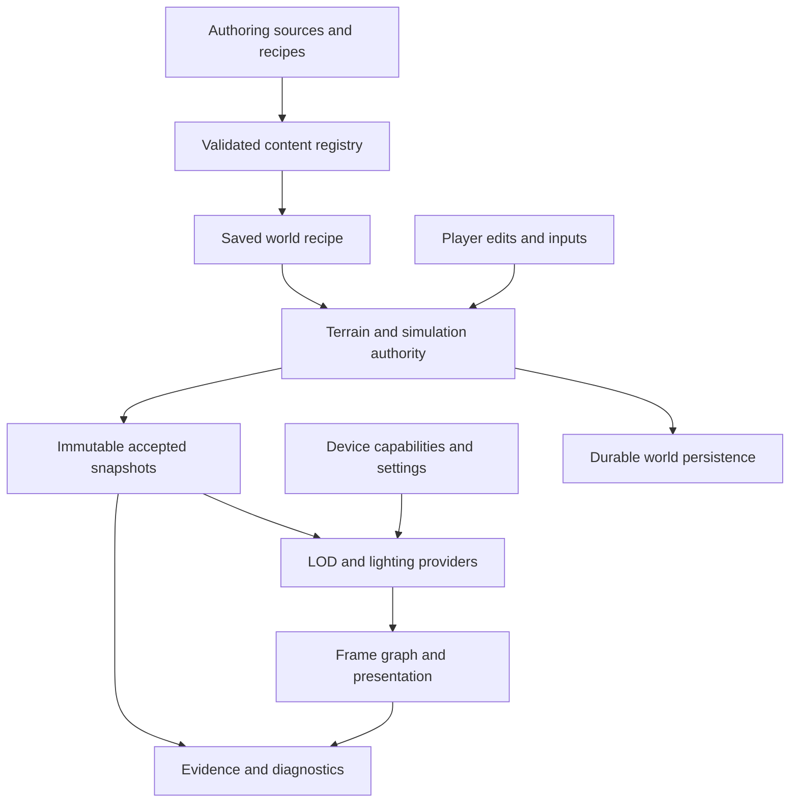

# Deep Primal — integrated engine design expansion

**Edition:** 2026-10-29. **Status:** proposed architecture and acceptance work, grounded in the preserved project documents and the accompanying primary-source study.

**Final source snapshot:** [33c43c943f0469195e7ab1a6852ab4360fad1788](https://github.com/Shnewbs/Deep-Primal/commit/33c43c943f0469195e7ab1a6852ab4360fad1788), declaring `0.0.1-alpha.29-dev.77-seam-contract.1`. **Coverage:** 487 originals and expanded replicas: 468 Git Markdown documents plus 19 project-collection documents. The Dev69 pin `9a1d92a44d7d3864d35e0c3ac288158a37c33015` was an earlier research-refresh checkpoint, not this edition's final source or a newly qualified playable build.

This document connects the detailed expansions across world generation, finite water, rendering, lighting, assets, settings, and verification. The individual replicas retain their original content and add specific follow-ups. Use [the corpus guide](README.md) for every source and [the discrepancy register](DISCREPANCIES.md) for statements that belong to different revisions or scopes.

## 1. Recommended direction

Develop Deep Primal around a deterministic, versioned world core, explicit authoritative state, bounded asynchronous work, and interchangeable presentation providers. Strengthen the contracts between those parts before adding another advanced rendering or authoring feature.

The existing documents already establish much of this direction: frozen saved terrain revisions, finite water and constituents, separate engine/graphics/LOD modules, staged/effective graphics settings, protected art, and qualified evidence. The largest opportunity is to turn these distributed rules into interfaces that every subsystem can enforce.

The design should allow three kinds of evolution independently:

- **World evolution:** a new saved generator, material, hydrology, or simulation revision with a defined migration or opt-in policy.
- **Presentation evolution:** new lighting, meshes, upscalers, and effects operating on accepted snapshots with explicit coverage and validity.
- **Authoring evolution:** new tools, recipes, and content schemas producing validated definitions without silently altering existing worlds.

That separation gives the standalone direction a practical migration path. The host adapter remains a named implementation boundary while pure world contracts become reusable. The independent Maritime project retains its own platform and packaging identity.

## 2. One ownership model across systems

Every mutable quantity or resource needs one authoritative owner, a revision, a lifetime, and a publication rule.

| Data or resource | Proposed authority | Reader-facing form | Core invariant |
| --- | --- | --- | --- |
| Saved world recipe | World manifest | Immutable generation snapshot | Creation defaults do not rewrite existing saves |
| Generated base terrain | Versioned field/material pipeline | Chunk/material query result | Same recipe and coordinates give the declared deterministic result |
| Player edits | Saved world edit layer | Accepted revisioned cells | Regeneration cannot erase edits |
| Water and constituent mass | Simulation ledger | Accepted cell/reservoir state | Transfers conserve owned quantities |
| Ocean/drainage connectivity | Versioned regional topology | Known/unknown connectivity result | Local boundaries do not invent global ocean access |
| Logical light | Selected world-light authority | Typed ready/pending result | Renderer caches do not become gameplay truth |
| Visual lighting | Render provider | Versioned radiance/visibility estimate | Contribution ownership prevents double counting |
| GPU buffers and textures | Renderer resource manager | Lifetime-scoped handles | Reuse waits for actual completion |
| Content identity | Asset registry | Stable IDs and validated definitions | Renames do not silently create new content identities |
| Graphics preferences | Client settings transaction | Requested/effective/pending values | Device fallback preserves saved user intent |

The table is a proposed shared contract. Existing implementations must be mapped to it with actual ownership evidence before claiming conformance.

Snapshots carry enough identity to reject stale work. A renderer reset, chunk unload, save switch, or content reload changes the relevant generation. Work started under an older generation cannot publish merely because its coordinates still appear valid.

## 3. World generation and terrain authoring

Use authoring software as a source of useful workflows and explicit intermediate data. Houdini, Gaea, and World Machine provide relevant comparisons for erosion, masks, tiling, and global context; the [terrain research notebook](research/terrain-water-research.md) records their actual documented behavior and limitations.

Define a typed intermediate representation:

- Scalar density and its sampling/error contract.
- Surface height and normals with a declared coordinate system.
- Geological unit identity and physical parameters.
- Climate vectors and biome weights.
- Drainage graph, basin/outlet IDs, and connectivity coverage.
- Artistic masks with units and semantic meaning.
- Authoring provenance, tool/recipe version, seed, scale, and content hashes.

A visual sediment mask must not automatically become a stored amount of transported sediment. A heightfield does not contain the full three-dimensional cave or geology volume. A density zero set does not automatically supply a conservative distance bound for ray marching.

Separate global context from local detail. Continental structure, watershed connectivity, and canonical feature identity require coherent context across chunk boundaries. Local erosion detail, surface variation, and vegetation decoration may use bounded overlap once their dependencies are explicit.

For every procedural feature, define its canonical anchor, stable ID, influence bounds, conflict priority, and clipped per-chunk contribution. Replaying chunks in another order must not duplicate a tree, change an ore body, or alter a river connection under the declared determinism policy.

The [terrain and water chapter](chapters/terrain-water.md) expands these contracts, including missing coverage, saved revisions, morphology, and authoring exports.

## 4. Finite water as a durable transaction system

The Water Engine specification already contains substantial conservation and lifecycle design. The useful expansion is to make its hardest transitions mechanically precise.

Track quantity and constituents across every owner: loaded cells, persisted unloaded state, regional reservoirs, groundwater, snow/ice, pending transfers, and any future containers, pipes, or wetness stores. Add a new storage mechanism only after defining how it enters the same ledger.

A transfer needs an ID, source/destination world identity, expected revisions, reserved quantity, constituent payload, durable state, and deduplication rules. An age threshold alone cannot safely undo a pending debit if a delayed destination commit can still arrive. Recovery must fence late work or prove that the transaction has reached one terminal outcome.

For native writes, verify the resulting state after callbacks. The return value from a setter is only one observation. Handle reentrant edits, unrelated cells, cross-level events, unloads, refused-but-applied writes, and compensation failure explicitly.

Define quantization in one place. The existing sixteenth-block representation must have a precise relationship to external volume units. Preserve exact remainder ownership when the conversion is fractional, or constrain accepted transfers to an exactly representable quantum. Rounding must never create a gradual source of free water.

Finally, distinguish physical time, simulation steps, and rendering interpolation. A loaded-only simulation can be deterministic for an equal active-set and input history without promising that different loading histories produce identical elapsed physical evolution. State the chosen rule and test it.

## 5. Regional topology before visual continuity

Terrain that looks continuous can still have contradictory hydrology. The Dev68 audit's enclosed-basin seam witness is particularly valuable because it identifies the next boundary to test: actual cross-region ocean connectivity. It remains a source-model planning witness until exercised against the real regional and native path.

The earlier Dev69 refresh included [stitched marine admission](replicas/git/docs/validation/engine-continuation/v8-ocean-seams-2026-10-29/README.md), an opt-in routing policy v2 inside saved-profile r5. Subsequent source-only policies through v7 refine basin rejection, saved ocean-domain admission and shoreline classification while preserving older saved identities. An authored ocean mask is still not proof of globally correct marine topology. [Saved-domain evidence](replicas/git/docs/validation/engine-continuation/v8-source-ocean-mask-2026-10-29/README.md), [shoreline evidence](replicas/git/docs/validation/engine-continuation/v8-shoreline-coherence-2026-10-29/README.md).

The final Dev77 snapshot also contains the [bounded outlet-topology helper](replicas/git/docs/validation/engine-continuation/v8-outlet-topology-2026-10-29/README.md) and [stricter shared-seam observations](replicas/git/docs/validation/engine-continuation/v8-region-seam-contract-2026-10-29/README.md). The standalone helper has actual production-core tests; the regional bridge tests use labeled API doubles and do not compile the full production watershed dependency graph. Rejecting inconsistent flood, stage, catchment, water-class or receiver observations prevents an invalid merge but does not reconcile global routing. Observational ports do not derive physical water from cumulative catchment. Native generation, real codecs/save-reopen, river discharge, lake spill and conserved live-water accounting remain separate qualification work.

Represent ocean/outlet connectivity with an explicit unknown state. Resolve that state through canonical regional topology, a coarse global connectivity representation, or a documented deferred boundary policy. Do not convert an unknown local edge into an infinite ocean.

Regridding and LOD transitions must conserve owned water and composition. Geometry aggregation can change how the surface is displayed; it cannot silently change the ledger. Scientific models and authoring tools may use approximations appropriate to their own purpose. Deep Primal's game-state contract decides which can be adopted.

Acceptance must include enclosed basins spanning multiple regions, signed-coordinate boundaries, changed neighbor arrival order, player-created barriers, unload/reopen, and topology revision migration.

## 6. Renderer, LOD, and lighting integration

The renderer should consume immutable accepted snapshots and publish a coherent visible result. Give each job a world generation, content/material revision, chunk/edit revision, coverage state, request generation, and cancellation state. GPU publication additionally depends on device generation and resource lifetime.

Budget the complete path: capture, queueing, transform scratch, upload staging, live residency, retired resources, disk indexes, and retries. A cap on live buffers alone can hide a much larger pending or retired footprint. A bounded queue still needs a progress rule when capacity becomes available.

Adopt a frame-resource contract for scene color, depth, motion vectors, exposure, reactive information, and temporal history. Specify projection conventions, jitter, units, dimensions, sample positions, validity, and production/consumption order. Preserve required world depth before any hand or UI path that overwrites it.

The lighting design keeps logical light and visual radiance distinct. Its authority handoff, GI provider selection, source removal, cache confidence, fallback behavior, and contribution accounting are preserved in [the lighting replica](replicas/project/LIGHTING-ENGINE.md). The new [lighting integration chapter](chapters/lighting-integration.md) connects that design to actual chunk, LOD, material, and temporal-input contracts.

GI, reflections, shadows, and upscaling should advertise the guarantees they satisfy at the selected tier. A provider with incomplete geometry coverage must expose that fact. A stable cache is not evidence that newly exposed geometry has been represented.

Use [the renderer chapter](chapters/render-performance.md) for the deeper resource, scheduling, LOD, capability, and performance specification.

## 7. Upscaling and current capability data

The preserved project documentation identifies spatial FSR 1 as implemented and an optional NGX/JNI bridge as present but incomplete for temporal activation. Treat new temporal providers as separately qualified integrations.

Current vendor support is a moving input. The [rendering notebook](research/render-performance-research.md) records the inspected AMD and NVIDIA sources and their version-specific limits. Derive availability from the actual API, runtime effect version, device, driver, required inputs, and successful initialization.

The client should distinguish requested provider, effective provider, unavailable reason, quality preset, internal resolution, history state, and any pending restart. Preserving an unsupported saved preference is useful; displaying it as active is misleading.

Temporal acceptance needs motion and depth coherence, exposure changes, camera cuts, resize, dynamic resolution, transparency, water, foliage, disocclusion, and world changes. Frame generation has separate latency, pacing, resource, and platform requirements.

## 8. Asset, material, and editor workflow

Give every asset a stable content ID separate from its file path and content hash. Track editable sources, import recipe, validated definition, generated export, and runtime package as distinct objects.

Renaming an asset preserves identity. Changing its bytes changes its content revision. Reimporting with another recipe creates a new derived artifact. Changing gameplay material semantics may require saved-world compatibility work. These operations must not be conflated.

The 32×32 block/item default is an authoring policy. The existing approved 64×64 ground and sand work remains protected by its recorded exceptions and acceptance process. Texture size, atlas size, mip behavior, channel color space, normal convention, compression, and tile scale need separate fields.

Rock families and tint variants also need separate identities. A tint variant may reuse structure; a geological family with different grain, layering, or weathering needs an authored shape/material distinction. The existing catalogs can become validated production data incrementally, with local implemented checkpoints recorded accurately.

The [asset, material, and UI chapter](chapters/assets-materials-ui.md) turns these requirements into import, preview, review, accessibility, and settings contracts. The [architecture chapter](chapters/architecture-authoring.md) defines registry, schema, module, migration, and extension boundaries.

## 9. One cross-system scenario

Use a player placing a dam during a rainstorm, then traveling away and reopening the world, as an integration fixture:

1. The edit layer stages the barrier. Water authority validates affected owners and reserves accepted displacement destinations or bounded escrow; the edit defers or fails if conservation cannot be maintained.
2. Geometry, water, and constituent ownership commit together under a shared accepted revision. Bounded transport/connectivity work is then scheduled from that state.
3. Any pending cross-cell transfer either commits once under valid revisions or reaches an explicit recovery outcome.
4. Lighting and mesh invalidation refer to the same accepted edit revision.
5. The renderer keeps a valid previous or conservative provisional result while newer snapshots are incomplete.
6. LOD aggregation changes presentation without moving authoritative water between owners.
7. Unload persists cell state, constituent masses, topology obligations, and pending transaction state under the correct world identity.
8. Reopen reconstructs the same accepted ownership and resumes valid work. Late work from the previous session is rejected.

Check conserved quantity and chemistry, saved revisions, stale publication rejection, visual seams, queue progress, peak memory, frame/tick latency, and recovery after injected failure. The scenario is a proposed acceptance fixture, not a newly executed test.

## 10. Proposed implementation order

| Priority | Work package | Required output | Promotion evidence |
| --- | --- | --- | --- |
| P0 | Provenance and shared identities | World/content/request/device generations and finding IDs | Stale completion and conflicting-version fixtures |
| P0 | Water commit/recovery | Durable quantity/constituent ownership and fenced transfer outcomes | Real callback, unload, crash/reopen tests |
| P0 | Regional connectivity | Canonical basin/outlet contract and unknown coverage | Actual multi-region closed-basin witnesses |
| P1 | Saved recipe and asset schemas | Versioned definitions, import recipes, migration policies | Old-world replay and clean reimport comparisons |
| P1 | Renderer lifetime and progress | Complete byte ledgers and bounded fair scheduling | Upload failure, stationary recovery, travel/reset tests |
| P1 | Temporal frame contract | Preserved depth/motion/exposure and provider capabilities | Backend/device-specific temporal image acceptance |
| P1 | Lighting integration | Explicit authority, contribution, cache validity, and fallback | Edit/removal/disocclusion/LOD reference scenes |
| P2 | Advanced erosion and content | Typed physical/visual data and bounded feature implementation | Conservation, determinism, art, and native tests |
| P2 | Broader optimization | Measured improvements at useful end-to-end boundaries | Reproducible matched workload distributions |

Priorities describe proposed design dependencies; they do not reclassify every old audit finding as a current defect.

## 11. What completion means

Each feature needs a specified input/output contract, ownership model, failure behavior, saved compatibility policy, resource budget, observability, and acceptance evidence. A feature list or source-only helper is not a complete integration.

Use [the validation chapter](chapters/validation-evidence.md) to record independent evidence dimensions and preserve historical grades. Use the per-document review cards to see precisely how each original should be extended. The next engineering milestone should select a bounded subset of these contracts, implement it, and qualify its actual runtime path before claiming the broader engine is complete.
