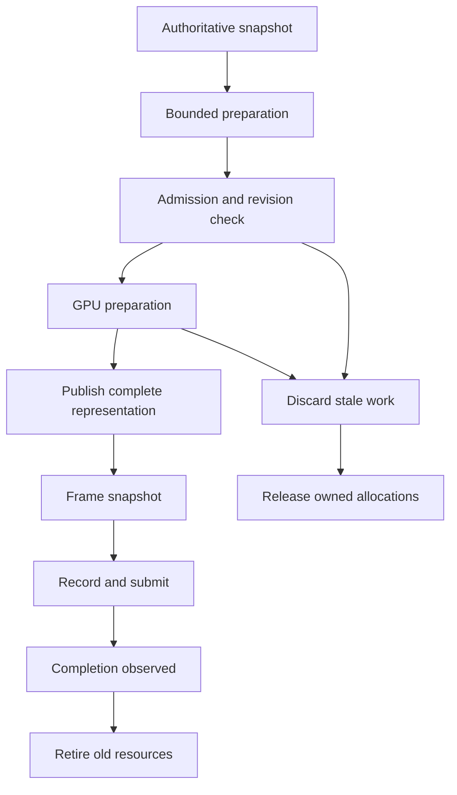

# Deep Primal rendering and performance: an executable contract

**Status:** Proposed integration architecture and acceptance plan, expanded on 2026-10-29. This chapter does not certify a new renderer build, hardware capability, or performance result. Preserved source documents retain their original dates and evidence limits.

The renderer should deliver a coherent, useful view under a finite budget. Distance sliders, completed worker jobs, low allocation counts, and successful API calls are supporting measurements. The player-facing outcomes are stable terrain coverage, correct materials and water, responsive camera movement, and predictable recovery after edits, travel, or resource pressure.

The cross-engine research is in [Rendering, LOD, Performance, and Upscaling Research](../research/render-performance-research.md), with twelve primary sources and separate evidence and design inference. This chapter applies those lessons to the actual Deep Primal pipeline. It does not propose adopting an entire external renderer.

## 1. Establish the implementation baseline

The reviewed project sources already describe several substantial components. Their scope must remain visible when planning the next increment.

| Component | Source-scoped baseline | Qualification still needed |
| --- | --- | --- |
| Terrain LOD | Chunk-derived snapshots, greedy reduction, bounded discovery, persisted recovery, revision guards, and cache admission | Useful native coverage during travel, edits, reopen, and pressure |
| Submission | Ordered synchronous indexed API batches with a 4,096-record hard limit | Actual driver work, GPU timing, and transparent-water parity |
| Upscaling | FSR 1 EASU with optional RCAS through the common rendering interface; native and spatial fallback | Matched native image and performance captures on each backend |
| NVIDIA provider | Optional direct NGX JNI Vulkan Super Resolution bridge with explicit inputs and lifetime requirements | Complete temporal renderer integration, qualified runtime packaging, and RTX execution |
| Telemetry | Bounded CPU cull/upload/submit histories, transform statistics, page latency, frame intervals, and transition intervals | Correlated GPU completion, whole-frame behavior, and device memory |

These statements are grounded in [LOD architecture](../replicas/git/docs/LOD-AND-DRAINAGE-ARCHITECTURE.md), [upscaling](../replicas/git/docs/UPSCALING.md), [the NGX provider contract](../replicas/git/renderer-vulkan/src/main/native/dlss/README.md), and [the renderer backlog](../replicas/git/docs/renderer-jams/RENDERER-BACKLOG.md). Historical version labels describe their pinned snapshots. Resolve the implementation baseline from the selected commit and build properties; do not treat an older README or self-audit grade as the current release identity.

Every experiment should declare four states independently: source present, compiled into the tested artifact, exercised by that artifact, and accepted on the named device. A helper test can establish the first two for that helper without establishing the latter two for Minecraft or a GPU provider.

The earlier [visibility-snapshot reuse increment](../replicas/git/docs/renderer-jams/20261029-visible-snapshot-reuse/REVIEW.md), pinned to implementation `74d7447d3206952f0aa5be6003212dea9e9f7ce4`, reuses a render-thread transient collector while still publishing detached immutable ordered snapshots. A `finally` clears references; reset releases backing storage, and a frame exceeding 32,768 records causes that collector to be discarded. The immutable snapshot still allocates. Its paired Java21 synthetic extraction fixture reports about 68.3% lower thread allocation, with 69,984 focused assertions per run. This is source/component evidence: complete-client allocation, retained heap, frame tails, Vulkan/OpenGL water pixels, and GPU performance remain unqualified. The next check should bind immutable snapshot lifetime and collector cleanup to actual extraction, publication failure, and world reset.

### 1.1 Frozen-source successors

This edition stops at source `33c43c943f0469195e7ab1a6852ab4360fad1788`, version `0.0.1-alpha.29-dev.77-seam-contract.1`, with NeoForge `26.1.2.122`. Earlier “current” descriptions retain their own historical pins. The following source-tested successors update CPU selection and sampling status; they do not constitute a newly qualified native artifact.

| Record | Source change | Acceptance boundary |
| --- | --- | --- |
| [Squared-error selection, jam24](../replicas/git/docs/renderer-jams/20261029-squared-error-selection/REVIEW.md) | Precomputes hysteresis thresholds and compares squared range, retaining the previous selector near numeric boundaries and invalid inputs. | Exact selection parity and component medians do not establish complete-frame benefit. |
| [Page broadphase, jam25](../replicas/git/docs/renderer-jams/20261029-page-frustum-broadphase/REVIEW.md) | Caches complete multi-part union bounds and falls back to ordered fine tests when coarse rejection is unavailable. | Validate bound containment after every permitted geometry or water-position change and with real host frusta. |
| [A/B gate, jam26](../replicas/git/docs/renderer-jams/20261029-frustum-ab-gate/REVIEW.md) | Adds a restart-required coarse-off switch and separate coarse-test counters. | The paired all-visible fixture regresses; disabled testing can still retain cached bounds. |
| [Adaptive sampling, jam27](../replicas/git/docs/renderer-jams/20261029-adaptive-frustum/REVIEW.md) | After at least 32 eligible tests with insufficient savings, bypasses three coarse passes before sampling again. | Completed-extract check counts are a cost proxy; original fine culling continues, and tail results remain mixed. |
| [Pose sampling, jam28](../replicas/git/docs/renderer-jams/20261029-pose-frustum/REVIEW.md) | Resamples after more than four blocks or eight degrees from the last successful sample. | These are CPU policy thresholds; actual camera-getter compilation and native performance remain open. |
| [Finite-angle repair, jam29](../replicas/git/docs/renderer-jams/20261029-finite-yaw-overflow/REVIEW.md) | Normalizes extreme finite headings before subtraction and samples conservatively for invalid inputs. | Repairs a missed coarse-sampling opportunity; its arithmetic fixture was slower and fine visibility remained authoritative. |
| [Normal-angle fast path, jam30](../replicas/git/docs/renderer-jams/20261029-normal-angle-fastpath/REVIEW.md) | Uses bounded conditional wrapping for ordinary angles while preserving extreme and invalid branches. | The later synthetic arithmetic improvement does not measure the production extraction call stack. |
| [Scene-pixel LOD, jam31](../replicas/git/docs/renderer-jams/20261029-scene-pixel-lod/REVIEW.md) | Uses valid active world-target height for projected error, with the previous native arithmetic as fallback. | Scaled scenes can select coarser geometry; validate target lifetime and reconstructed silhouettes, seams, and water. |

Coarse page testing remains default-on; adaptation remains default-off; the coarse-off override takes precedence. The preserved backlog ends at jam28, so the later three records supply its successor context. Native qualification should compare fixed/adaptive/off modes with effective scene height and selected LOD distribution recorded. Separate end-to-end quality-mode comparisons from equal-geometry experiments intended to isolate reconstruction or culling cost. Accept source parity, output quality, and CPU/GPU frame performance independently; none of these successors establishes temporal FSR or active RTX NGX dispatch.

## 2. One generation identity across the runtime

Introduce an immutable `RenderEpoch` containing world identity, dimension, world-attachment generation, renderer-device generation, resource-pack/material generation, and settings generation. A camera-origin generation belongs to frame transforms and temporal histories. It need not invalidate persistent world-space geometry when the geometry representation remains origin independent.

Each derived product additionally records its source key and source revisions: terrain, optical material, light field, water presentation, mesher format, and relevant LOD policy. A job compares these at admission and publication. Matching coordinates alone is insufficient after a world switch; matching world identity alone is insufficient after an edit or renderer recreation.

This is a proposed ownership graph, not a promise that all stages run asynchronously. The current single graphics queue remains a valid implementation. Parallelism is earned only when explicit dependencies, completion tokens, and measured overlap justify it.

Cancellation revokes the right to publish immediately. It does not prove a worker has stopped or a recorded command buffer has released a resource. Track cancelled workers until retirement, and attach completions to the generation that created them. An old completion may release its own allocations; it may not mutate a new world's queues, counters, coverage, or history. The existing [recovery-epoch repair](../replicas/git/docs/renderer-jams/20261028-recovery-epochs/README.md) supplies a concrete precedent: renewed ownership must survive a stale scanner completion.

## 3. Bound work and prove useful progress

Separate discovery, authoritative capture, disk restoration, meshing, upload preparation, publication, and visible submission. Give each stage a queue owner, capacity, admission rule, cancellation rule, and progress counter. A saturated upstream queue must receive backpressure before expensive downstream allocations occur.

The documented disk service examines at most 256 entries per granted worker turn, retains up to 8,192 nearest keys, and bounds owner-thread reconciliation. It also has separate missing-folder/error retry, empty-directory polling, and nonempty-directory refresh policies. Those are useful finite-work contracts. They are not wall-clock deadlines: a directory operation can block, and client ticks can pause. Preserve the distinction when displaying diagnostics. See [disk cursor](../replicas/git/docs/renderer-jams/20261028-disk-cursor/README.md), [retry](../replicas/git/docs/renderer-jams/20261028-disk-retry/README.md), and [stationary refresh](../replicas/git/docs/renderer-jams/20261028-nonempty-refresh/README.md).

Add an age-aware scheduler above these local limits. Near-camera demand gets priority, but reserve bounded service for old valid work. Track oldest eligible age and repeated rejection reasons. The existing every-eighth oldest-first capture rule is a starting policy, not proof that every requested region eventually becomes visible under continuous movement. Eligibility must distinguish unavailable authority, missing disk data, stale revision, hard memory denial, and ordinary scheduling delay.

A quality request is admitted in stages. First provide a complete coarse representation from available authoritative data; then refine where projected benefit is greatest. Unexplored terrain requires its own server/generator delivery contract. It cannot be synthesized from a local cache miss or obtained by silently increasing simulation and full-chunk tracking distances.

Keep a valid covering parent while children are incomplete. Publish a replacement cut of the hierarchy only when coverage, material/pass classification, source revisions, and required boundary data are compatible. On edits, withdraw invalid enhanced data immediately according to the lighting and terrain rules; use the explicitly defined conservative fallback. Do not retain visibly stale occlusion merely because the replacement mesh is expensive.

The upload soft budget needs an explicit indivisible-item policy. The documented first-part progress allowance may exceed a soft time/byte allowance once, while hard resident limits, revision validity, and pause conditions remain enforced. Count the exception and debt; do not convert it into an unlimited bypass. Ordinary 1,024-quad parts were documented as 94,208 bytes, below the normal 256 KiB minimum upload allowance. Therefore experimental 32 KiB splitting is an experiment in scheduling and latency, not proof that the default path deadlocks. [Forward progress](../replicas/git/docs/renderer-jams/20261027-lod-upload-forward-progress/REVIEW.md) and [quad splitting](../replicas/git/docs/renderer-jams/20261027-quad-bounded-upload/REVIEW.md) preserve this distinction.

External lessons become specific experiments: Nanite suggests measuring finite streaming and visibility capacity; HLOD suggests a separate coarse representation; Unity LOD transitions suggest a screen-space decision with explicit bounds; meshoptimizer suggests separate simplification and layout passes. Their algorithms and constants are not interchangeable with editable block terrain. Use the notebook's RP-01, RP-02, RP-04, and RP-05 as research inputs, then require project-specific fixtures before adoption.

## 4. Resource ownership includes retirement

Extend the existing pending-byte ledger into an owner ledger spanning preparation, residency, replacement, and retirement. Every allocation has one accounting owner and one lifecycle state. A transfer changes ownership once; it does not add a second copy of the same allocation to the total.

| State | Required owner and release rule |
| --- | --- |
| Reserved | Admission owner; release if preparation never commits |
| CPU prepared | Worker/result owner; bounded queue and cancellation cleanup |
| GPU pending | Upload owner; accepted allocations charged immediately |
| Published resident | Page or pass owner; immutable identity and revision |
| Retired but referenced | Retirement owner; charged until the last GPU/recording reference is finished |
| Released | No live ownership; repeated release is rejected or safely idempotent |

Track CPU heap, native/staging memory, device-local estimates, and actual reported device budgets separately. The working peak includes old and new pages during replacement, staging overlap, command buffers, descriptors, histories, provider scratch, and retired allocations. Counting only resident LOD payloads understates the peak. A transform-element cap is a useful structural bound but is not a measured heap-byte ceiling.

The project already fixes several failure paths: pending ownership clears before rollback, committed pages are not freed twice after superseded-resource cleanup, reset attempts later releases after earlier failures, and eviction preserves recovery bookkeeping. Preserve those behaviors while adding completion-aware retirement. A Java `close()` attempt is not proof that GPU memory became reusable, and successful CPU API return is not GPU completion. See [upload abort](../replicas/git/docs/renderer-jams/20261028-gpu-upload-abort/README.md), [reset control cleanup](../replicas/git/docs/renderer-jams/20261028-reset-control-cleanup/REVIEW.md), and [eviction continuity](../replicas/git/docs/renderer-jams/20261028-eviction-failure-recovery/README.md).

The Vulkan backend should encode producer and consumer stages, access, layout, and ownership only where required by actual usage. Existing fences and a single graphics queue are sufficient foundations; timeline semaphores, synchronization2, transfer queues, and bindless rendering are optional implementations, not prerequisites. Memory coherence controls host visibility requirements, not every other GPU hazard. Views and descriptors must remain valid through their last use, with views retired before their images. The exact backend baseline is in [Vulkan capabilities](../replicas/git/docs/VULKAN-CAPABILITIES.md); RP-06 provides the primary synchronization reference.

Do not silently return uncertain allocations to a free pool after a close or submission fault. Quarantine ownership, retain the first failure with later cleanup failures attached, and enter a defined renderer failure path. Device-loss reconstruction is a separate feature from best-effort cleanup. OpenGL requires equivalent semantic ownership through the context thread and completion mechanisms even when its API exposes different state transitions.

## 5. Coordinates, depth, and motion are shared interfaces

Keep authoritative positions in the project's stable world-coordinate representation. Construct camera-relative GPU values by subtracting the origin at adequate precision before conversion to float. The same frame origin must reach terrain, entities, water, lights, shadow casters, reflections, culling, and motion. Exact integer distance ranking and camera-relative rendering solve different problems; a correct scheduler does not establish stable far-coordinate pixels.

Define one backend-neutral depth descriptor: encoding, forward or reversed ordering, near/far convention, finite or infinite far plane, sample count, viewport, texture origin, projection matrix, and valid extent. Each adapter converts explicitly to its API or SDK convention. Never infer a depth convention solely from “Vulkan” or “OpenGL,” and never reconstruct distance with constants copied from a different projection.

Motion vectors describe current-to-previous correspondence in a declared coordinate system and unit. Include camera motion, moving entities, animated vertices, terrain replacement, and water presentation movement. A world-origin rebase must either transform both frames consistently or reset affected history. Geometry with no trustworthy previous state supplies invalidity/reactive information, not invented zero motion.

The current upscaling endpoint includes world, hand, outlines, and post-processing before reconstruction, while the UI is drawn at native output resolution. The world depth is cleared before the hand pass. A temporal provider therefore needs a preserved pre-hand world depth product and an explicit hand-composition decision. Choose either correctly described hand depth/motion within reconstruction or a qualified separate hand pass; do not feed cleared depth as complete scene geometry. This limitation is already documented in [upscaling](../replicas/git/docs/UPSCALING.md) and [NGX integration](../replicas/git/renderer-vulkan/src/main/native/dlss/README.md).

Lighting, exposure, reconstruction, and presentation also need explicit color descriptors. Declare scene-linear or display-referred color, primaries, pre-exposure, alpha meaning, and output transform. The implemented FSR 1 endpoint does not automatically establish the input contract of a newer temporal provider. Each integration must specify where tone mapping, sharpening, transparency, and native UI occur. Avoid a second ordinary TAA accumulation when a temporal reconstruction provider owns that responsibility.

## 6. Compile a frame plan before recording

Create a `FramePlan` from a coherent frame snapshot and the effective feature profile. Each pass declares inputs, output semantics, extent, format, sample count, required revisions, temporal validity, and lifetime. Compilation rejects missing producers, incompatible depth/color descriptors, unsafe read/write aliases, or allocations above the admitted peak.

The logical dependencies are: current geometry and material snapshot; depth and surface guides; direct lighting and required baseline; optional qualified diffuse transport and reflections; transparent/water composition; reconstruction or native resolve; output transform and UI; presentation. The detailed lighting order remains owned by [LIGHTING-ENGINE.md](../replicas/project/LIGHTING-ENGINE.md), including its direct-only provider input contracts and pre-reflection radiance rules. Do not collapse those products into one ambiguously named scene-color texture.

Keep ordinary indexed batching truthful. The current helper bounds Java references per synchronous API call and preserves order; it does not establish hardware multi-draw indirect. If a future GPU-driven path is evaluated, specify command-buffer capacity, culling bounds, material/pass compatibility, overflow behavior, and fallback before benchmarking it. Transparent ordering and water depth cannot be sacrificed to increase a draw-count headline.

Frame-plan failure before target redirection should select a valid fallback. Failure after partial recording requires the backend's explicit discard/drain policy and may require presentation of a safe resolved image. Restore host binding and state at the documented adapter boundary. Resource reload, swapchain resize, provider recreation, and world changes invalidate the appropriate plan and history generations, rather than partially reusing incompatible resources.

## 7. Feature gates and persistent settings

Represent capability as a structured result: requested mode, available implementation, API/device support, packaged native availability, resource-contract readiness, initialization result, first-evaluation result, effective mode, and failure reason. A saved request survives temporary unavailability; an effective mode describes what produced the current frame. Apply/Revert and restart-required renderer changes must preserve that distinction.

Keep FSR 1 spatial quality options separate from temporal Native AA. The documented guard already omits Native AA for FSR 1 and stages Quality for a legacy incompatible selection without writing saved settings until Apply. Preserve serialized compatibility and test switching, cancellation, reopen, and unavailable-provider behavior. [FSR quality guard](../replicas/git/docs/renderer-jams/20261028-fsr-native-aa-guard/README.md) is the regression anchor.

For newer FSR, query the selected adapter and deployed effect rather than inferring support from the broad AMD family name. Record SDK package, loaded effect/runtime, driver, enabled API features, formats, and actual selected algorithm. RP-08 and RP-09 document current vendor requirements; they do not qualify the owner's AMD8060S machine. A compatible vendor feature must still pass the project's resource, image, failure, and performance suites.

Preserve the existing direct NGX bridge as the concrete NVIDIA integration boundary. Streamline research is an alternative architectural reference, not evidence that the project uses Streamline. Requirements specific to Streamline frame generation do not become requirements for direct NGX Super Resolution. Query recommended extents, require actual successful evaluation before reporting activation, and preserve the bridge's drain requirement for recorded but unsubmitted commands. Native runtime presence alone is insufficient.

Frame generation has a separate capability, latency, presentation, UI, and lifecycle contract. Count simulated ticks, rendered frames, generated frames, and actually presented frames independently. It must not alter finite-water updates or claim a faster simulation. Vulkan priority does not imply every optional feature must exist on OpenGL; the fallback profile must retain a playable, correctly composed native/FSR 1 path with truthful availability reporting.

## 8. Measure complete outcomes fairly

Use a reproducible capture manifest: source and artifact hashes, Java/runtime, OS, GPU/driver, active backend, display mode, resolution, render extent, provider and quality, near/vertical/LOD distances, seed/world version, exact camera path, time/weather, resource pack, water state, cache condition, telemetry flags, and thermal/power policy. Compare identical manifests except for the intended variable.

Separate cold load, warm stationary view, scripted travel, teleport, terrain/light edits, water motion, resource reload, world switch, and pressure recovery. Include fixed-camera arrival of new persisted pages. Record coverage age and correctness beside timings; a faster frame that silently draws less valid terrain is a different result.

The 240-observation LOD histories measure CPU stages, not GPU completion. Page admission-to-cache-commit latency includes waiting across extraction passes; it is not transfer-engine duration. The latest preparation-failure probe records target/transform failures, but no-visible-LOD frames and culling remain outside that submit metric. The 512-frame steady window and separate bounded transition window answer different questions. Preserve zero-sample and unavailable states. [Submit-stage timing](../replicas/git/docs/renderer-jams/20261029-submit-stage-timing/README.md), [pre-draw failures](../replicas/git/docs/renderer-jams/20261029-pretransform-failures/README.md), and [page latency](../replicas/git/docs/renderer-jams/20261028-page-upload-latency/REVIEW.md) define these boundaries.

Add a frame identifier and epoch to snapshots so CPU spans, queue delays, GPU timestamps, resource peaks, publication events, and presented-frame intervals can be correlated. Do not add stage percentiles to estimate a frame percentile; the samples and critical path differ. Poll timestamp availability without blocking, track dropped measurements, and report timing overhead with instrumentation on and off. RGP can help inspect qualified AMD Vulkan captures; RP-07 does not supply an OpenGL profiler or establish a capture on this target.

Report medians and tail distributions with sample counts, repeated trials, warmup policy, and uncertainty. Retain slow trials and failed attempts. Pair allocation reductions with retained heap and GC measurements. Separate successful, failed, deferred, and empty work so failure-heavy runs cannot look faster by disappearing from the sample population.

## 9. Delivery gates

The next accepted increment should connect existing mechanisms before adding optional complexity:

1. Freeze the source/artifact/device manifest and establish native Vulkan plus OpenGL baseline captures.
2. Exercise world generation changes, renewed disk ownership, upload abort, reset, eviction, resize, and provider failure through the actual renderer; verify bounded ownership after completion.
3. Correlate discovery-to-visible latency, coherent coverage, CPU stages, GPU completion, and peak live-plus-retired memory.
4. Add the shared depth, motion, color, and temporal descriptors, then qualify one temporal provider without weakening native fallback.
5. Evaluate hierarchy refinement, GPU-driven submission, or finer upload splitting only against the measured bottleneck and identical visual acceptance scenes.

Acceptance records should include machine-readable outcomes and reviewable images or captures. A failed gate records the failing stage and retained fallback behavior. No self-audit score, vendor sample, helper assertion count, or reduced allocation figure substitutes for those observations.
