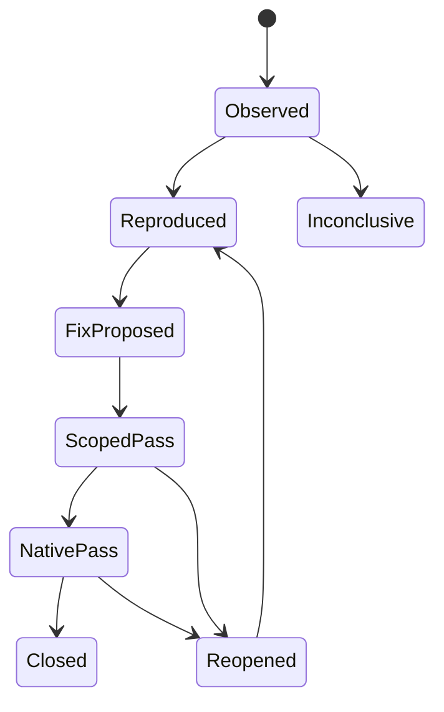

# Validation, evidence, and promotion contracts

**Status:** proposed expansion, 2026-10-29. This chapter defines how to demonstrate future behavior. No game build, native test, benchmark, release, or new engine grade was performed as part of the documentation expansion.

## 1. The problem the existing records reveal

The corpus contains valuable failures, corrected fixtures, retained staged candidates, source-only checks, package checks, software-renderer runs, and native sessions. Their boundaries are often explained carefully inside individual reports. The weakness is that a reader must reconstruct those boundaries across hundreds of documents, and top-level summaries can describe different revisions.

At the final pinned source commit, the Gradle property declares Dev77 while the top-level README and integrated-core summary describe Dev32. The shared root work-state record is a Dev53 checkpoint. Dev69 is an earlier research refresh, and Dev70–77 introduce separately scoped successor evidence. These are different observations, not interchangeable current-status signals. See [the discrepancy register](../DISCREPANCIES.md).

A second recurring pattern is promotion by association: a helper passes millions of assertions, a model reproduces a callback defect, a GPU readback matches selected bytes, or an archive passes CRC checks. Each is useful; none automatically proves the complete game path. The expanded system must preserve the original result while explicitly identifying the next untested boundary.

Epic's [automation documentation](https://dev.epicgames.com/documentation/en-us/unreal-engine/automation-test-framework-in-unreal-engine) distinguishes API, feature, stress, and screenshot testing. Borrow that separation as a taxonomy, then define the boundaries that actually matter for this engine.

## 2. Evidence is a vector

Avoid one ascending status such as “tested” that hides missing dimensions. A feature needs independently recorded dimensions:

| Dimension | What it answers | Typical evidence |
| --- | --- | --- |
| Design | Is the intended behavior specified? | Versioned contract and invariant |
| Source | Is the relevant implementation present at this revision? | Pinned paths and blob hashes |
| Pure behavior | Does the algorithm satisfy a controlled oracle? | Java/core/property fixture |
| Adapter integration | Is the real boundary wired correctly? | Actual registry, codec, callback, scheduler test |
| Persistence | Does the behavior survive the required lifecycle? | Edit, unload, save, reopen, migration |
| Presentation | Does the actual rendered result satisfy its image contract? | Captures, camera paths, image differences |
| Performance | Is cost acceptable for a named workload and device? | Raw latency, allocation, residency, throughput |
| Packaging | Is the tested code inside the delivered artifact? | Source/class/archive/runtime identity chain |
| Release | Is an explicitly qualified artifact available? | Exact artifact and publication receipt |

Values are `not-run`, `pass`, `fail`, `blocked`, `inconclusive`, or `not-applicable-with-reason`. “Blocked” is not a pass. An API double must be named as such even when its classes have the same method signatures as a host API.

A feature may have strong pure-behavior evidence and failed persistence. A previous release may have native evidence while a newer source change has only a model check. Display those situations directly.

## 3. Claim and evidence records

Use stable requirement IDs and separate immutable run IDs. The following schema is illustrative; fields marked as placeholders must be resolved before an actual run:

```json
{
  "schema_version": 1,
  "claim_id": "WATER-CONSERVATION-REOPEN-001",
  "claim_revision": 1,
  "run_id": "example-not-executed",
  "source": {
    "commit": "required-before-execution",
    "dirty": false,
    "production_blobs": [],
    "fixture_blobs": [],
    "recipe_hash": "required-before-execution"
  },
  "scope": {
    "boundary": "native-save-reopen",
    "uses_api_doubles": false,
    "dimensions": ["quantity", "salt_mass", "sediment_mass"],
    "excluded": ["owner-GPU-frame-time"]
  },
  "environment": {
    "jdk": "record-exact-build",
    "os": "record-build",
    "renderer": "record-backend-or-headless",
    "device": "record-if-used",
    "driver": "record-if-used"
  },
  "result": {
    "status": "not-run",
    "oracle": "conservation-ledger",
    "raw_artifacts": [],
    "failed_attempts": [],
    "accepted_attempt": null
  }
}
```

The record is incomplete until the actual source, fixture, environment, and output identity are captured. Keep the record outside shipping runtime state. Changing a display label cannot upgrade its status.

One run can support several claims, but each claim lists its own oracle and exclusions. One claim can require several runs across backends or worlds. Do not multiply assertion counts when multiple reports cite the same run.

### Required provenance chain

Record source commit, exact relevant source bytes, build recipe, compiler/toolchain, compiled output, packaged members, selected runtime artifact, and produced evidence. An archive checksum proves that its bytes were read consistently. It does not prove that the archive contains current code. This distinction is already demonstrated by the historical packaged-class-freshness incidents.

[Gradle dependency verification](https://docs.gradle.org/current/userguide/dependency_verification.html) provides dependency-integrity mechanisms. Project class freshness and runtime artifact selection remain separate obligations in this design.

## 4. Independent oracles and negative controls

A test that copies the implementation's arithmetic can preserve the same bug. Prefer a simpler oracle, an invariant, an exhaustive small state space, or a different formulation. Document where the oracle shares assumptions with production.

| Subject | Strong independent check | Important negative control |
| --- | --- | --- |
| Water transfer | Total owned quantity and constituent mass before/after | Duplicate debit, missing credit, stale receiver |
| Density optimization | Scalar exact sampling plus boundary witnesses | Incorrect sign interval or interpolation endpoint |
| Chunk generation | Same cells under reversed/random chunk order | Shared mutable RNG or neighbor-write dependency |
| Cache lifecycle | Completion after clear/close/world switch | Late task admitted under the wrong generation |
| Upload ledger | Reserved, live, pending, and retired bytes reconciled | Allocation failure between reservation and publish |
| Settings | Requested/effective state across failed Apply and restart | Partial disk write or unsupported saved choice |
| Texture import | Export recipe and material-channel interpretation | sRGB decoding on a scalar mask |
| Test harness | Deliberately broken implementation rejected | Optimized-away assertion or fake success marker |

Mutation rejection is evidence that a check detects the selected fault. It does not establish coverage of all possible faults. Retain both the mutation definition and the reason it failed.

Source-text guard searches are screening tools. A lexical match before a read is insufficient to prove that the guard dominates every executable path. Use an executable boundary fixture or a parser/control-flow analysis where that property matters. Do not infer a live defect merely because a static checker has a blind spot.

## 5. Native callback and transaction fixtures

The water and V8 records repeatedly cross a dangerous boundary: a native setter can synchronously call other code, change another cell, unload a chunk, or report a result that does not describe the final state.

Define tests around the transaction contract:

1. Capture immutable world identity, dimension, coordinates, epoch, and expected revision.
2. Reserve the finite resources needed for the intended commit.
3. Perform the real native write under the narrowest supported ownership scope.
4. Revalidate residency, identity, revision, and final state after callbacks.
5. Commit corresponding ledgers once, or execute bounded compensation with its own verified outcome.
6. Publish renderer invalidation only for the resulting accepted state.

Fault injection must cover a refused-but-applied write, an accepted-but-replaced write, mutation of a future cell, mutation of an unrelated cell, cross-level callbacks, unload during the operation, callback recursion, and rollback failure. “Rollback requested” is weaker than “original state restored.”

If compensation cannot restore invariants, enter an explicit recoverable error or quarantine state. Do not silently return a clean success. Persist enough diagnostic identity to investigate without serializing arbitrary runtime object references.

These are proposed future fixtures. The existing source-model witnesses are retained with their actual scope; this chapter does not assert that their native counterparts have been executed.

## 6. Lifecycle matrix

For each authoritative subsystem, enumerate lifecycle transitions rather than only its normal tick:

| Transition | Required observation |
| --- | --- |
| Fresh create → first use | Correct saved revision and bounded initial work |
| Edit → invalidate → rebuild | No stale publication or duplicate quantity |
| Loaded → unloading | New work admission closes at a defined point |
| Unloading → persisted | Dirty state is durable or explicitly uncommitted |
| Persisted → reopened | Same authoritative state and migration decision |
| World A → world B | Late work and writes remain bound to A |
| Device ready → lost/recreated | GPU resources retired/recreated under a new device generation |
| Running → close/cancel | Futures reach a terminal state and owned resources are released |
| Budget full → capacity available | Deferred work eventually resumes without camera movement |

Build tests from the subsystem's real admission and publication points. A time limit must bound the operation under test, not simply kill an unrelated process while work remains orphaned.

For water, compare the joint ledger of loaded cells, unloaded accounts, suspended transfers, groundwater, snow/ice, and explicit sources/sinks. Choose a closed fixture where possible. If a reservoir exchange is permitted, record its signed quantity and composition. Reopen must preserve both amount and chemistry.

For renderer state, account for live, pending, staged, retired, and reusable allocations separately. Ending at zero after a reset is insufficient if in-flight commands still reference freed memory.

## 7. Performance experiments

Performance claims require a workload definition before the result is inspected. Record scene/seed/camera path, vertical range, requested and effective distances, visible/delivered counts, quality settings, resolution, internal render scale, backend, device/driver, build flags, thermal/power conditions, and background workload.

### Measurement layers

- **Kernel:** scalar noise, density expression, queue operation, or mesh transformation.
- **Subsystem:** generation stage, water tick, LOD capture/upload, or presentation pass.
- **End to end:** request-to-ready chunk latency, complete simulation tick, or rendered/presented frame.

Keep all three where a kernel change is intended to improve the player experience. Reducing temporary allocation is not the same as lowering resident memory or improving frame latency.

The [JMH maintainers](https://github.com/openjdk/jmh) explicitly caution that a benchmark harness does not remove experimental pitfalls. A proposed harness must consume outputs, control warm-up and process isolation, and separate setup from the measured region without removing costs the real workload pays.

### Recommended protocol

Predeclare baseline and candidate source identities, expected correctness equality, sample count, warm-up rule, paired workload order, and stopping criteria. Use fresh process forks where JIT or global cache state matters. Report cold start, warm unique work, and repeated cached work separately.

For distributions, retain raw samples or a lossless enough representation to recompute requested percentiles. Report sample count, duration, median, p95, p99 where supported, maximum, and failures. A p99 from a tiny run is a fragile observation; expose the sample size and avoid precision that the experiment cannot support.

Use matched A/B scenes and alternating run order to limit environmental bias. Re-run only when resolving a concrete uncertainty or a required gate. Explain excluded outliers; do not remove slow frames merely because they contain the expensive behavior being evaluated.

### GPU timing and instrumentation

CPU command encoding, API submission, GPU execution, and presentation are separate intervals. Name timestamp boundaries and queue synchronization. Record unsupported or invalid timestamp samples.

Khronos's [validation guidance](https://docs.vulkan.org/guide/latest/validation_overview.html) identifies validation layers as development tooling with overhead. Run instrumented correctness sessions separately from representative performance sessions and label both. Neither software rendering nor another manufacturer's GPU certifies the owner's target device.

## 8. Visual acceptance

Keep the rendering oracle separate from simulation correctness. A correct finite-water ledger can still display cracks; a smooth surface can conceal incorrect water ownership.

Use fixed cameras for controlled comparisons and scripted movement for temporal behavior. Include dark caves, bright outdoors, exposure transitions, thin geometry, emissive changes, moving water, vegetation, disocclusion, teleports, chunk borders, and near/LOD handoff.

Record scene-linear buffers when available, presentation output, exposure, tone mapping, temporal-history resets, and selected quality tier. Pixel equality is appropriate for some deterministic paths; stochastic lighting needs a declared estimator or tolerance and a sufficiently converged reference.

Every tolerance needs units and a purpose: world-space crack size, image-space error, temporal convergence duration, allowed lost detail, or exposure-relative luminance. Do not infer complete visual quality from a few matched upload-buffer bytes.

## 9. Findings, supersession, and carried grades

Give each finding a stable ID, first-observed source, affected contract, minimal witness, severity, owner subsystem, evidence links, resolution commit if known, and residual acceptance gate.

Recommended finding states:



“Scoped pass” must name the scope. Native success does not automatically satisfy owner-device or long-soak requirements. A finding can close only when its defined acceptance conditions pass; unrelated requirements remain open.

Preserve the original ten-category rubric and historical numbers. Store a grade's source commit, rubric version, category weights, evidence basis, and which categories were freshly assessed. Repeating a carried score in a new report must not refresh its evidentiary date.

A statement such as “mean strictly greater than 8.5” must be evaluated with its original precision and policy identity. Do not substitute an earlier inclusive threshold or average away a blocking correctness defect. This expansion assigns no grade.

## 10. Promotion and maintenance

Promotion is an explicit decision over required gates, not a side effect of copying a document or adding a feature label.

- A design can become an experiment once its inputs, ownership, oracle, and failure behavior are specified.
- An experiment can become an integrated candidate once the real adapter path and required lifecycle behavior pass.
- A candidate can become a qualified package once the artifact identity chain and required platform gates pass.
- A package can be published under the project's actual release policy once its declared acceptance conditions hold.

Preserve old evidence and append a supersession link instead of rewriting past outcomes. A future corpus refresh should compare source hashes, flag newly added Markdown, and list changed claims. Do not recursively treat generated replicas as new original documents.

### Acceptance fixtures for the evidence system itself

1. Change one source file after a run: its result remains historical and cannot qualify the new implementation automatically.
2. Swap a stale class into an otherwise valid archive: package identity fails even if CRC passes.
3. Run a helper with an API double: the report cannot emit a native-pass status.
4. Reuse a report's raw evidence in a second summary: the unique-run count remains unchanged.
5. Produce an incomplete/failed process log containing a success-looking marker: the accepted result still requires terminal process status and expected outputs.
6. Correct a bad fixture: retain the original failed attempt, the fixture diff, and a fresh result.
7. Apply a docs-only commit: no engine grade, release status, task ownership, or benchmark timestamp changes.
8. Restore this documentation edition: all original-source sections match the manifest hashes and every inventoried document has one replica.

## 11. Successor evidence in the final Dev77 input

The fixed input for this edition is `33c43c943f0469195e7ab1a6852ab4360fad1788`. The added Dev69–76 independent audit reports were read in full; their executions remain the reports' evidence, not tests rerun by this documentation task. Dev77's seam-contract receipt is producer evidence at this cutoff.

| Evidence chain | What the retained records support | Remaining promotion boundary |
| --- | --- | --- |
| Deep closed basin, Dev69–70 | Exact production-helper/API-double counterexamples distinguish a repaired bounded basin from a longer basin that exceeds the search cap | Certified marine authority and actual native watershed behavior |
| Marine seed and shoreline policies, Dev71–74 | Source inspections and explicit Boolean model witnesses distinguish shared seed propagation, authored masks, interior admission and mixed-corner classification | Real graph/adapter execution, saved-policy replay, chemistry and quantity lifecycle |
| Outlet solver, Dev75 | The standalone production Java solver has an independent minimax oracle and rejected mutations; its evidence does not require a Minecraft API double | Complete trustworthy regional inputs, authenticated marine anchors and native saved-policy integration |
| Boundary bridge, Dev76–77 | Boundary-double fixtures expose then reject contradictory shared observations; the report distinguishes validation from reconciliation | Full production watershed dependency graph, real neighboring snapshots, global routing and uniquely owned discharge |
| LOD culling and motion gates | Exact helper tests, parity/model checks, option modes, rejected mutations and adverse synthetic timings have named scopes | Equivalent visible output and complete-frame measurements on each accepted native backend |

Use the [Dev70 audit replica](../replicas/git/docs/engine-hourly-audits/2026-10-28T2132-c08e0046/REVIEW.md), [Dev73 audit replica](../replicas/git/docs/engine-hourly-audits/2026-10-29T0735-529bbe9/REVIEW.md), [Dev75 audit replica](../replicas/git/docs/engine-hourly-audits/2026-10-29T0935-8968d3d/REVIEW.md), [Dev76 audit replica](../replicas/git/docs/engine-hourly-audits/2026-10-29T1032-00921e12/REVIEW.md), and [Dev77 seam-contract replica](../replicas/git/docs/validation/engine-continuation/v8-region-seam-contract-2026-10-29/README.md) to follow the exact source and residual gates. These successor records do not rewrite older outcomes or promote the carried whole-engine score.

## Definition of done

The next implementation milestone is complete only when its named contracts have evidence at the required boundaries, limitations are visible beside the result, and a reviewer can reproduce the conclusion from immutable inputs. This documentation edition itself is complete when corpus coverage, source preservation, internal navigation, review provenance, and Git publication are verified.
