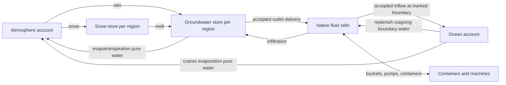
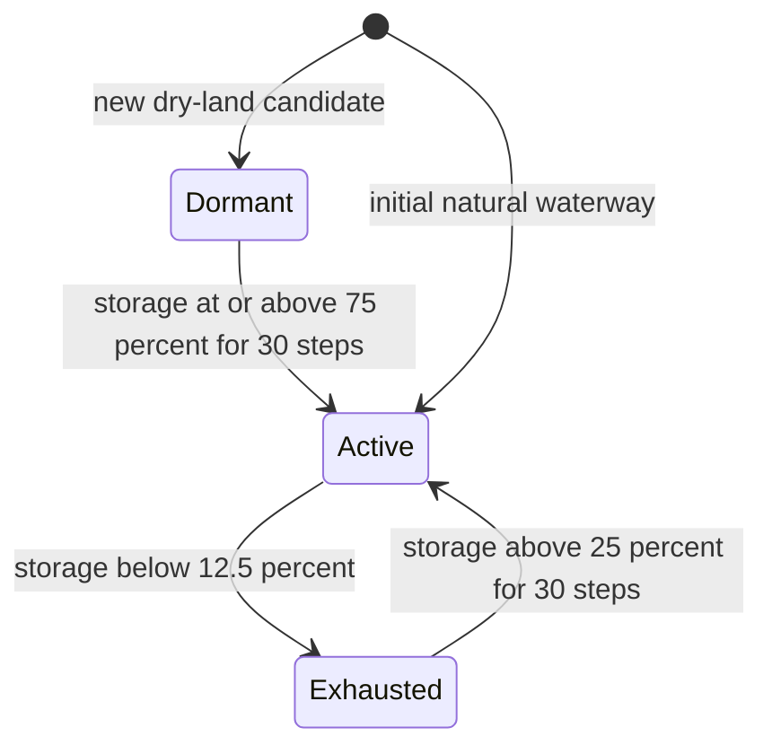

# Expanded replica — WATER-ENGINE.md

**Edition:** 2026-10-29 · **Status:** research expansion and proposed design.

| Provenance | Value |
| --- | --- |
| Original | [Open original source](https://chatgpt.com/library?file_id=libfile_411800f615248191a497f2ebb9cf4a2e&account_id=personal) |
| Source identity | library: WATER-ENGINE.md |
| Preserved source SHA-256 | `4ddef6a2741bc70a1e916d02da7139bf1f615631291d10dfbf171c02fd32d7f4` |
| Review method | full-text |
| Proposed-work priority | P0 |

The original document is preserved byte-for-byte below. New material is a dated proposal; historical results keep their original source, environment, and limitations. The priority describes follow-up design work, not a newly reproduced runtime defect.

[Corpus guide](../../README.md) · [Integrated design](../../ENGINE-DESIGN-EXPANSION.md) · [Detailed chapter](../../chapters/terrain-water.md) · [Discrepancy register](../../DISCREPANCIES.md)

## Research expansion — source scope

The consolidated Water Engine is explicitly anchored to alpha 26, updated 2026-10-25, and already separates implemented, partial, approved, proposed, open, and historical behavior. It specifies sixteen-unit cells, 4096-quanta block accounting, finite regional/ocean/atmosphere stores, spring hysteresis, source guards, composition, loaded-only scheduling, persistence, gameplay APIs, presentation, configuration, and validation. A 37-item gap register and 16 owner decisions cover much of the apparent missing scope. This full-text review targets unsafe or underspecified proposed contracts and later-document drift; it does not claim the described code was freshly built, measured, or verified.

## Research expansion — gaps and details to deepen

- Correction needed in proposed persistence: §11.2 permits age-based rollback of a pending cross-owner transfer without a fencing or durable commit contract. A late destination credit after rollback can duplicate water. §19 assumes host atomic saving is sufficient, but independent records need a demonstrated multi-record recovery protocol. Transaction IDs also need world/dimension/edge epochs and safe deduplication retention.
- Elaboration and correction: §21.2 omits persisted unloaded cells from its global closed-box sum and must include every enabled owner such as wetness, frozen water, pipe storage, residues, and in-flight transfers exactly once. Sealed-and-dry quarantine in §11.3 must mean unavailable to exchange, not loss of existing conserved contents.
- Numeric deepening: §18.3 rounding prevents gain only if fractional conversion remainders remain owned; repeated lossy round trips are still incorrect. Composition diffusion needs overflow-safe multi-neighbor limits, and evaporation to zero volume needs residue ownership. Per-cell constituent or sparse-entry caps cannot discard the fifth constituent or nondefault metadata.
- Policy clarification: blanket chunk-load-order determinism conflicts with loaded-only evolution when activation histories differ. The well-priority proposal reintroduces a natural-flow reservation that is not the current finite default. Destructive replacement as a declared exception also needs a boundary separating operator removal from ordinary gameplay displacement.
- Scheduling and interface deepening: environmental step/second and saturation behavior are already open questions, but interval identity, fair service, wake-up, and stale-result rejection need exact contracts. Flat or pressurized flow cannot generally be recovered from client level gradients; visual hints and measured gameplay flow need separate validity. Proposed thermal mixing must conserve energy rather than average temperature unweighted.

## Research expansion — proposed contracts

- Specify one owning-thread commit for live transfers and a durable journal or atomic region checkpoint for cross-record persistence. Persist reservation, debit, credit, and deduplication evidence before acknowledgement. Expiry may request cancellation, but rollback is legal only after the destination is fenced against late commit and recovery establishes that credit did not occur. Include world UUID, dimension, boundary identity, owner epochs, monotonic sequence, amount, constituents, and revision.
- Define a complete account registry and audit scope. Include loaded and persisted-unloaded cells, regional/boundary stores, containers, pipes, wetness, ice/snow, residues, and durable transfer owners as applicable. A pending debit owns escrow exactly once. Quarantine freezes exchange and preserves raw records and ledger obligations; it never silently reinitializes or zeroes quantities.
- For host integer-mB adapters, initially allow exactly 125 mB = 512 quanta = 2 native units, or implement a separately owned rational remainder account. Simulate is nonmutating; commit checks actual accepted amount and revisions. Reject unsupported granularities rather than repeatedly flooring away water. Constituent transport uses checked widened products and exact donor/receiver balance.
- Define composition and thermal capacity rules: snapshot-based per-edge proposals, total donor budgets across all neighbors, positivity, non-overshoot, and deterministic remainder allocation. At zero water, retain nonvolatile constituents in a residue owner. Storage-cap overflow must refuse, compact losslessly, or use a bounded fallback representation. If enabled, heat stores energy with capacity/phase information; temperature is derived.
- Separate generator determinism, replay determinism for equal accepted inputs and activation history, and schedule-dependent loaded-world evolution. Key discharge caps and dwell transitions to one logical regional interval, shared across outlet rechecks and reload. Specify cancellation, wake on border/material edits, oldest-work age, bounded fair service, and no unloaded catch-up or accumulated emission backlog.
- Define topology-edit and query contracts: an ordinary edit that removes fluid capacity must route, escrow with bounded ownership, or defer/reject atomically. Operator destruction is separately logged. Return current, pending, unsupported, or unavailable with world/geometry/flow revisions. Measured current powers entities/wheels; renderer gradients are hints. Keep optional natural-flow reservation, coarse catch-up, mine seepage, and erosion explicitly unapproved until dispositioned.

## Research expansion — acceptance checks

- Inject a crash after every journal/checkpoint transition, replay messages, delay the destination beyond expiry, and reopen the world; require exactly one debit and credit or exactly neither, including constituents and escrow. A timed-out transfer must never later credit.
- Run one million reversible native/container/adapter transfers at supported and unsupported granularities. Require zero quantum and constituent drift, no mutation during simulate, no overflow, and no duplicated source/ocean identity.
- Evaporate a saline cell fully, restore water, mix a fifth constituent, fill metadata capacity, and run multiple simultaneous diffusion neighbors; preserve residues and total constituent quantities without negative concentrations.
- Exercise unload/reload, quarantine, save corruption, capacity reduction, basin split/merge, and ordinary versus operator block replacement; audit loaded plus persisted owners and preserve nonzero unavailable contents.
- Compare identical replay inputs under worker reordering while separately varying activation history. Under saturated edits, prove configured fair service, source-cap compliance, no catch-up burst, still-water rest, and identical authoritative hashes with presentation disabled.

## Research expansion — source anchors

- 11.2 Boundary transaction schema
- 11.3 Save schema, migration and repair
- 18.3 Host-fluid conversion hazard
- 21.2 Global invariants (run continuously in tests)
- 22. Gap register

## Research expansion — source-context links

These pinned links resolve original dependencies outside their new replica locations. Exact tracked repository paths also resolve original links with an incorrect relative base; the original text remains unchanged. Project-collection references use an identical Git counterpart, an explicit tracked path, or a unique tracked filename where available.

| Original relative target | Pinned source target |
| --- | --- |
| `../roadmap.md` | [Open](https://github.com/Shnewbs/Deep-Primal/blob/33c43c943f0469195e7ab1a6852ab4360fad1788/roadmap.md) |
| `BIOME-PLAN.md` | [Open](https://github.com/Shnewbs/Deep-Primal/blob/33c43c943f0469195e7ab1a6852ab4360fad1788/docs/BIOME-PLAN.md) |
| `CONFIGURATION-AND-ORE-AUTHORING.md` | [Open](https://github.com/Shnewbs/Deep-Primal/blob/33c43c943f0469195e7ab1a6852ab4360fad1788/docs/CONFIGURATION-AND-ORE-AUTHORING.md) |
| `ENVIRONMENTAL-WATER-AND-TERRAIN-V4.md` | [Open](https://github.com/Shnewbs/Deep-Primal/blob/33c43c943f0469195e7ab1a6852ab4360fad1788/docs/ENVIRONMENTAL-WATER-AND-TERRAIN-V4.md) |
| `GLACIAL-LANDSCAPES.md` | [Open](https://github.com/Shnewbs/Deep-Primal/blob/33c43c943f0469195e7ab1a6852ab4360fad1788/docs/GLACIAL-LANDSCAPES.md) |
| `LOD-AND-DRAINAGE-ARCHITECTURE.md` | [Open](https://github.com/Shnewbs/Deep-Primal/blob/33c43c943f0469195e7ab1a6852ab4360fad1788/docs/LOD-AND-DRAINAGE-ARCHITECTURE.md) |
| `STREAMS-CANOPY-PUDDLES-AUDIT-2026-10-22.md` | [Open](https://github.com/Shnewbs/Deep-Primal/blob/33c43c943f0469195e7ab1a6852ab4360fad1788/docs/STREAMS-CANOPY-PUDDLES-AUDIT-2026-10-22.md) |
| `TERRAIN-MECHANICS.md` | [Open](https://github.com/Shnewbs/Deep-Primal/blob/33c43c943f0469195e7ab1a6852ab4360fad1788/docs/TERRAIN-MECHANICS.md) |
| `TERRAIN-WATER-SNOW-LOD-AUDIT-2026-10-22.md` | [Open](https://github.com/Shnewbs/Deep-Primal/blob/33c43c943f0469195e7ab1a6852ab4360fad1788/docs/TERRAIN-WATER-SNOW-LOD-AUDIT-2026-10-22.md) |
| `VALIDATION-0.0.1-alpha.23.md` | [Open](https://github.com/Shnewbs/Deep-Primal/blob/33c43c943f0469195e7ab1a6852ab4360fad1788/docs/VALIDATION-0.0.1-alpha.23.md) |
| `VALIDATION-0.0.1-alpha.26.md` | [Open](https://github.com/Shnewbs/Deep-Primal/blob/33c43c943f0469195e7ab1a6852ab4360fad1788/docs/VALIDATION-0.0.1-alpha.26.md) |
| `WATER-BUDGET-REQUIREMENTS.md` | [Open](https://github.com/Shnewbs/Deep-Primal/blob/33c43c943f0469195e7ab1a6852ab4360fad1788/docs/WATER-BUDGET-REQUIREMENTS.md) |
| `design-decisions-2026-10-18.md` | [Open](https://github.com/Shnewbs/Deep-Primal/blob/33c43c943f0469195e7ab1a6852ab4360fad1788/docs/design-decisions-2026-10-18.md) |

## Preserved source document

Original links retain their original document context. Use the pinned source and source-context index above for dependencies not copied into this edition.

<!-- BEGIN PRESERVED SOURCE -->
# Deep Primal — Water Engine

**Status:** consolidated specification with a labeled gap-fill layer. **Implementation baseline:** alpha 26 (2026-10-24). **Updated:** 2026-10-25. **Prototype target:** Minecraft 26.1.2 / NeoForge 26.1.2.122 / Java 25.

This is the single entry point for how water works in Deep Primal: the finite native fluid, the regional environmental accounts that feed it, the ocean and atmosphere boundary, water composition, seasonal behavior, gameplay interfaces, presentation, performance, configuration, validation and the work that is still missing. It merges three existing documents and adds proposals where none of them say anything yet.

| Source | What it contributes |
| --- | --- |
| `ENVIRONMENTAL-WATER-AND-TERRAIN-V4.md` | What alpha 26 actually implements: groundwater/snow accounts, springs, ocean/atmosphere accounts, chemistry advection, `continental_v4` terrain. |
| `WATER-BUDGET-REQUIREMENTS.md` | Owner-approved mechanics, accounting rules, seasonal/desert behavior, operating modes, headwater/composition requirements and acceptance lists. |
| `roadmap.md` | Tracking IDs (`WATER-01`…`WATER-08`, `OCEAN-01`…`OCEAN-03`, `SNOW-01`, `TERRAIN-01`…`TERRAIN-10`) and the completion rules. |

Nothing here marks a roadmap item complete. Do not infer owner-GPU performance, permanent perennial flow, entire-world hydrology simulation or full terrain-roadmap completion from this document or from alpha 26.

## Contents

- [0. Reading guide](#0-reading-guide)
- [1. Design principles](#1-design-principles)
- [2. Status at a glance](#2-status-at-a-glance)
- [3. Units and numeric model](#3-units-and-numeric-model)
- [4. Architecture](#4-architecture)
- [5. Native fluid physics](#5-native-fluid-physics)
- [6. Regional environmental accounts](#6-regional-environmental-accounts)
- [7. Ocean and atmosphere boundary](#7-ocean-and-atmosphere-boundary)
- [8. Water composition](#8-water-composition)
- [9. Regimes, climate inputs and policy modes](#9-regimes-climate-inputs-and-policy-modes)
- [10. Lakes, dams and floods](#10-lakes-dams-and-floods)
- [11. Ownership, persistence and unloaded regions](#11-ownership-persistence-and-unloaded-regions)
- [12. Terrain coupling](#12-terrain-coupling)
- [13. Gameplay interfaces](#13-gameplay-interfaces)
- [14. Presentation and networking](#14-presentation-and-networking)
- [15. Performance and scheduling](#15-performance-and-scheduling)
- [16. Configuration](#16-configuration)
- [17. Commands and inspection](#17-commands-and-inspection)
- [18. API and compatibility](#18-api-and-compatibility)
- [19. Failure modes](#19-failure-modes)
- [20. Exploit analysis](#20-exploit-analysis)
- [21. Validation and acceptance](#21-validation-and-acceptance)
- [22. Gap register](#22-gap-register)
- [23. Open owner decisions](#23-open-owner-decisions)
- [24. Suggested phasing](#24-suggested-phasing)
- [25. Glossary, references and changelog](#25-glossary-references-and-changelog)

---

## 0. Reading guide

### Status tags

Every behavior in this document carries one of these tags. A tag describes the behavior, not the quality of the idea.

| Tag | Meaning |
| --- | --- |
| **[IMPLEMENTED A26]** | Ships in alpha 26 according to the alpha 26 document, within the limits stated there. Broader acceptance may still be open. |
| **[PARTIAL]** | Part ships; the limit is stated beside it. |
| **[APPROVED]** | Owner-approved direction recorded in the water budget document or design decisions; not implemented. |
| **[PROPOSED]** | Added by this consolidation to fill a gap. No owner decision exists. Never treat it as a requirement until dispositioned (see [section 23](#23-open-owner-decisions)). |
| **[OPEN]** | A question the existing documents leave unanswered. |
| **[HISTORICAL]** | Superseded by a later dated owner direction; kept so the reasoning is traceable. |

### Precedence

When documents disagree, resolve in this order:

1. The newest dated owner clarification.
2. The alpha 26 document, for what ships today.
3. The water budget document, for approved-but-unimplemented behavior.
4. The roadmap, for tracking and completion rules.
5. This document, for gap-fill proposals only. It never overrides 1–4.

Known conflicts and how they are recorded are in [section 9.6](#96-decision-record-superseded-minimum-flow-guarantee).

### Dated owner direction used here

| Date | Direction |
| --- | --- |
| 2026-10-21 | Rock/soil drainage and underground routing scope; no sinkholes; panning/sluices use consumed recipes. |
| 2026-10-22 | Hybrid water system approved; desert wet-season flood and dry-season recession is a required scenario. |
| 2026-10-23 | River supply at headwaters; distinct composition state for river/ocean/other liquids; contact must not stack volume. |
| 2026-10-24 | Streams may dry and sources may appear in new places when sustained inflow, storage and terrain support them; players move measured water but cannot place a renewable spring; ordinary lakes remain finite; the ocean is an explicitly accounted fixed-stage boundary. Stream source safety and smoother presentation direction. |

---

## 1. Design principles

These are the invariants every water feature must preserve. A feature that cannot satisfy them is not ready to ship.

1. **Conservation.** For every account, change in stored water equals accepted inputs minus accepted outputs. The only exceptions are the enumerated external inputs and removals: generated initial conditions, finite geological initialization, creative commands, creative buckets and destructive block replacement.
2. **One owner per volume.** A given quantum of water is represented in exactly one place at a time: a loaded fluid cell, a regional store, an ocean/atmosphere account, a container or a transfer in flight. No copies, no mirrored counters.
3. **Pay for accepted water only.** A source debits its backing store for what the destination accepted. If nothing is accepted, nothing is debited and nothing is queued.
4. **No delivery backlog.** Blocked, full or backwatered outlets simply stop. Saturation never builds an imaginary queue that later bursts out.
5. **Fail closed.** Exhausted, full, stale or unavailable accounts refuse the transfer. They never create, destroy or clamp-and-forget water silently.
6. **Work limits are separate from water limits.** When the scheduler is saturated, work is deferred. Deferred work must not delete water, fabricate supply or produce a catch-up burst.
7. **No unloaded catch-up.** Unloaded time produces no water, melt, delayed burst or activation. This is the alpha 26 behavior and remains the default unless a bounded coarse-record policy is explicitly approved ([GAP-11](#22-gap-register)).
8. **Presentation never changes physics.** Interpolation, LOD, foam, puddles, canopy drips, shader settings and graphics quality cannot create, consume or move authoritative water.
9. **Determinism.** Seeded inputs produce the same results independent of worker count, chunk load order and chunk-visit order wherever the specification claims determinism.
10. **Versioned saves and frozen geography.** Existing worlds keep their saved generator, geography and height. New behavior is adopted through explicit, documented migration, never by silently rewriting published terrain.
11. **Players move water; they do not mint it.** A player can relocate measured water. A player cannot place a renewable spring, and no gameplay loop may return more water than it consumed from an accounted store.
12. **Honest abstractions.** The ocean boundary, the coarse rainfall model and the regional store are gameplay approximations. Documentation and UI call them that and never claim planetary or atmospheric physics.
13. **Evidence before claims.** A behavior is "done" when its verification exists and is recorded, in line with the roadmap's completion rules. A fixture passing proves the fixture.

---

## 2. Status at a glance

| Area | Status | Notes and source |
| --- | --- | --- |
| Independent finite fluid (`engine_water`), 1–16 units per cell, in the water fluid tag | **[IMPLEMENTED A26]** | Registered and tagged; a full cell is not an emitter. Roadmap alpha 22; water budget doc. |
| Bounded gravity, pooling and local routing; 3 transport substeps per 20 Hz tick | **[IMPLEMENTED A26]** | Nominal 60 substeps/second assumes 20 TPS and bounded admission. No guaranteed FPS. Alpha 23. |
| Bounded connected-pool pressure (communicating vessels, enclosed pipes/wells) | **[IMPLEMENTED A26]** | Open natural flowing reaches use local gravity/routing instead of remote leveling. |
| Per-region groundwater and snow accounts (64×64) | **[IMPLEMENTED A26]** | One persisted pair per visited region per dimension; initialized once. |
| Spring/outlet activation with hysteresis | **[IMPLEMENTED A26]** | 75% / 25% / 12.5% thresholds, 30-step dwell. |
| Regional and per-outlet discharge caps | **[IMPLEMENTED A26]** | 32 units per environmental second per regional work record; 4 units per outlet per visit. |
| Stream source guard (channel-surface cap) | **[PARTIAL]** | On by default for natural waterway emitters; bounded dedicated-server fixture passed. Natural weather, dam/overtopping and long-duration acceptance open. |
| Surface infiltration and discharge to groundwater | **[IMPLEMENTED A26]** | Coarse; clay and constructed floors sealed. Numeric rates not documented ([GAP-06](#22-gap-register)). |
| Weather recharge, snow store, melt, evapotranspiration, ocean evaporation | **[PARTIAL]** | Coarse regional approximation. Full seasonal climate not implemented. |
| Ocean boundary (marked cells, Y=95, sea stage 96) and ocean/atmosphere accounts | **[IMPLEMENTED A26]** | Finite declared capacities; fail closed. |
| Composition: integer salt and sediment advected with accepted volume; bucket preservation | **[IMPLEMENTED A26]** | No diffusion, appearance, reactions or erosion solver. |
| Composition-only diffusion, visual appearance, reactions | **[APPROVED]** | Water budget doc, 2026-10-23. |
| Designated perennial major-river allocation (balanced mode) | **[HISTORICAL]** in part | Not implemented and superseded for this implementation by the 2026-10-24 clarification. See [9.6](#96-decision-record-superseded-minimum-flow-guarantee). |
| Seasonal melt streams, full climate, hemisphere-aware seasons | **[APPROVED]** | Depends on the climate plan; biome roster comes first. |
| Strict policy and independent source-safety controls as user-visible settings | **[APPROVED]** | Config surface not yet shipped (source guard default is on). |
| Coarse unloaded catchments and boundary-transfer transactions | **[APPROVED]** | Open; roadmap `TERRAIN-01`, `WATER-02`. |
| Unified lakes, sills, spillways, dams as accounted storage | **[APPROVED]** | Open; roadmap. Ordinary lakes stay finite. |
| Displacement, waterlogging, containers, fair basin work | **[APPROVED]** | `WATER-01`. |
| Transactional fluid ports, pumps, pipes, tanks, valves, sensors | **[APPROVED]** | `WATER-04`. |
| Pressure equipment, deep water, stamina, currents, mounts | **[APPROVED]** | `WATER-05`. |
| Irrigation, drinking, sponge, fishing/boats/dripstone interactions | **[APPROVED]** | `WATER-06`. Boat submersion on custom water is fixed (A26). |
| Canopy interception, puddles, wetness | **[APPROVED]** | `WATER-07`, `WATER-08`. Cosmetic, never authoritative. |
| Waves, surf, circulation, tides, bathymetry | **[APPROVED]** | `OCEAN-01`…`OCEAN-03`. |
| Snow accumulation, drifts, thaw/refreeze, glaciers | **[APPROVED]** | `SNOW-01`; seasonal glacier geometry open. |
| Wells (depletable, shared aquifer) | **[APPROVED]** | Aquifer sharing ships; the well mechanic and extraction priority are not specified ([GAP-05](#22-gap-register)). |
| Ice, freezing, water temperature, water quality, mine seepage, dam failure | **[PROPOSED]** | Gap-fill, see [section 22](#22-gap-register). |

---

## 3. Units and numeric model

### 3.1 Units

| Quantity | Value | Notes |
| --- | --- | --- |
| Native fluid cell | 1–16 units | One block of water is 16 units. |
| Environmental store resolution | 256 integer quanta per unit | 4096 quanta per block. |
| Regional store | 64×64 columns | 4096 columns, which is 4×4 = 16 chunks. |
| Groundwater cap, snow cap | 1024 blocks each | 4,194,304 quanta (2^22) per store. |
| Initial groundwater | 30–70% of cap | Seeded from rainfall; roughly 307–717 blocks. Rounding rule not stated. |
| Ocean reserve (initial) | 134,217,728 blocks | 2^27 blocks = 2^39 quanta = 549,755,813,888. |
| Atmosphere reserve (initial) | 67,108,864 blocks | 2^26 blocks = 2^38 quanta = 274,877,906,944. |
| Regional discharge cap | 32 units per environmental second | Shared by all outlets of one active regional work record; equals 2 blocks. |
| Outlet cap | 4 units per visit (default) | Inside the regional cap. |
| Rain rate | 64 quanta per column-second | 0.25 unit, which is 1/64 block, before substrate weighting. |
| Column scan | 64 columns per tick (default) | Stops between columns after a nominal 2 ms window. |
| Full environmental column visit cadence | 20 ticks | Per the 2026-10-24 clarification. |
| Transport substeps | 3 per 20 Hz tick | Nominal 60 per second. |
| Sea level | marked surface cells at Y=95; sea stage 96 | Boundary acts only on marked cells. |

### 3.2 Worked conversions

- One vanilla-sized bucket is assumed to be one block: 16 units, 4096 quanta **[assumption; confirm container conversion table, see [GAP-08](#22-gap-register)]**.
- One full regional work record can deliver at most 32 units per environmental second, which is 2 blocks of water, or 120 blocks per environmental minute, regardless of how many outlets it contains.
- A 16-unit cell holding 5 units is at 5/16 block depth; a stream surface of "eight units" is half a block.
- The ocean account at 2^39 quanta needs a 64-bit integer. A 32-bit signed counter overflows at 2^31 quanta, which is only 524,288 blocks.

### 3.3 Arithmetic conventions

**[PROPOSED] [GAP-08]**

1. All account arithmetic is 64-bit signed integer in quanta. No floating-point value is ever the stored quantity.
2. Every transfer is a single operation that debits the donor and credits the receiver by the *same* number of quanta. A transfer that cannot credit in full is reduced to what can be credited before the debit.
3. Remainders below one native unit stay with the donor. Remainders are never rounded into existence at the receiver.
4. Capacity checks use checked arithmetic. Overflow, underflow or a failed check is a fail-closed refusal with a counter increment, not a clamp.
5. Constituent quantities (salt, sediment) use the same integer rules and travel in proportion to accepted volume, with the rounding remainder retained in the donor (already true in alpha 26).
6. Derived values (fill fraction, head, concentration) are recomputed from stored integers and are never persisted as the source of truth.

### 3.4 Open numeric questions

- **[OPEN] [GAP-09]** The docs use "environmental step" (dwell counts of 30) and "environmental second" (regional cap) without defining their relationship. The 2026-10-24 clarification gives a 20-tick cadence for full column visits. Define whether one step equals one cadence interval, one second, or something else, and state wall-clock equivalents for the 30-step dwell.
- **[OPEN]** The rounding rule when initializing 30–70% of the cap (307.2 blocks is not an integer number of quanta).
- **[PROPOSED] Rain calibration check [GAP-06].** At the unweighted default, a fully loaded region (4096 columns) would receive 64 blocks per second, filling a 1024-block store in 16 seconds. The substrate, exposure, phase and rain-duration weighting that brings this down is not stated in the supplied documents. Record those weights and the effective precipitation per rain hour so atmosphere debits can be sanity-checked against the 2^26-block reserve.

---

## 4. Architecture

### 4.1 Layers

| Layer | Owns | Notes |
| --- | --- | --- |
| L0 Host | Chunk storage, lighting, scheduling, networking, GPU interfaces | Minecraft/NeoForge. The water engine uses host APIs and replaces nothing native in the Overworld terrain path. |
| L1 Native fluid cells | Loaded physical water, 1–16 units per cell | `engine_water`. Local gravity, pooling, routing, pressure. |
| L2 Regional accounts | Groundwater and snow per 64×64 region | Persisted per dimension; initialized once when first visited. |
| L3 Boundary accounts | Coarse ocean and atmosphere storage per dimension | Finite, explicit capacities. Fixed-stage ocean boundary. |
| L4 Composition | Sparse salt/sediment state | Advected with accepted volume; serialized with the stores. No block entity per water block. |
| L5 Presentation | Client meshes, interpolation, LOD, particles, sound | Reads state; never writes quantities. |
| L6 Gameplay interfaces | Buckets, containers, pumps, machines, drinking, farming | Move measured water between accounts via transactions. |

### 4.2 Flow of water between accounts

Evaporation and evapotranspiration return pure water to the atmosphere and leave dissolved/suspended constituents behind in the source store (alpha 26).

### 4.3 Logical per-tick pipeline

*Design-intent description. Verify the exact order against the source before relying on it for debugging.*

1. **Transport.** Up to three fluid substeps: gravity, routing, pressure, thin-film drain, washing through replaceable plants. Composition advects with each accepted transfer.
2. **Admission.** Examine up to `columnsPerTick` loaded surface columns, rotating through loaded chunks. Stop between columns once the nominal 2 ms window is spent. Request no remote chunks.
3. **Column visit.** Classify the surface (permeable or sealed), then either recharge groundwater from surface water or discharge groundwater to the surface for this visit, never both. Recheck cached natural-stream outlet candidates.
4. **Regional work record.** Apply weather recharge, snow melt, evapotranspiration and spring hysteresis; allocate outlet deliveries under the shared regional cap; apply the stream source guard.
5. **Boundary exchange.** Debit/credit the ocean account at validated marked boundary cells.
6. **Persistence.** Mark changed regional records, composition and boundary accounts dirty for the normal save path.

### 4.4 Ownership rules

| Volume lives in… | Owned by | May leave through… |
| --- | --- | --- |
| A loaded fluid cell | L1 | Flow, infiltration, boundary credit, bucket/pump extraction, evaporation (planned), destructive replacement (external removal) |
| A regional store | L2 | Accepted outlet delivery, evapotranspiration, extraction (wells, planned) |
| The ocean account | L3 | Replenishing outgoing marked-boundary water, coarse evaporation |
| The atmosphere account | L3 | Rain, snow |
| A container or machine | L6 | Transactional port or bucket placement |

Rules: never copy, never mirror. A transfer that crosses owners is one transaction with one debit and one credit. Placed creative water and destructive replacement are *declared* external inputs and removals, not leaks.

### 4.5 Dimension scoping

Each dimension persists its own regional accounts, ocean/atmosphere accounts and composition. The Nether and End keep their native generators; the water engine treats them as separate dimensions with their own policy ([GAP-16](#22-gap-register), [section 12.4](#124-dimension-policy)).

### 4.6 Thread and concurrency model

**[PROPOSED] [GAP-07]**

- All authoritative mutation of fluid cells and accounts occurs on the server thread that owns the level. Worker threads may *read immutable snapshots* (for example generation-time terrain samples) and *compute* proposals; applying a result is a single owning-thread transaction.
- Client LOD and mesh work uses owning-thread snapshot capture, as established in the roadmap for the LOD runtime, and never writes server state.
- Every proposal carries a revision. A stale proposal is rejected, not merged.
- Results must not depend on worker count or completion order. The existing worker-count comparison gate for worldgen extends to hydrology initialization.

---

## 5. Native fluid physics

### 5.1 Cell model

**[IMPLEMENTED A26]**

- A native cell holds 1–16 finite units. A full cell is not a replenishing emitter.
- The engine registers a custom finite `engine_water` fluid and includes it in the water fluid tag.
- Legacy eight-unit hooks do not automatically support the sixteen-unit fluid. Each legacy hydrology feature must be audited individually before compatibility is claimed.
- Boats classify custom water correctly: submersion on `engine_water` returns the boat to the normal buoyancy path. Vanilla fluid behavior is unchanged.
- Source identity is explicit. Only marked ocean boundary cells act as ocean boundaries; buckets preserve constituent quantities but never copy ocean or source identity.

### 5.2 Transport

**[IMPLEMENTED A26]**

- Gravity and local routing move existing volume; nothing is created by flow.
- Three transport substeps per host tick (nominal 60 per second at 20 TPS), with retained bounded work when the budget saturates.
- Dormant loaded interiors activate; thin films drain toward nearby outlets; flow washes through replaceable plants.
- Loaded chunk borders resume through bounded, coalesced scans without forced chunk loads. Unloaded borders are sealed.
- Flow through a filled channel does not need to increase stored volume when outflow equals inflow.

### 5.3 Pressure

**[IMPLEMENTED A26]**

- Connected-pool pressure is bounded and verified by communicating-vessel and blocked-passage fixtures: surfaces rise and volume is conserved.
- **Open natural flowing reaches** use local gravity and routing. They are not leveled as a whole connected river, which keeps a sloping river from behaving like a static tank.
- **Covered passages and enclosed wells or pipes** keep communicating-vessel pressure.
- The open-channel classification uses saved geography and the actual exposed or enclosed state of the cells.

### 5.4 Gaps in the native physics layer

| ID | Gap | Proposal **[PROPOSED]** |
| --- | --- | --- |
| **GAP-01** | No measured flow. Water wheels, gauges, discharge limits and inspection all need a trustworthy flow figure. | Per-edge and per-cell throughput counters in native units per second, sampled over a short rolling window, off by default and enabled per watched cell/region. Counters are derived from accepted transfers only. |
| **GAP-02** | Oscillation and tie-breaking. Equal-head neighbors can slosh or favor an axis. | Deterministic tie-break from a seeded coordinate hash, a minimum-transfer threshold, and sleep for cells whose neighborhood did not change. Cover with a "still pond stays still" fixture. |
| **GAP-03** | Displacement and waterlogging policy. Placing a block into water, pistons, falling blocks, explosions and waterlogged blocks all change where units live. | Displaced units must be routed to a neighbor or become a conservative pending displacement; they are never deleted. Waterlogged blocks hold a defined number of units (decision needed: one full block, or a partial amount). Explosion vaporization credits the atmosphere account. Sponge storage holds measured units, not a deletion. |
| — | Entity forces. | Currents push entities in proportion to *measured* local flow, not cosmetic texture direction. See `WATER-05`. |
| — | Sleeping. | Cells and whole regions with no change for N substeps drop out of active work and wake on any neighbor change. |

---

## 6. Regional environmental accounts

### 6.1 Region records

**[IMPLEMENTED A26]**

- Each dimension persists one groundwater/snow account per *visited* 64×64 region.
- A region initializes its finite geological groundwater once. Later chunk loads reuse it; relocating across a chunk border does not reset supply.
- `/deepprimal water` reports without initializing a new aquifer.
- Groundwater, snow, ocean, atmosphere and sparse cell composition are serialized together.

**[PROPOSED] Record fields** (names illustrative, to be reconciled with the real schema, see [GAP-18](#22-gap-register)):

| Field | Type | Purpose |
| --- | --- | --- |
| `schemaVersion` | int | Migration gate. |
| `regionX`, `regionZ`, `dimension` | ints/id | Identity. |
| `groundwaterQuanta` | long | Authoritative store. |
| `snowQuanta` | long | Authoritative store. |
| `datumY` | int | Hydraulic datum, derived once from the sixteen deterministic samples. |
| `springStates` | sparse map | Per-outlet active/dormant/exhausted state and dwell counters. |
| `composition` | sparse | Salt and sediment quantities for groundwater and snow. |
| `lastEnvironmentalStep` | long | For stale-work rejection and replay protection. |
| `revision` | long | Increments on every committed change. |

### 6.2 Capacity and initialization

**[IMPLEMENTED A26]**

- Each store holds at most 1024 blocks.
- Initial groundwater is 30–70% full according to seeded rainfall.
- Because the initial maximum (70%) is below the 75% needed for *new* dry-land outlets, a freshly initialized store can never activate a new outlet by itself. New outlets require real net recharge. This is intended: visiting chunks or waiting on an unchanged initial store cannot activate them.

### 6.3 Hydraulic datum and head

**[IMPLEMENTED A26]**

- An aquifer's hydraulic datum is shared by all its outlets and derived from the lowest of sixteen deterministic regional terrain samples.
- Storage changes the head. Actual exposed terrain determines where delivery is possible. The outlet does not have to be an original generated stream source.

**[OPEN] [GAP-04]** The head curve (how fill fraction maps to head above the datum), its maximum and any lateral head gradient across the region are not given in the supplied documents. Record them here, with a plot of head versus fill, once confirmed from source. A head curve that is monotonic and bounded is required so that the hysteresis thresholds below stay meaningful.

### 6.4 Spring and outlet state machine

**[IMPLEMENTED A26]**

| Transition | Condition |
| --- | --- |
| Initial natural outlets | Existing natural waterways are supplied by initial natural groundwater with no activation dwell. |
| New dry-land outlet becomes eligible | Storage at or above **75%** for **30 environmental steps**. |
| Active outlet shuts off | Storage below **12.5%**. |
| Exhausted outlet reactivates | Storage above **25%** for **30 environmental steps**. |

The band between 12.5% and 25% keeps an outlet in its current state, which prevents flicker. It is not documented whether a newly activated dry-land outlet obeys the same 12.5% shutoff; assume it does and confirm.

### 6.5 Delivery

**[IMPLEMENTED A26]**

- **Springs pay for accepted water only.** Solid or full destinations and backwater stop delivery without any backlog.
- **Shared regional cap:** all outlets in one active regional work record share at most 32 native units per environmental second, with a default maximum of 4 per outlet per visit (`outletUnitsPerVisit`).
- **Rotation:** allocation order rotates each environmental interval so the same outlets are not always favored.
- **Cached candidates:** natural-stream outlet candidates are rechecked as their columns pass through the existing loaded-column scan budget. Moving stream water does not wait for another full 20-tick environmental visit to receive metered source water. Recharge, infiltration, the 32-unit cap, the channel-surface cap and the scan budget are unchanged.

**Stream source guard [PARTIAL]**

- Metered stream or headwater delivery must not push a generated channel above its planned fractional surface. The guard uses the same sixteenth-block rounding as terrain generation.
- At the limit, new delivery pauses and the undelivered water stays in its finite backing aquifer. No backlog, no deletion.
- Default **on** for natural waterway emitters.
- It does **not** suppress stored water, rainfall or runoff floods, dam backwater, basin storage or legitimate overtopping.
- A regional discharge allowance is not a channel-capacity limit; the two are separate checks.
- The dedicated-server check `DEEPPRIMAL_STREAM_SOURCE_NATIVE_CHECK` verifies on a fractional eight-unit stream surface that a six-unit cell receives only two units, a dry outlet fills to its planned surface over rate-limited visits, later checks debit no more groundwater, and unrelated stored water is unchanged. This bounded fixture passed. It does not substitute for natural weather, dam or long-duration acceptance.

### 6.6 Infiltration and discharge

**[IMPLEMENTED A26]**

- Higher surface water can infiltrate into available groundwater capacity.
- Clay and constructed floors are sealed. Sand, gravel, soil and rock have different eligibility and rates.
- Each visit either recharges from the surface or discharges to it.

**[PROPOSED] [GAP-06]** Publish a parameter table. Suggested qualitative ordering to confirm against the code: coarse gravel and sand infiltrate fastest; loam and ordinary soil moderately; unfractured rock slowly; fractured rock depending on fracture; clay, constructed floors and saturated cells at or near zero. Numeric rates, saturation interaction and the capacity ceiling (what "available groundwater capacity" means when the store is nearly full) must be stated, since the desert-recession scenarios in [section 9](#9-regimes-climate-inputs-and-policy-modes) depend on them.

### 6.7 Weather, snow and evapotranspiration

**[PARTIAL]**

- Recharge uses a coarse regional approximation: the currently loaded catchment area, the sampled exposed permeable surface, and the biome precipitation phase.
- Rain debits the atmosphere into groundwater. Snow enters its separate finite store; warm conditions move measured snow into groundwater.
- Groundwater evapotranspiration and coarse ocean evaporation return pure water to the atmosphere, retaining constituents.
- `rainQuantaPerColumnSecond` (default 64) is the loaded-catchment precipitation rate before substrate weighting.
- Unloaded time produces no water, melt, delayed burst or activation catch-up.

### 6.8 Work admission

**[IMPLEMENTED A26]**

- At most 64 surface columns per tick by default, rotating through loaded chunks.
- Admission stops *between* columns after a nominal 2 ms window. A single uncached calculation may exceed that window; this is not a proven hard 2 ms bound.
- No remote chunks are requested.
- Coverage arithmetic and degradation rules are in [section 15](#15-performance-and-scheduling).

### 6.9 Wells and extraction

**[APPROVED]** Shared aquifers and wells can be depleted by extraction and later recover; perennial allocation must not make every well infinite; environmental-flow reservation versus extraction priority must be defined before implementation.

**[PROPOSED] [GAP-05]** Minimum viable well model:

1. A well is an outlet with a *negative* delivery: it debits the regional store at the pump or bucket rate and credits a container, a pipe or a fluid cell.
2. Extraction has its own regional cap (separate from the 32-unit outlet delivery cap) so wells cannot starve natural outlets instantly, and natural outlets cannot hide extraction.
3. Local drawdown lowers effective head near the well; recovery follows regional recharge. Several wells in one region interfere because they share one store.
4. Priority when the store is low: natural outlet baseline first (it is the environmental flow reservation), then extraction. Under strict policy this reservation is removed.
5. Extraction below a minimum store fraction fails closed and reports "dry well" with the store fraction visible in inspection.
6. Wells never pump from a neighbor region's store without an explicit shared-aquifer rule; the region boundary is the accounting boundary.

### 6.10 Snow store

**[PARTIAL]** A separate finite store per region, capped at 1024 blocks. Melt moves measured snow into groundwater under warm conditions. Deep accumulation, canopy and drift behavior, compaction, thaw/refreeze and seasonal glacier geometry remain open (`SNOW-01`). Frozen water must stay distinct from dry ground: ice and snow retain their water and feed later thaw accounts.

---

## 7. Ocean and atmosphere boundary

### 7.1 What ships

**[IMPLEMENTED A26]**

- Terrain V4 records generated continental-ocean water origin, including its initial salinity.
- Only **marked surface cells at Y=95** act as ocean boundaries; the sea stage is 96.
- Existing V1–V3 worlds can adopt the boundary only on a full, already existing sea surface with full neighboring water and matching ocean geography. Adoption does not rebuild banks or refill edited dry terrain.
- Unmarked legacy underwater cells keep their previous fresh default until composition is transported into them. The migration does not rescan or reclassify the whole ocean.

### 7.2 Exchange rules

**[IMPLEMENTED A26]**

| Direction | Rule |
| --- | --- |
| Outgoing boundary water (sea feeding a receiver) | Replenished only by debiting the finite ocean account. |
| Incoming water (river reaching the sea) | Must reach sea stage, leave its sender, and be credited **once**. |
| Level | The boundary never adds a block above sea stage. |
| Ordinary lakes at the same elevation | Receive none of this behavior. They stay finite. |
| Exhausted or full accounts | Fail closed. Capacities are explicit, not unbounded counters. |

### 7.3 What the numbers mean

The initial ocean reserve (134,217,728 blocks) and atmosphere reserve (67,108,864 blocks) are finite declared circulation storage. They are gameplay regional-boundary abstractions, not a simulation of planetary ocean area or atmospheric physics. Generated surface water and the finite geological initialization are initial conditions. Creative commands, creative buckets and destructive block replacement remain external inputs and removals and must be counted as such ([GAP-35](#22-gap-register)).

### 7.4 Approved design intent

**[APPROVED]**

- Accounted ocean reservoir with a prescribed average gameplay sea level, not a globally simulated ocean whose blocks rise after every river contribution.
- Never delete inland water simply because it reaches the same Y level as the sea.
- Rain, snow and recharge draw through explicit atmospheric transfers; precipitation is not debited from the ocean a second time when it infiltrates or melts.
- Ocean storage and circulation budgets stay bounded and balanced over long runs. Moving unlimited net creation into a growing hidden counter would conceal the underlying error.
- Isolated inland pools never acquire an ocean drain.
- Global mean sea-level evolution is a separate future opt-in with storage/area, terrain, save and performance implications.

### 7.5 Account health

**[PROPOSED]**

- **Ocean account full:** incoming credit is refused before the sender is debited. The river reach backs up physically (backwater), subject to the local overflow rules. The boundary still never adds a block above sea stage.
- **Ocean account empty:** outgoing replenishment is refused. Document the visible consequence (local sea cells lower, or the boundary reports as "unreplenished") and test it. Reaching this state should require extreme extraction, so it is a safety net, not a gameplay loop.
- **Warnings:** inspection reports the ocean and atmosphere fill fraction and raises a server log warning at configurable low and high thresholds (for example 5% and 95%).
- **Closed-box audit:** the sum of atmosphere + ocean + regional stores + loaded cells + containers must equal initial storage plus cumulative external inputs minus cumulative external removals ([section 21](#21-validation-and-acceptance)).

### 7.6 Waves, tides and storm surge

**[APPROVED] visuals, [PROPOSED] physical policy [GAP-19]**

- Visible waves, shore breakers, foam, swash and sound (`OCEAN-01`) are presentation. They share data with the physical wave model where specified but cannot change authoritative water.
- Stable mean sea level does **not** mean suppressing every wave, tide or storm surge. Physical coastal inundation needs an accounted stage/storage/exchange policy; visual displacement alone is not enough.
- Options for physical tides: **(a)** visual-only for the first release; **(b)** a bounded oscillation of the boundary stage by a few sixteenths, exchanging with the ocean account both ways; **(c)** event-driven storm surge with a bounded duration and recession. Recommendation: ship (a), design (b) and (c) with the climate plan so surge is driven by weather rather than hardcoded.

### 7.7 Circulation and bathymetry

**[APPROVED, open]** `OCEAN-02` (winds, rotation, basin/coast/seafloor geometry, depth, temperature/salinity, surface/deep flow, vertical exchange, estuary and rip flow) and `OCEAN-03` (shelf-to-trench bathymetry). The current generator does not support literal 11 km depth; any Mariana-scale depth must be evaluated against vertical storage, lighting, network and performance limits first.

---

## 8. Water composition

### 8.1 What ships

**[IMPLEMENTED A26]**

- Integer **salt** and **sediment** quantities travel with bulk transfer in proportion to accepted volume. Rounding remainders stay in the donor.
- Groundwater, snow, ocean, atmosphere and sparse cell state are serialized together.
- Buckets preserve constituent quantities but never copy ocean or source identity.
- Evaporation and evapotranspiration return pure water and leave constituents behind.

**Not shipped:** independent visual appearance, a chemical reaction system, composition-only diffusion, and any live erosion or deposition solver.

### 8.2 Governing rules

**[APPROVED]**

1. **Volume and composition are separate transactions.** Pure contact diffusion exchanges constituent amounts while each cell's physical units stay unchanged. Bulk flow advects constituents in proportion to accepted volume.
2. Both conserve totals and reject stale or repeated transfers. Dilution never duplicates or deletes salt, minerals or contaminants.
3. At river/ocean interfaces, bounded local mixing and advection form the transition. Contact never instantly homogenizes a whole river or ocean.
4. Contact between different water kinds must not stack volume or raise a level. A full connected river/ocean interface blends constituents without adding a second layer.
5. Persist sparse, versioned composition with ownership, revisions and fixed-point remainders. **No block entity or NBT object per water block.** Omitted metadata needs explicit migration and default semantics.
6. Kind labels and concentrations derive from authoritative quantities, never the reverse.

### 8.3 Mixing arithmetic

Concentration is constituent quantity divided by water units. Equal-volume fresh and salt water mix to the mass-weighted concentration with unchanged total volume.

Worked example: cell A holds 8 units and 80 salt quanta; cell B holds 8 units and 0. After full equalization each holds 8 units and 40 salt quanta. The totals (16 units, 80 salt) are unchanged and neither cell's level moved.

**[PROPOSED] diffusion step:** for neighboring cells A and B, transfer

`delta = floor(k × (cA/vA − cB/vB) × min(vA, vB))`

from the higher-concentration cell, where `k` is a per-constituent coefficient in (0, 0.5], `c` is constituent quantity and `v` is water units. Apply a minimum-transfer threshold so rounding does not create endless ping-pong, retain remainders in the donor, and bound the number of mixing pairs processed per tick. The formula is a starting point; the real choice must satisfy the conservation and stability acceptance tests.

### 8.4 Liquid family compatibility

**[APPROVED requirement; PROPOSED details]**

| Family | Behavior |
| --- | --- |
| Miscible (fresh, brackish, saline, mineral-laden, tannin-stained, contaminated water) | Blend within the shared physical-volume solver as one fluid with different composition. |
| Immiscible (for example oils) | Keep separate phases and interfaces with conservative displacement. Requires a concrete fluid identity and density ordering. |
| Reactive pairs (for example water and lava) | Explicit recipe with accounted products, phase change and volume change. See [GAP-23](#22-gap-register). |

Rule: **no unaccounted volume from contact.** Not every liquid mixes and not every reaction leaves the level unchanged, but every change must be declared.

### 8.5 Kinds are traits, not species

The water-type catalog (23 entries) mixes source classes (rain, rivers, lakes, groundwater), settings (spring, wetland) and overlapping composition or appearance traits (salinity, sediment, tannin, contamination). They are not 23 mutually exclusive fluids. Keep them in the shared composition model and do **not** register duplicate fluid IDs that could bypass conservation or mixing. Separate non-water liquid families need concrete identities and compatibility/accounting rules before registration.

**[PROPOSED]** Derived salinity label thresholds (labels only, not physics): fresh below 0.5 parts per thousand, brackish 0.5–30, saline above 30, with ocean water near 35. The concentration unit must be fixed once the salt quantum is defined.

### 8.6 Composition consumers and extra constituents

**[PROPOSED] [GAP-20]** Composition is only worth carrying if something reads it.

| Consumer | Reads | Effect |
| --- | --- | --- |
| Drinking and thirst | Salt, contaminants, tannin | Harm, taste, treatment requirement (see [13.3](#133-drinking-and-water-quality)). |
| Farming | Salt | Saline irrigation harms crops; repeated use raises soil salinity (see [13.5](#135-farming-irrigation-and-soil-moisture)). |
| Fishing and habitats | Salinity | Fresh versus brackish versus salt species and spawning. |
| Panning and sluices | Sediment | Recipe inputs; never mints ore from flow. |
| Boilers and steam (later) | Minerals | Scale and maintenance. |
| Visuals | Sediment, tannin, depth | Clarity and color; cosmetic only. |

**Constituent registry (proposed):** datapack-defined constituents with an ID, integer unit, optional diffusion coefficient, optional decay or treatment rule, visual color contribution and hazard class. Cap the number of constituents per water cell (suggest 4) so sparse storage stays bounded. Water **temperature is not a constituent**; it is a separate thermal field ([13.4](#134-water-temperature-and-thermal-coupling)).

### 8.7 Sediment and erosion

Full live sediment transport and terrain-eroding solvers are optional and default-off (`TERRAIN-03`). Panning and sluices use consumed recipes by default. Any settling of suspended sediment in still water must deposit into an accounted destination (bed material or an item pool), never vanish, and stays optional.

---

## 9. Regimes, climate inputs and policy modes

### 9.1 Water regimes

**[APPROVED]** with the alpha 26 model supplying the mechanism.

| Regime | Expected behavior | How the finite model delivers it |
| --- | --- | --- |
| Perennial | Reach keeps flowing under ordinary conditions. | Emergent from sustained storage and inflow. No unconditional guarantee in alpha 26 ([9.6](#96-decision-record-superseded-minimum-flow-guarantee)). |
| Seasonal or intermittent | Fills in its wet or melt season, then contracts, separates into pools or dries. | Recharge and snow melt vary with climate; storage crosses the hysteresis thresholds. |
| Storm-driven or ephemeral | Dry wash or basin floods after storms and drains back. | Runoff exceeds local drainage; infiltration, evaporation and downstream discharge restore a dry bed. |
| Groundwater-fed refuge | Spring, oasis or residual pool persists through dry weather. | Local aquifer storage supports the losses. A dry surface elsewhere does not imply an empty aquifer. |

### 9.2 Seasonal desert flooding and recession

**[APPROVED]** required acceptance scenario.

- A desert basin may flood in its wet period and dry again through the following hot, dry period. Temporary desert lakes, washes and exposed beds use the same mechanics. Not every desert has the same winter-rain/summer-dry calendar.
- Biome and habitat context help define the expected regime. Actual supply, weather, terrain and substrate decide how much water remains.
- Evaporation is evaluated against water availability, exposed surface, temperature, humidity, wind and sunlight. Infiltration uses material permeability, soil saturation and groundwater capacity. A sandy bed and a sealed clay basin do not recede at the same rate.
- Evaporated water goes to the atmosphere account, infiltrated water to soil/aquifer storage, drainage to the connected downstream account. Visible water may disappear while its quantity remains accounted elsewhere.
- Shallow water retreats into pools and sub-unit films, then damp ground and an exposed bed. Cosmetic wetness follows available moisture and dries gradually. **Never hide a still-full physical fluid cell to simulate evaporation.**
- Sediment and soil state persist through inundation and drying. Salt or valuable material is not generated freely each cycle.
- Frozen water stays distinct from dry ground: ice and snow retain their water and feed later thaw.
- Biome identity is stable across ordinary floods and dry seasons. Inundation is an environmental state, not a biome conversion.
- Recession uses coarse summaries and event-driven active patches. Seasonal drying is not a sink that can cancel unlimited upstream emissions.

**Surface evaporation, films and puddle accounting [PROPOSED] [GAP-12]**

1. **Wetness store.** A sparse per-column fixed-point wetness value (quanta below one native unit) holds water too thin for a fluid cell. It is the authoritative owner of that water; cosmetic wet-look derives from it.
2. **Promotion and demotion.** When accumulated wetness reaches one unit and local geometry supports a cell, it is promoted into an `engine_water` cell in one transaction. A 1-unit cell that evaporates fully demotes into wetness before disappearing.
3. **Evaporation rate** = base × exposed surface × weather factor (temperature, humidity, wind, insolation from the climate contract) × availability, in integer quanta with a retained fractional remainder per column. Credited to the atmosphere account once.
4. **Puddles and canopy drips** (`WATER-07`, `WATER-08`) are cosmetic or feed the wetness store through a single accounted precipitation event, never both and never a second time.
5. **Budget.** Evaporation work rides the existing column scan; it adds no new scanner.

### 9.3 Climate and weather input contract

**[PROPOSED] [GAP-10]** The biome roster comes first and the climate plan later. To avoid blocking hydrology on that plan, define a narrow interface now.

`ClimateSample(dimension, region, time) → { precipitationRate, phase (rain|snow|mixed|none), temperature, humidity, windSpeed, insolation }`

Requirements: deterministic from seed, calendar and dimension; cheap enough to call once per region step; defined for unloaded regions; never mutates state. Initial implementation reads biome precipitation phase and the V4 latitude temperature component. A later climate model replaces it without touching hydrology. Hemisphere-aware seasons, northern/southern polar regions, an equatorial region and Earth mode are inputs to the later plan.

### 9.4 Calendar, pause and catch-up

**[PROPOSED] [GAP-11]** The roadmap commits to TFC-style time behavior including a default empty-server calendar pause, with subsystem catch-up and sleep rules still to specify. Alpha 26 gives hydrology no catch-up.

| Option | Behavior | Risk |
| --- | --- | --- |
| **A. None** (alpha 26) | Unloaded time produces nothing. | Players can avoid droughts by leaving; seasonal state in unloaded regions is stale. |
| **B. Bounded analytic catch-up** | On region load, compute net recharge/ET/melt for elapsed calendar time, clamp to a maximum span, and apply one transaction to the regional store only, never to fluid cells. | Must not produce delayed bursts or reward leaving and returning; needs capacity clamping. |
| **C. Background coarse ticking** | Advance coarse records on a slow cadence. | Cost; more state to persist and test. |

Recommendation: keep A until the climate plan exists; if seasons require more, adopt B. Whatever is chosen, an empty-server pause freezes hydrology time as well as the calendar.

### 9.5 Policy modes

| Mode | Behavior | Status |
| --- | --- | --- |
| **Finite environmental** | Streams can dry and sources can appear when sustained inflow, storage and terrain support them. Ordinary lakes finite. Fixed-stage ocean boundary. No unconditional minimum flow. | **[IMPLEMENTED A26]** default |
| **Balanced** | Renewable environmental baseflow for designated major rivers, seasonal meltwater, finite local physics, fixed average ocean boundary. | **[APPROVED 2026-10-22], not implemented, see 9.6** |
| **Strict** | No protected minimum-flow allocation. Supply follows finite stores and declared recharge. Drought or over-extraction can dry rivers and springs. Ocean policy separate. | **[APPROVED]** |
| **Source safety** | Reduces or pauses new source delivery at head, storage or capacity limits. Preserves existing water. A gameplay abstraction, not a physically unlimited source. | **[PARTIAL]** guard is on by default for natural waterway emitters |

### 9.6 Decision record: superseded minimum-flow guarantee

**Facts**

- 2026-10-22: the approved hybrid design included a renewable minimum baseflow for designated perennial major rivers (balanced mode).
- 2026-10-24: the owner clarified that streams may dry and sources may appear in new locations when sustained incoming water, storage and terrain support them. The alpha 26 document states this supersedes an unconditional minimum stream-flow guarantee for this implementation. The water budget document confirms that alpha 26 does not implement an unconditional designated-major-river allocation.

**Consequences recorded here**

1. Alpha 26 behavior is the finite environmental model. The balanced-mode allocation text remains as historical and optional requirement until the owner dispositions it.
2. **Source placement is not a contradiction.** New dry-land outlets that activate at runtime are regional-record *state*, not a terrain rewrite. Moving generated headwater positions in a delivered V3 world still needs an explicit saved terrain revision.
3. Perennial behavior is emergent: large aquifers, snowfields and catchments keep big rivers flowing; droughts and extraction can dry them.

**[OPEN] Decision D-1** (see [section 23](#23-open-owner-decisions)): keep "Balanced" as an optional preset with an inspectable renewable allocation, drop it permanently, or replace it with tuned emergent perennial behavior. Trade-off: an allocation gives players reliable big rivers but adds a special-case account and an extraction-exploit surface; emergent behavior has no special case but rivers can vanish in drought.

### 9.7 Ice, freezing and thaw

**[PROPOSED] [GAP-13]**

- Freezing depends on temperature from the climate contract and on salinity (brine freezes lower than fresh water).
- Ice is a **state of the same volume**, not a new quantity. Freezing converts water units to ice units one-for-one; thawing returns them. The owner of frozen volume stays accounted, and snow/ice stores feed thaw into groundwater.
- Flowing water freezes more slowly than still water. A frozen surface stops evaporation and infiltration through the frozen cells.
- Bounded work: a maximum freezing-front advance per region per environmental step; no whole-lake instant freeze.
- Ice harvesting consumes the stored volume; breaking ice over water returns units to the cell below, never deletes them.
- Interactions with `SNOW-01` (thaw/refreeze, meltwater), boats (ice blocks movement) and thermoregulation (falling through ice) are listed as dependencies.

---

## 10. Lakes, dams and floods

### 10.1 Lakes and reservoirs

**[APPROVED]** Track storage, local level, sill/spillway/outlet capacity and downstream conditions. Incoming water normally leaves through connected outlets. Blocked outlets raise storage and may overflow locally. Ordinary lakes remain finite. Unified lakes and spillways are open roadmap work.

### 10.2 Dams and blocked rivers

**[APPROVED]**

- Default behavior: water accumulates behind a dam, raises the upstream level, finds a legitimate spillway or overtops available banks.
- Backwater affects exchanges and springs by head.
- Topology and storage changes update affected reaches without scanning the world or deleting player structures.
- A positive minimum delivered flow cannot be guaranteed into a permanently sealed finite basin *and* guarantee no flooding. Under source safety the delivery guarantee yields to the storage/head limit. The unrealized requested flow is not newly created water. Snow or ice that already melted remains in an accounted store or follows an overflow route; pausing further melt or delivery as a safety action must be labeled as that abstraction.

### 10.3 Floods and recession

**[APPROVED]** Rainfall and runoff may exceed local drainage and produce temporary physical floods. Water level and wet area fall when evaporation, infiltration, downstream discharge and extraction exceed new input. Flood and recession are driven by local stage and accounted flux, not by a cosmetic overlay.

### 10.4 Natural obstructions

**[APPROVED, open]** `TERRAIN-10`: grounded natural obstructions with accounted ponding, bypass or outlet response, and release when removed.

### 10.5 Dam failure and bank erosion

**[PROPOSED, optional, default off] [GAP-14]**

- Overtopped unsupported soil or loose-rock dams erode their crest at a material-dependent rate and may breach, releasing storage through a widening notch.
- Conservation is automatic: a breach lets stored units flow, it creates none.
- Because the approved direction forbids deleting player structures as a side effect, a setting such as `damFailure = off | natural-only | all` gates it. Default `off`; `natural-only` applies to generated obstructions; `all` is an explicit hardcore opt-in.
- Bound the number of erosion events per tick and persist breach progress so a reload does not reset it.

### 10.6 Flood hazards and warnings

**[PROPOSED] [GAP-36]** Server events when a gauged reach crosses a configurable flood stage; stream gauge and rain gauge items with a readable rate; audible rising-water cue; optional map overlay for known flood-prone basins. These read state only and never alter water.

### 10.7 Mine seepage and dewatering

**[PROPOSED] [GAP-15]** Digging below the local groundwater head is a core mining decision and the water table is already modeled. Today nothing connects them.

- **Seep points.** An open cavity cell adjacent to saturated ground whose floor lies below the local head becomes a seep candidate. Inflow ≈ permeability × head difference, capped per point and by a separate regional seepage cap.
- **Accounting.** Seepage debits the regional store through the same delivery machinery as springs and appears in inspection. It stops when the store drops below a threshold or when the cavity fills to the head.
- **Control.** Pumps (`WATER-04`) remove seepage and are the dewatering tool. Clay, constructed linings and supports seal seep points.
- **Bounds.** Only cavity cells adjacent to open air below head are candidates; cap active seep points per region; no whole-world scan.
- **Difficulty placement.** Decision needed on which presets enable it ([section 23](#23-open-owner-decisions)). It interacts with cave-ins (`TERRAIN-09`): saturated ground should weaken support.

---

## 11. Ownership, persistence and unloaded regions

### 11.1 Loaded and coarse ownership

**[APPROVED, open]**

- Use a versioned seeded watershed graph with shared outlet identities, finite regional stores and coarse discharge summaries. Loaded detail and coarse records have one owner for each represented volume.
- Persist boundary-transfer transactions and revisions and water composition where relevant. Reconcile once when chunks activate. Reject stale and repeated work.
- A receiving unloaded region must accept into an authoritative coarse store with capacity, or apply backpressure. An absent chunk must not be a free sink and must not freeze every downstream ledger indefinitely.
- No per-block global ocean scan, no permanent forced chunk tickets, no whole-world fluid ticking.
- Alpha 26 seals unloaded borders; coarse transfers across unloaded borders remain open.

### 11.2 Boundary transaction schema

**[PROPOSED] [GAP-17]**

| Field | Purpose |
| --- | --- |
| `txId` | Unique and monotonic per boundary edge; makes replay idempotent. |
| `sourceOwner`, `destOwner` | Cell, regional store, ocean account or container. |
| `quanta`, `constituents` | Amounts moved. |
| `sourceRevision`, `destRevision` | Stale-work rejection. |
| `state` | `pending`, `committed`, `rejected`. |
| `createdStep` | Age cap and cleanup. |

Protocol: check destination capacity first and refuse before debiting; debit the source and record the pending transaction; credit the destination and record the `txId` in its ledger; mark committed. Crash recovery resolves a pending transaction by checking whether the destination ledger already holds its `txId` (commit) or not (roll back the source debit). Pending transactions older than a cap are rolled back. Coarse border transfers use per-edge accumulators with capacity and an age cap.

### 11.3 Save schema, migration and repair

**[PROPOSED] [GAP-18]**

- **Schema versions** on every persisted water record. A record from a newer schema than the running build is read-only and disables hydrology for that region; it is never reinterpreted.
- **Migration** from V1–V3 worlds follows `existingEngineWorlds`: hydrology is enabled without replacing terrain, initialized per region on first visit, deterministically from the saved seed. Take a backup before the first migrated save.
- **World ledger.** Keep cumulative external-input and external-removal counters per dimension so the closed-box audit can run on a live save.
- **Audit and repair.** A command verifies invariants, quarantines a corrupt record and treats the region as sealed and dry until repaired. Fail closed means *no water created*, not *best guess restored*.
- **Replay protection.** Every persisted work step carries a step number and revision so a reload cannot apply a transfer twice.

### 11.4 Multiplayer exchange

Gameplay state is server-authoritative. Two players acting on the same cell in one tick are serialized by the owning thread; the second sees the updated state. No client action changes stored quantities without a server transaction.

---

## 12. Terrain coupling

### 12.1 Terrain V4

**[IMPLEMENTED A26]** The default new-world packs select `deepprimal:continental_v4`; V1/V2/V3 codecs remain available. The independent pipeline keeps seeded continents and coasts, priority-flood watersheds, river and lake geometry, caves, climate-based biome selection and custom vegetation. V4 adds:

- Eight-neighbor bank containment against the actual discretized water surface, including bends and chunk boundaries.
- Seeded folded bedding, faults, rock provinces and intrusions using temporary native block palettes.
- Finite host-dependent ore and gem bodies from one deterministic regional deposit center shared between columns; host geology decides eligibility, including high-elevation occurrences.
- Variable soil cover tied to rainfall, sediment and slope, revealing underlying geology in cuts.
- A broad latitude component in temperature, shared with biome selection.

Nether and End keep native generators.

### 12.2 What each side gives the other

| Terrain gives hydrology | Hydrology gives terrain |
| --- | --- |
| Sixteen deterministic datum samples per region | Nothing live. No erosion solver exists; soil cover reflects rainfall at generation time only. |
| Exposed permeable surface and material class | |
| River geometry and planned fractional channel surface (the source guard limit) | |
| Marked ocean cells and ocean geography | |
| Bank containment and enclosed/exposed classification | |

### 12.3 Initial conditions

Generated surface water and finite geological initialization are initial conditions, accounted once. Newly explored regions initialize once and then persist. Source identity survives save and reload.

### 12.4 Dimension policy

**[PROPOSED] [GAP-16]**

| Dimension | Policy |
| --- | --- |
| Overworld | Full water engine. |
| Nether | Placed water vaporizes as in the native game. Treat vaporized units as a *declared external removal* with a counter, rather than crediting an atmosphere the dimension does not have. |
| End | Water engine inert; native behavior. |
| Modded dimensions | Inert by default. A datapack-defined dimension policy can opt in and must declare its ocean/atmosphere capacities and sea stage. |

### 12.5 Terrain items that gate water features

These are terrain/geology items, listed because water features depend on them. They are not water-engine work until their terrain half exists: connected tributaries and cross-region outlets (`TERRAIN-01`), hydraulic width/depth/speed and cascades (`TERRAIN-02`), rock-specific wear and masks (`TERRAIN-03`), riparian bank rules and current continuity (`TERRAIN-04`), geology-linked caves, karst and through-mountain rivers with returning springs (`TERRAIN-06`), soil horizons (`TERRAIN-07`), slope stability and cave-ins (`TERRAIN-09`), natural obstructions (`TERRAIN-10`), seasonal glacier geometry, dunes and natural debris. **Sinkholes and live surface-collapse sinkhole behavior are excluded.**

### 12.6 Revision policy

Changes to generated source or outlet placement, river carving or ocean marking require a new generator codec revision (for example V5), a version tag in the save, and an explicit migration decision. Existing worlds keep their saved generator and geography. Opt-in revisions (such as river-mouth deltas, oxbow lakes and distributary budgets, currently staged and core-checked only) stay opt-in until validated.

---

## 13. Gameplay interfaces

| Interface | Behavior | Status |
| --- | --- | --- |
| Buckets | Preserve constituent quantities; never copy ocean/source identity; exact container conversions. | **[IMPLEMENTED A26]** for composition; containers open |
| Containers, partial fills, waterlogging, displacement | Lossless conversions with native units. | **[APPROVED]** `WATER-01`, [GAP-03](#22-gap-register) |
| Pumps, pipes, tanks, valves, sensors | Progression-appropriate, transactional. Optional machine adapters tested separately. | **[APPROVED]** `WATER-04` |
| Wells | Depletable shared aquifer extraction. | **[APPROVED]**, [GAP-05](#22-gap-register) |
| Deep water, pressure equipment, stamina, currents, mount swimming | Rated gear; warnings; navigation. | **[APPROVED]** `WATER-05` |
| Irrigation, drinking, inspection, sponge storage, fishing, boats, dripstone | Measured, fluid-aware. Lava, gas hazards and admin infinite sources are later explicit proposals. | **[APPROVED]** `WATER-06` |
| Panning and sluices | Consume input recipes; optional local-geology context; cannot mint ore from flowing water. | **[APPROVED]** |
| Rotation power | See 13.7. | **[PROPOSED]** |

### 13.1 Buckets and containers

- A bucket move is one transaction: debit the source cell (or store) and credit the container, or the reverse.
- Partial containers hold integer units and integer constituent quantities.
- Placing from a container into a cell that cannot fully accept it returns the remainder to the container.
- Creative buckets and commands are external inputs and are counted in the world ledger.

### 13.2 Pumps, pipes, tanks, valves and sensors

- Every port is a lossless transactional boundary with explicit capacity and rate.
- Pipes and tanks are fluid owners, not pass-through illusions. Volume in a pipe is accounted and conserved.
- Sensors read measured quantities (level, flow, composition) and never modify them.
- Machine adapters for other mods are separate, optional and independently tested ([section 18](#18-api-and-compatibility)).

### 13.3 Drinking and water quality

**[PROPOSED] [GAP-22]**

- Drinking draws measured units from the cell or container; it never makes water.
- Quality is derived from composition: salt above a drinkable threshold causes dehydration or damage; contaminants and sediment cause illness chance; tannin affects taste only.
- Treatment is a recipe-based process (boiling, settling, filtering) that consumes input water and produces output water of a defined quality, with every removed constituent routed to a byproduct, not deleted.
- Safe-water inspection ("measured drinking/inspection" in `WATER-06`) shows the derived quality label, gated by the field-guide inspection rules.

### 13.4 Water temperature and thermal coupling

**[PROPOSED] [GAP-21]**

- Temperature is a **thermal field per water cell or region**, separate from composition. It follows climate input, depth and inflow, and mixes with the same conserving rules as composition (energy exchanged, units unchanged).
- Consumers: thermoregulation (cold-water immersion, wet clothing and drying), hot springs, cooling of heated items, ice formation ([9.7](#97-ice-freezing-and-thaw)), fish habitat.
- Bound the cost: coarse regional temperature with sparse local overrides near heat sources; no per-cell temperature everywhere.

### 13.5 Farming, irrigation and soil moisture

**[PROPOSED] [GAP-25]**

- Soil moisture is a stored quantity derived from the same wetness/groundwater accounting, not a block-state toggle bypassing it.
- Irrigation moves measured water from channels or tanks into soil; crops draw moisture; drought and flooding both matter.
- Salinity from irrigation water accumulates in soil and is reduced only by flushing with fresher water.
- The farm-water convenience level (hydration radius versus real transport) is an owner decision ([section 23](#23-open-owner-decisions)).

### 13.6 Fire, lava, steam and quench

**[PROPOSED] [GAP-23]**

- Water extinguishes fire by consuming a small declared quantity of units, not for free.
- Water and lava follow an explicit reaction recipe: product block, steam, and a fixed accounting of units (consumed, vaporized to atmosphere, or converted). Vaporization credits the atmosphere account in the Overworld.
- Quenching hot work in the metallurgy loop consumes water and may heat the cell's temperature field.
- Steam transport and steam-powered machinery are a proposed later extension and must not be a free source of water or power.

### 13.7 Rotation power from flow

**[PROPOSED] [GAP-24]** The M4 milestone calls for water wheel → axle → mill with overstress and persistence.

- Output derives from **measured** discharge and head drop across the wheel (needs [GAP-01](#22-gap-register)): `power ∝ discharge × head drop × efficiency`, in game stress units.
- A wheel in still water produces nothing. A stream with no flow produces nothing. Placing a wheel must not create energy beyond what the measured flow supplies.
- Wheels in series share the available head; each takes only the drop it uses.
- A wheel is not a water consumer: discharge passes through, so its presence must not create or delete units.
- The stress-unit scale is a separate decision (D11).

### 13.8 Entities: currents, swimming, drowning and air

**[PROPOSED] [GAP-26]** (on top of `WATER-05`)

- Current force on entities is proportional to *measured* local flow, with a hard cap, not to the cosmetic texture direction.
- Depth classes (wade, swim, deep) drive stamina cost, armor and load buoyancy, and pressure equipment requirements.
- Air supply and drowning stay vanilla-compatible by default; deep-water rules are layered on top and configurable.
- Mounts and boats use the same measured current. Boats on custom water already use the normal buoyancy path.

### 13.9 Sponges, dripstone and absorption

Sponge storage holds measured units and can release them; it is never a deletion. Dripstone and similar fluid-aware blocks draw from the actual source and obey the same ownership rules.

### 13.10 Panning and sluices

Recipe-based, consuming input items. Optional local-geology or deposit context may improve prospecting but must not mint unlimited ore or gems from flowing water.

### 13.11 Readouts

Gauges, rain gauges and field-guide pages are the player-facing view of the same state ([10.6](#106-flood-hazards-and-warnings), [section 17](#17-commands-and-inspection)). They are read-only.

### 13.12 Admin and creative rules

**[PROPOSED] [GAP-35]**

- Creative placement, `/setblock`, `/fill` and creative buckets are declared external inputs and removals, counted in the world ledger.
- A game rule or config key controls whether admin water bypasses the source-delivery caps.
- "Admin infinite source" blocks remain a separate later proposal with explicit labeling, never a default.
- Commands that fill or remove large volumes are rate-limited or chunked to protect the tick budget.

---

## 14. Presentation and networking

### 14.1 The rule

Presentation reads authoritative state and never writes it. Interpolation, LOD, foam, puddles, canopy drips, sound, shader choices and graphics settings must not create, consume or move water. Turning every presentation feature off must leave the physics state bit-identical (see [section 21](#21-validation-and-acceptance)).

### 14.2 What ships and what is open

| Item | Status |
| --- | --- |
| Independent liquid patches with GPU height interpolation and wet/dry face fading; terrain-invalidation bypass, fallback, resource reload and GPU teardown validated | **[IMPLEMENTED]** (roadmap alpha 22) |
| Per-frame liquid presentation and height interpolation | **[IMPLEMENTED]** (alpha 21/23) |
| Query of delivered client chunks, halo refresh on chunk arrival, replacement and unload, release of departed GPU pages | **[IMPLEMENTED]** |
| Smooth temporal easing when flow direction retargets | **[IMPLEMENTED A26]** |
| Production fix for abrupt flow-direction seams (staged sampled-color reference exists) | **[OPEN]** needs mesh/shader payload integration and live-client captures |
| Enabled-view page walls, foreground/depth and water seams on OpenGL and Vulkan (`P0-RENDER`) | **[OPEN]** top roadmap priority |
| Mixed transparency, waterfall/front topology, extreme views | **[OPEN]** |
| Canopy interception, puddles, foam, sound, wakes | **[APPROVED]** cosmetic, `WATER-07`, `WATER-08`, `OCEAN-01` |

### 14.3 Water mesh reference

Better Water Mesh is a **visual reference only**. Do not copy its code or assets. A production solution must preserve finite quantity, uniform-flow texture fidelity, player edits, alpha and lighting, page boundaries and bounded GPU and history cost.

### 14.4 LOD and distant water

Distant water must carry the same material, lighting, cutout, depth, alpha and fade behavior as near water, and keep composition, snow and wave continuity across the near/far boundary (`LOD-02`). Third-party shader and renderer combinations are certified separately. Client interpolation, LOD, particles and quality settings cannot change quantity.

### 14.5 Networking

**[PROPOSED] [GAP-27]**

- **Authoritative state:** per-cell level (units) travels in the normal chunk and block-update path.
- **Flow direction:** derive on the client from the level gradient plus per-region hints for generated rivers (computed from saved geography). Do not stream per-cell velocity.
- **Composition:** send a coarse per-section summary (for example one byte each of average salinity and sediment) for visuals, plus authoritative composition only on inspection or interaction. Never one packet per water cell.
- **Bandwidth:** deltas only, a per-player per-tick cap, and coalescing of many small level changes in a section into one update.
- **Join, reconnect, resource reload and saturation:** each must converge to authoritative state without a full resync storm; test them explicitly (the roadmap lists these for LOD; extend to water).
- **No client prediction of physics.** Smoothing is visual only.

---

## 15. Performance and scheduling

### 15.1 Shipped budgets

| Budget | Default | Meaning |
| --- | --- | --- |
| `columnsPerTick` | 64 | Maximum loaded surface columns examined per tick. |
| Admission window | 2 ms nominal | Checked between columns. One uncached calculation may exceed it. Not a proven hard bound. |
| Environmental column visit | every 20 ticks | Full-visit cadence; cached outlet candidates are rechecked through the scan budget. |
| Regional discharge | 32 units per environmental second | Shared across a regional work record. |
| Outlet delivery | 4 units per visit | Per outlet inside the regional cap. |
| Transport substeps | 3 per tick | Nominal 60 per second at 20 TPS. No guaranteed minimum FPS. |

### 15.2 Coverage arithmetic

At the default, the scanner can examine at most 64 × 20 = **1280 columns per second**. A full pass over all loaded columns therefore takes at least `loaded columns ÷ 1280` seconds (and no less than the 1-second cadence).

| Simulation radius (chunks) | Loaded chunks (square) | Loaded columns | Best-case full-pass period |
| --- | --- | --- | --- |
| 4 | 81 | 20,736 | about 16 s |
| 8 | 289 | 73,984 | about 58 s |
| 12 | 625 | 160,000 | about 125 s |
| 32 | 4,225 | 1,081,600 | about 845 s |

These are arithmetic upper bounds on throughput, not measurements; the 2 ms window or host load can lengthen them, and overlapping player areas share loaded columns. The consequence to verify: spring-state and recharge responsiveness degrades as simulation distance grows, and the 30-step dwell ([GAP-09](#22-gap-register)) must be interpreted against the real revisit period.

### 15.3 Counters to expose

**[PROPOSED] [GAP-32]**

Columns examined per tick; admission-window overruns; maximum uncached calculation time; active regional work records; outlets rechecked; transfers refused by reason (destination full, source empty, stale revision, guard limit, cap reached); pending-transaction count; the invariant "undelivered backlog = 0"; sparse composition entry count; region record bytes; save I/O time; network bytes per player. Counters are cheap integers, always on, and read by `/deepprimal water` and the diagnostic export.

### 15.4 Degradation order

**[PROPOSED]** When over budget, in this order:

1. Examine fewer columns this tick (rotation continues, so no region starves).
2. Defer weather, evapotranspiration and snow melt to the next interval.
3. Defer cosmetic presentation work.
4. Defer boundary exchanges (the transfer simply does not happen yet).

**Never:** delete water, skip a conservation check, apply a catch-up burst, or request remote chunks. Adaptive `columnsPerTick` scaling with measured MSPT is allowed within configured floor and ceiling.

### 15.5 Worst cases to benchmark

Long ocean coastlines with many marked boundary cells; many simultaneous springs in one region; a flooded basin full of thin films; piston-driven water; dense pipe and tank networks; many loaded/unloaded chunk-border resumes; multiplayer with players spread across regions; high simulation distance; mass `/fill` of water. Record named-hardware worldgen, server-tick (p95/p99), memory, I/O and network budgets as the roadmap requires.

### 15.6 Memory and save size

Composition is sparse and versioned, with no block entity per water block. Cap sparse entries per region, compact entries that return to the default composition, and report region record size in the counters. Region records exist only for visited regions.

### 15.7 Non-goals

Whole-world fluid ticking, per-block global ocean scans, forced chunk tickets, and any guaranteed minimum FPS.

---

## 16. Configuration

### 16.1 Shipped keys

Server config file: `deepprimal-hydrology.toml`.

| Key | Default | Meaning |
| --- | --- | --- |
| `enabled` | `true` | Environmental recovery and ocean boundary exchanges. |
| `existingEngineWorlds` | `true` | Enable hydrology in saved V1–V3 worlds without replacing terrain. |
| `columnsPerTick` | `64` | Maximum loaded surface columns examined. |
| `outletUnitsPerVisit` | `4` | Per-outlet delivery cap, inside the shared regional cap. |
| `rainQuantaPerColumnSecond` | `64` | Coarse loaded-catchment precipitation rate before substrate weighting. |

**[OPEN]** The stream source guard is described as on by default for natural waterway emitters; the supplied documents give no config key to switch it.

### 16.2 Organization

All Deep Primal settings live under domain-organized `deepprimal` roots, preserving client/server scope and world overrides (`CONFIG-01`). Water settings belong in a hydrology domain; client graphics water options stay in the client graphics domain and cannot affect physics.

### 16.3 Proposed keys

**[PROPOSED] [GAP-34]** None of these ship. Reload class: **L** live, **R** requires restart, **W** locked at world creation (saved).

| Key | Suggested default | Class | Purpose |
| --- | --- | --- | --- |
| `policy` | `finiteEnvironmental` | L | `finiteEnvironmental`, `balanced` (if retained, D-1) or `strict`. |
| `sourceSafety` | `true` | L | Source guard and head/storage limits as a visible setting. |
| `regionalDischargeUnitsPerSecond` | `32` | L | The regional discharge cap. |
| `springActivationFraction` / `…Steps` | `0.75` / `30` | L | New dry-land outlet threshold and dwell. |
| `springReactivateFraction` | `0.25` | L | Exhausted outlet reactivation. |
| `springShutoffFraction` | `0.125` | L | Active outlet shutoff. |
| `admissionMillis` | `2` | L | Nominal admission window. |
| `adaptiveColumns` | `false` | L | Scale `columnsPerTick` with MSPT. |
| `oceanCapacityBlocks`, `atmosphereCapacityBlocks` | 134,217,728 / 67,108,864 | W | Declared reserves; saved with the world. |
| `mineSeepage` | `off` | L | `off`, `natural`, `on`. |
| `damFailure` | `off` | L | `off`, `natural-only`, `all`. |
| `iceEnabled`, `waterTemperature`, `waterQuality` | `false` | L | Optional modules. |
| `exposeFlowCounters` | `false` | L | Enables flow metering. |
| `auditOnLoad` | `false` | L | Run the ledger audit on world load. |
| `adminWaterBypassesCaps` | `false` | L | See [13.12](#1312-admin-and-creative-rules). |

**Rule: configuration changes never destroy water.** Lowering a capacity below stored volume leaves the store over capacity: it accepts no more input and drains through normal outputs. It is never clamped silently.

### 16.4 Presets

**[PROPOSED]** The roadmap plans Primal, Hardcore and High TISM presets. A starting mapping, all tunable:

| Setting | Primal | Hardcore | High TISM |
| --- | --- | --- | --- |
| `policy` | `finiteEnvironmental` | `finiteEnvironmental` | `strict` |
| `sourceSafety` | `true` | `true` | `false` |
| `mineSeepage` | `off` | `natural` | `on` |
| `damFailure` | `off` | `natural-only` | `all` |
| `waterQuality` | `false` | `true` | `true` |
| `iceEnabled` | `true` | `true` | `true` |
| `waterTemperature` | `false` | `true` | `true` |

Presets are configuration only. They never alter saved capacities or geography.

---

## 17. Commands and inspection

### 17.1 Shipped

**[IMPLEMENTED A26]**

- `/deepprimal info` reports the actual saved generator revision.
- `/deepprimal water` reports whether hydrology is enabled, visited local groundwater and snow storage, spring activation, and coarse ocean and atmosphere storage. It does **not** initialize a new aquifer.

### 17.2 Proposed subcommands

**[PROPOSED] [GAP-28]** Read-only unless noted; output is rate-limited and permission-gated.

| Command | Output |
| --- | --- |
| `water region [x z]` | Store fractions, datum, outlet states and dwell counters, revision. |
| `water outlets` | Outlets in range with state, last delivery, refusals by reason. |
| `water cell` | Units, composition, flow estimate and owner of the targeted cell. |
| `water ledger` | World external-input/removal totals and per-account balances. |
| `water audit [repair]` | Run the invariants; `repair` quarantines corrupt records (operator only, with backup). |
| `water budget` | The counters in [15.3](#153-counters-to-expose). |
| `water flow start|stop` | Enable measured flow counters for a watched region. |

### 17.3 Debug overlay

**[PROPOSED]** Server-gated client overlay: region borders, store fill color, outlet state, flow arrows, composition tint, guard-limit markers. Off by default, never part of normal rendering.

### 17.4 Logging

Structured entries for state transitions (outlet activation/exhaustion), refused transfers by reason, audit failures and quarantines, with rate limiting so a saturated or corrupt region cannot flood the log.

### 17.5 Native checks

`DEEPPRIMAL_STREAM_SOURCE_NATIVE_CHECK` is an existing dedicated-server fixture. **[PROPOSED]** adopt one naming scheme, `DEEPPRIMAL_<AREA>_NATIVE_CHECK`, and keep a short registry of all fixtures with what each proves and does not prove.

### 17.6 Player-facing documentation

**[PROPOSED] [GAP-37]** Field-guide pages for water (units, why a stream dried, aquifers and wells, ocean as a boundary, composition and safe water, flood season) delivered by the native Markdown/datapack field guide, gated by the inspection rules. Players should be able to answer "why did my river stop?" in-game from the same state that `/deepprimal water` reports.

---

## 18. API and compatibility

### 18.1 Principles

One authoritative path. No mod, script or adapter may set a stored quantity directly; all changes are transactions that debit one owner and credit another. The API sits behind the platform-neutral core boundary.

### 18.2 Proposed API surface

**[PROPOSED] [GAP-29]**

| Interface | Purpose |
| --- | --- |
| `WaterView` (read) | Level, composition, owner, flow estimate for a cell; fill fraction for a region. |
| `WaterTransaction` | `begin`, `debit(owner, quanta, constituents)`, `credit(owner, quanta, constituents)`, `commit`, `rollback`. Server thread only. |
| `RegionalStoreView` (read) | Groundwater/snow fraction, outlet states. |
| Events (post-only) | `WaterTransferCommitted`, `RegionInitialized`, `OutletStateChanged`. Observers cannot change quantities. |

All quantities are quanta. The API is marked experimental until the integrated v0.1 content milestone.

### 18.3 Host-fluid conversion hazard

Native units do not divide a host bucket evenly: one block is 16 units = 4096 quanta, while a host bucket is 1000 mB. So 1 unit = 62.5 mB and 1 mB = 4.096 quanta. Adapters must define rounding so a conversion **never creates water**: insert rounds down to whole quanta and returns the remainder; extract reports only what was actually debited; repeated round trips must not gain volume (an exploit test, [section 20](#20-exploit-analysis)).

### 18.4 Compatibility matrix

| Integration | Policy |
| --- | --- |
| Other fluid mods, pipes, tanks, Create-style machines | Separate optional adapters through the transactional port; tested individually. Not required for the base mod. |
| Vanilla water from other mods or datapack features | Pick a policy ([section 23](#23-open-owner-decisions)): convert to `engine_water` on chunk load and count as an initial condition, or treat placement as an external input. |
| Vanilla cauldrons, dispensers, waterlogging, dripstone | Audit each; every one moves measured units. |
| KubeJS and datapacks | Read-only events and data-driven definitions (infiltration table, constituent registry, dimension policy, water labels). Quantities change only through the transaction API. Versioned. |
| Distant Horizons and other renderers | Not bundled; compatibility behavior only. Owner-selected authored renderer inside Deep Primal; certify combinations separately. |
| Water mods referenced for ideas (Finite Water, PhysEx Reborn, Water Erosion, Streams Reflowing, Canopy Cascade, Puddles & Floods) | References, not bundled engines; no code or asset copying. |

---

## 19. Failure modes

**[PROPOSED] [GAP-31]** Every row is fail-closed: no water is created, and nothing is deleted except through a declared external removal.

| Condition | Behavior | Observable |
| --- | --- | --- |
| Destination full or solid | Stop delivery; no backlog; source not debited | Refusal counter "destination full" |
| Source store empty or below shutoff | Outlet stops or reverts to exhausted | Outlet state change |
| Ocean account full | Refuse credit before debiting; river backs up physically | Warning, counter |
| Ocean account empty | Refuse replenishment | Warning, counter |
| Atmosphere account empty | Rain and snow recharge refused | Counter |
| Groundwater store full | Recharge refused; surplus handled only by an accounted runoff event or not at all | Counter |
| Stale revision or repeated transfer | Reject and drop the proposal | Counter |
| Missing or corrupt record | Quarantine; treat region as sealed and dry until repaired | Audit report |
| Newer schema than build | Read-only; hydrology disabled for that region | Log |
| Capacity lowered by config | No deletion; store accepts no input until below capacity | Inspection shows over-capacity |
| Work saturation | Defer work per [15.4](#154-degradation-order) | Overrun counters |
| Chunk unload during a transfer | Transaction is atomic; pending ones resolved on next load | Pending count |
| Crash or kill during save | Host atomic save semantics; replay protection prevents double-apply on reload | Audit on load |
| Worker order differs | Deterministic results required | Determinism test |
| Client desync | Discard client state; resend authoritative snapshot | Network counter |

---

## 20. Exploit analysis

**[PROPOSED] [GAP-30]** Each vector must have an automated test showing the closed-box audit still balances, with ledger deltas equal to declared externals.

| Vector | Risk | Mitigation |
| --- | --- | --- |
| Two buckets or two players filling from one cell in the same tick | Duplicate volume | Owning-thread serialization; the second transaction sees the debited cell |
| Chunk-border ping-pong across loaded/unloaded edges | Repeated credit or debit | One-owner rule; transaction `txId` idempotence; sealed unloaded borders |
| Unload and reload to reset springs or aquifers | Infinite supply | Region initialized once and persisted; no re-initialization on reload |
| Relocating wells across chunk or region borders | Reset of supply | The regional store is the accounting boundary and persists |
| Pump to tank to pump loops with unit conversion | Gain from rounding | Round in favor of the store; round-trip test |
| Native source behaving like vanilla infinite-source rule | Infinite water | `engine_water` is finite; no two-source regeneration |
| Sponge, cauldron, dripstone, dispenser loops | Free water or deletion | Each moves measured units; audit each |
| Waterlogged block copy or break | Duplicate or lost units | Waterlogged blocks hold defined units; breaking returns them |
| Pistons, falling blocks, explosions | Deletion of water | Displacement routing or declared vaporization |
| Cobble and obsidian generators | Free material from water | Reaction recipes consume accounted units ([13.6](#136-fire-lava-steam-and-quench)) |
| Portals and dimension travel with filled containers | Bypassing dimension policy | Containers keep constituents; policy per dimension |
| Creative tools leaking into survival | Unaccounted water | Declared external inputs in the world ledger |
| **Ocean pumping** | The ocean is effectively inexhaustible for play | Intentional approximation: outgoing boundary water debits a 2^27-block account. Confirm with the owner ([section 23](#23-open-owner-decisions)); a per-region boundary replenishment cap is an available lever |

---

## 21. Validation and acceptance

### 21.1 Evidence rules

Per the roadmap: check an item only when its implementation and stated verification exist, and link the commit and evidence. Label partial work explicitly. A fixture passing proves the fixture. Do not infer owner-GPU performance or world-scale behavior from bounded checks.

### 21.2 Global invariants (run continuously in tests)

1. **Closed-box conservation:** atmosphere + ocean + regional stores + loaded cells + containers + pending transfers = initial + external inputs − external removals, in exact integer quanta.
2. No negative quantity anywhere; no store above its declared capacity unless over-capacity by config.
3. One owner per volume; no duplicated constituents.
4. Replay and restart idempotence: reloading mid-run changes nothing.
5. Determinism across worker counts and chunk load order.
6. Undelivered backlog is always zero.
7. Presentation off versus on yields an identical physics state hash.

### 21.3 Scenario suite

Consolidated from the water budget document and extended. Checked items are those the source documents record as passing; everything else is open.

**Implemented and verified (bounded)**

- [x] Native communicating-vessel and blocked-passage fixtures: raised surfaces and conservation (roadmap).
- [x] Dedicated-server stream source check on a fractional eight-unit surface (bounded fixture).
- [x] Dormant-interior activation, thin-film drain, conservation and continued basin filling (roadmap).

**Accounting and policy**

- [ ] Long-run closed-box conservation and renewable circulation cycles; depletion and recovery; small-quantity and container/machine cases.
- [ ] Many simultaneous glacier/catchment inputs do not progressively raise ocean blocks or grow hidden storage without bound.
- [ ] A perennial major river in normal operation; a seasonal melt stream; an over-pumped shared aquifer; strict versus finite versus balanced drought behavior (as policies exist).
- [ ] Dam fills, overtops and spills; closed inland basin; head-limited delivery; optional safety with no lost water and no emission backlog.
- [ ] Branch splits give each branch part of the discharge, never a duplicate.

**Seasonal and desert**

- [ ] Repeated desert wet-season flood and dry-season recession over several cycles, checking mass, appearance and saved state.
- [ ] Ephemeral versus supplied perennial reaches; fast-infiltrating reach versus slow-draining basin versus clay basin; residual groundwater beneath a dry surface.
- [ ] Freezing versus drying; conserved sub-unit moisture.

**Composition**

- [ ] Equal-volume fresh/salt mixing yields the mass-weighted concentration with unchanged volume; composition-only diffusion leaves both levels unchanged.
- [ ] A full connected river/ocean interface blends without a second layer; one ocean credit per accepted river debit.
- [ ] A full closed basin still raises, stops supply or overflows under the selected policy; chemistry is not a hidden drain.
- [ ] Headwater delivery debits the right backing supply; downstream cells never multiply it; replay, reload and unloaded exchanges neither duplicate water nor constituents.
- [ ] Repeated mixing, dilution, extraction and container exchanges preserve constituent amounts and sub-unit remainders.
- [ ] Immiscible layering and configured reactions keep declared product budgets with bounded work and deterministic recovery.

**Persistence and scale**

- [ ] Generated-region initialization, unload/reload, restart, worker ordering and multiplayer exchange without duplication or forced remote generation.
- [ ] V1–V3 world migration from golden saves: adoption of ocean boundary on full sea surfaces only; no rebuilt banks.
- [ ] Record named-hardware worldgen, tick, memory, I/O and network budgets; disabled presentation leaves physics unchanged.

### 21.4 Harness

**[PROPOSED] [GAP-33]**

- A headless closed-box simulator in the platform-neutral core, runnable without Minecraft, to test accounting rules fast.
- Property-based and fuzz tests: random operation sequences (buckets, pumps, flows, config changes, unload/reload) with invariants checked after every step.
- Golden save fixtures for each generator version and for pre-migration worlds.
- Concurrency tests for same-tick multi-player actions.
- Accelerated multi-year soak runs; in integer arithmetic the accepted drift is exactly zero, so any non-zero drift is a bug.
- A replay recorder to reproduce a failing sequence deterministically.

---

## 22. Gap register

Gaps found while consolidating. "Needs decision" means an owner call is required before implementation ([section 23](#23-open-owner-decisions)). Priority is a suggestion: **P0** blocks correctness or safety of what already ships, **P1** needed for approved features, **P2** valuable, **P3** optional.

| ID | Gap | Section | Needs decision | Priority |
| --- | --- | --- | --- | --- |
| GAP-01 | Measured flow and discharge counters | [5.4](#54-gaps-in-the-native-physics-layer) | No | P1 |
| GAP-02 | Deterministic tie-breaking, oscillation damping, sleeping | [5.4](#54-gaps-in-the-native-physics-layer) | No | P1 |
| GAP-03 | Displacement, waterlogging, pistons, explosions | [5.4](#54-gaps-in-the-native-physics-layer) | Yes (waterlog capacity) | P1 |
| GAP-04 | Head curve and hydraulic parameter table | [6.3](#63-hydraulic-datum-and-head) | No (document) | P0 |
| GAP-05 | Well and extraction model and priority | [6.9](#69-wells-and-extraction) | Yes | P1 |
| GAP-06 | Infiltration parameter table; rain calibration | [3.4](#34-open-numeric-questions), [6.6](#66-infiltration-and-discharge) | No (document) | P0 |
| GAP-07 | Authoritative thread and concurrency model | [4.6](#46-thread-and-concurrency-model) | No | P0 |
| GAP-08 | Arithmetic conventions and container conversions | [3.3](#33-arithmetic-conventions) | No | P0 |
| GAP-09 | Define environmental step versus second | [3.4](#34-open-numeric-questions) | No (clarify) | P0 |
| GAP-10 | Climate and weather input contract | [9.3](#93-climate-and-weather-input-contract) | No | P1 |
| GAP-11 | Calendar, pause and bounded catch-up | [9.4](#94-calendar-pause-and-catch-up) | Yes | P1 |
| GAP-12 | Surface evaporation, films, puddle accounting | [9.2](#92-seasonal-desert-flooding-and-recession) | No | P1 |
| GAP-13 | Ice, freezing and thaw | [9.7](#97-ice-freezing-and-thaw) | Yes (scope) | P2 |
| GAP-14 | Dam failure and bank erosion | [10.5](#105-dam-failure-and-bank-erosion) | Yes | P3 |
| GAP-15 | Mine seepage and dewatering | [10.7](#107-mine-seepage-and-dewatering) | Yes | P2 |
| GAP-16 | Dimension policy | [12.4](#124-dimension-policy) | Yes | P2 |
| GAP-17 | Boundary-transaction schema | [11.2](#112-boundary-transaction-schema) | No | P1 |
| GAP-18 | Save schema, migration, audit and repair | [11.3](#113-save-schema-migration-and-repair) | No | P0 |
| GAP-19 | Tides and storm surge policy | [7.6](#76-waves-tides-and-storm-surge) | Yes | P2 |
| GAP-20 | Composition consumers and extra constituents | [8.6](#86-composition-consumers-and-extra-constituents) | Yes | P2 |
| GAP-21 | Water temperature and thermal coupling | [13.4](#134-water-temperature-and-thermal-coupling) | Yes | P2 |
| GAP-22 | Water quality and drinking | [13.3](#133-drinking-and-water-quality) | Yes | P2 |
| GAP-23 | Fire, lava, steam and quench | [13.6](#136-fire-lava-steam-and-quench) | Yes | P2 |
| GAP-24 | Rotation power from measured flow | [13.7](#137-rotation-power-from-flow) | No | P1 |
| GAP-25 | Irrigation and soil moisture | [13.5](#135-farming-irrigation-and-soil-moisture) | Yes | P2 |
| GAP-26 | Currents, depth classes, drowning, air | [13.8](#138-entities-currents-swimming-drowning-and-air) | Yes | P2 |
| GAP-27 | Network sync and bandwidth | [14.5](#145-networking) | No | P1 |
| GAP-28 | Commands, inspection, overlay, ledger | [17.2](#172-proposed-subcommands) | No | P0 |
| GAP-29 | Transactional API and mod compatibility | [18.2](#182-proposed-api-surface) | Yes | P1 |
| GAP-30 | Exploit matrix and tests | [20](#20-exploit-analysis) | Yes (ocean pumping) | P0 |
| GAP-31 | Failure-mode matrix | [19](#19-failure-modes) | No | P0 |
| GAP-32 | Performance counters, budgets, degradation order | [15](#15-performance-and-scheduling) | No | P0 |
| GAP-33 | Test harness: simulator, fuzz, soak, determinism | [21.4](#214-harness) | No | P0 |
| GAP-34 | Config keys, presets, reload classes | [16.3](#163-proposed-keys) | Yes | P1 |
| GAP-35 | Admin and creative accounting | [13.12](#1312-admin-and-creative-rules) | Yes | P1 |
| GAP-36 | Flood warnings and gauges | [10.6](#106-flood-hazards-and-warnings) | No | P3 |
| GAP-37 | Player-facing field-guide pages | [17.6](#176-player-facing-documentation) | No | P2 |

---

## 23. Open owner decisions

### 23.1 Decisions

| ID | Question | Options | Suggested |
| --- | --- | --- | --- |
| D-1 | Disposition of balanced mode (renewable allocation for designated major rivers) after the 2026-10-24 clarification | Keep as optional preset; drop; replace with tuned emergent perennial behavior | Emergent first; revisit an allocation only if playtests show unwanted dry-ups |
| D-2 | Ocean as inexhaustible-for-play source | Accept; add a per-region replenishment cap | Accept, with the account and warnings visible |
| D-3 | Waterlogged block capacity | One full block; partial amount | Defined partial amount if it simplifies displacement; decide with `WATER-01` |
| D-4 | Hydrology catch-up for unloaded regions | A none, B bounded analytic, C coarse ticking | A until the climate plan exists |
| D-5 | Mine seepage | Off; natural only; on | Off in Primal, natural in Hardcore, on in High TISM |
| D-6 | Dam failure | Off; natural-only; all | Off by default; natural-only in harsher presets |
| D-7 | Scope and release placement of ice, water temperature, water quality, fire/lava/steam | v0.1, later, never | Place with the survival and metallurgy milestones; keep modules optional |
| D-8 | Physical tides and storm surge | Visual-only first; bounded physical tide; event surge | Visual-only first |
| D-9 | Farm-water convenience | Hydration radius; real transport; hybrid | Hybrid, per `WATER-06` |
| D-10 | Foreign vanilla water ingress | Convert on load (initial condition); treat as external input | Convert on chunk load, counted once |
| D-11 | Nether vaporization accounting | Declared external removal; credit an atmosphere | Declared external removal |
| D-12 | Well model and extraction priority | See [6.9](#69-wells-and-extraction) | Minimum viable model first |
| D-13 | Constituent registry scope and per-cell cap | Fixed salt+sediment; datapack-defined with cap | Datapack-defined, cap of 4 |
| D-14 | Expose strict policy and source safety as settings | Yes now; later | Yes, with the policy key |
| D-15 | API stability and KubeJS exposure | Experimental until v0.1 content; stable earlier | Experimental until the integrated v0.1 content milestone |
| D-16 | Which presets enable harsh features | See [16.4](#164-presets) | As tabled |

### 23.2 Specification questions

These need a factual answer from the code or earlier documents, not a design choice.

| ID | Question |
| --- | --- |
| Q-1 | What is one "environmental step" in ticks, and how does it relate to the "environmental second" used by the regional cap? |
| Q-2 | What is the head curve (fill fraction to head)? |
| Q-3 | What are the infiltration rates per material, and how does saturation affect them? |
| Q-4 | What are the rain, substrate and phase weights, and the effective precipitation per rain hour? |
| Q-5 | Do newly activated dry-land outlets use the same 12.5% shutoff? |
| Q-6 | How is 30–70% initialization rounded to quanta? |
| Q-7 | What config key controls the stream source guard? |
| Q-8 | Does the real per-tick order match [4.3](#43-logical-per-tick-pipeline)? |
| Q-9 | Is one bucket exactly one block (16 units)? |
| Q-10 | What is the salt quantum and the salinity scale? |

---

## 24. Suggested phasing

A proposal for ordering, not a schedule or a release commitment. It respects the roadmap's stated priority: enabled-view correctness and supported water steps first, then connected drainage, source scale and material placement, then native hydrology integration.

| Phase | Focus | Contents | Exit evidence |
| --- | --- | --- | --- |
| **W0** | Verification foundation | Close Q-1…Q-10; GAP-07, 08, 09, 31, 32, 33; audit command and ledger (GAP-18, 28); exploit test harness (GAP-30) | Closed-box harness green; audit command works on a live save |
| **W1** | Finite fluid completeness | `WATER-01` containers, displacement, waterlogging (GAP-03); GAP-01 flow metering; GAP-02; `WATER-04` ports and pumps; `P0-RENDER` fix in parallel | Lossless container/port round trips; flow counters match fixtures |
| **W2** | Hydrology completeness | `TERRAIN-01` tributaries and outlets; lakes, sills, spillways; coarse boundary transfers (GAP-17); persistence hardening; wells (GAP-05); parameter tables (GAP-04, 06) | Dam, basin and desert scenarios pass; unloaded exchange without duplication |
| **W3** | Climate-coupled behavior | Climate contract (GAP-10); catch-up policy (GAP-11); evaporation and films (GAP-12); `SNOW-01`; ice (GAP-13); policy keys exposed | Repeated desert flood/recession cycles; seasonal melt stream |
| **W4** | Composition | Diffusion, appearance, reactions; constituent registry (GAP-20); water quality (GAP-22); reactions (GAP-23) | Composition acceptance list passes |
| **W5** | Gameplay integration | `WATER-05`, `WATER-06`; water wheel power (GAP-24, M4); irrigation (GAP-25); entities (GAP-26); optional mine seepage (GAP-15) and dam failure (GAP-14) | Prototype survival loop with measured water use |
| **W6** | Presentation, ocean and scale | `OCEAN-01`…`OCEAN-03`, `LOD-02`, `WATER-07`, `WATER-08`; network tuning (GAP-27); matched benchmarks | Named-hardware budgets recorded; visual acceptance scenes |

Roadmap ID mapping: `WATER-01`→W1, `WATER-02`→W2/W3, `WATER-03`→W4, `WATER-04`→W1, `WATER-05`→W5, `WATER-06`→W5, `WATER-07`/`WATER-08`→W6, `OCEAN-0x`→W6, `SNOW-01`→W3, `LOD-0x`→W6, `TERRAIN-01`/`06`/`10`→W2.

---

## 25. Glossary, references and changelog

### 25.1 Glossary

| Term | Meaning |
| --- | --- |
| **Unit** | One sixteenth of a block of water. A cell holds 1–16. |
| **Quantum** | One 256th of a unit. The integer resolution of environmental stores. |
| **Region** | A 64×64 column area (16 chunks) with one groundwater and one snow store. |
| **Regional work record** | The active unit of environmental work for a region; shares the discharge cap. |
| **Datum** | The hydraulic reference level for an aquifer, from the lowest of sixteen terrain samples. |
| **Head** | How far the aquifer's effective water level sits above the datum, driven by storage. |
| **Outlet** | A place where groundwater is delivered to the surface (spring, stream source, seep). |
| **Hysteresis** | Different thresholds for turning on and off, preventing flicker. |
| **Backwater** | Downstream water level that blocks upstream delivery. |
| **Stage** | Water surface elevation; the sea stage is 96. |
| **Fail closed** | On any inability to complete a transfer correctly, refuse it rather than guess. |
| **External input / removal** | Water entering or leaving the accounted system by creative tools, generated initial conditions or destructive replacement. |
| **Ledger** | Cumulative record of external inputs and removals plus per-account balances. |
| **Advection** | Constituents moving with bulk water flow. |
| **Diffusion** | Constituents exchanging between neighboring water without moving volume. |
| **Constituent** | A tracked dissolved or suspended quantity (salt, sediment, later others). |
| **Miscible** | Mixing into one liquid. |
| **Perennial / seasonal / ephemeral** | Flows year-round / during a wet or melt season / only after storms. |

### 25.2 Related documents

Paths assume this file lives in `docs/` alongside the others.

- [Roadmap](../roadmap.md)
- [Environmental water and terrain V4 (alpha 26)](ENVIRONMENTAL-WATER-AND-TERRAIN-V4.md)
- [Water mechanics and budget requirements](WATER-BUDGET-REQUIREMENTS.md)
- [Alpha 26 validation](VALIDATION-0.0.1-alpha.26.md) and [alpha 23 validation](VALIDATION-0.0.1-alpha.23.md)
- [Terrain mechanics](TERRAIN-MECHANICS.md)
- [Owner design decisions, 2026-10-18](design-decisions-2026-10-18.md)
- [Terrain, water, snow and LOD audit](TERRAIN-WATER-SNOW-LOD-AUDIT-2026-10-22.md) and [streams, canopy and puddles audit](STREAMS-CANOPY-PUDDLES-AUDIT-2026-10-22.md)
- [LOD and drainage architecture](LOD-AND-DRAINAGE-ARCHITECTURE.md)
- [Glacial landscapes](GLACIAL-LANDSCAPES.md) and [biome plan](BIOME-PLAN.md)
- [Configuration and ore authoring](CONFIGURATION-AND-ORE-AUTHORING.md)

Research grounding for the simplified seasonal-water design (process distinctions only, not numerical models):

- [USGS: ground-water recharge from small intermittent streams, western Mojave Desert](https://www.usgs.gov/publications/ground-water-recharge-small-intermittent-streams-western-mojave-desert-california)
- [USGS water science glossary](https://water.usgs.gov/water-basics_glossary.html)
- [NPS: water on the Colorado Plateau](https://www.nps.gov/articles/000/water-on-the-colorado-plateau.htm)

### 25.3 Maintenance rules

- This document is the single reference for water behavior. The roadmap keeps task status; detailed behavior lives here and in the documents above. Update both when behavior changes.
- When a proposal is dispositioned, change its tag from **[PROPOSED]** to **[APPROVED]**, **[IMPLEMENTED …]** or remove it, and record the dated rationale.
- Keep numeric values provisional until playtested. Select technical budgets before measuring success.
- Record scope reductions and deferrals explicitly rather than deleting promised features.
- Do not mark an item implemented without recorded verification.

### 25.4 Changelog

| Date | Change |
| --- | --- |
| 2026-10-25 | Initial consolidation of the alpha 26 environmental water document, the water budget requirements and the roadmap water items. Added units and arithmetic conventions, architecture, state machines, coverage arithmetic, failure-mode and exploit matrices, API and compatibility policy, configuration proposals, a 37-item gap register, open decisions and a suggested phasing. |

<!-- END PRESERVED SOURCE -->
