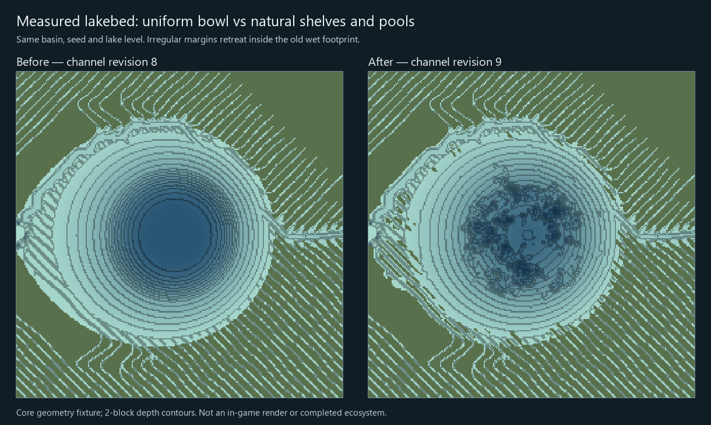

# Natural shoreline correction — saved channel revision 9

Baseline: `a4b76303d58562872a301690e40f2cc0f9e8591b`.

The supplied comparison showed regular lakebed rings, a uniform underwater substrate and sparse water-edge vegetation. Source inspection found a single smooth bowl deepening profile, wet loam collapsing to sand in the native material bridge, and a narrow default shoreline cover policy.

## Changed behavior

- Coherent, seeded shelf and pool variation breaks uniform bed-depth contours.
- Irregular shallow-margin deposits retreat the shoreline inside the former wet footprint. They never add wet area outside the original basin. A four-block buffer around routed channels protects inlets/outlets, and the lake stage is unchanged.
- Transport energy, slope, depth and coherent patches select sand, silt, clay and gravel. Selected bank patches expose sediment rather than continuous grass. Facies are computed once per column.
- The owned `deepprimal:riparian_mosaic` tag admits denser patchy ground cover. Eligible dry banks near planned water gain clustered tree admission, including low dry banks previously excluded by the global sea-level-plus-five threshold. Prairie canopy remains capped and desert admission stays zero.
- New authored profiles save channel revision 9. Existing 0–8 geometry is unchanged; no retrogen is applied.

This is a measured core geometry fixture, not an in-game screenshot. It does not display the new materials or vegetation.

## Validation

- Focused core suite: `NATURAL_SHORE_PASS checks=1198780`, exit 0, JVM verification enabled.
- Analytical basin: 29,670 remaining wet samples, 1,305 safely retreated samples, 7,028 shallower and 1,570 deeper bed samples; 740,044 routed-reach sample checks retain their water stage.
- Real engine wiring: two seeds, 267 old wet sample witnesses and 230 changed ground witnesses; no new wet area or changed retained-water stage.
- Exact baseline source differential: all 5,760 scalar fields across 576 columns in saved channel revisions 0–8 match bit-for-bit.
- All four substrate facies observed. 64,809 / 66,049 adjacent classifications agree (about 98.1%), providing coherent patches rather than per-cell dithering.
- Candidate core, baseline core and the production EngineChunkGenerator compile with Java 25; the adapter compiles against cached Minecraft 26.1.2 / NeoForge 26.1.2.122 APIs.
- Actual Minecraft codec/registry checks still pass for 40 owned biomes, now 14 habitat tags and all four profiles: 4,077 checks.
- Owned-biome generator `--check` passes for 99 generated assets.

The core test is registered in CoreChecks. Its optional baseline/core-JAR arguments isolate the exact old source in a separate class loader; an optional third argument writes the comparison CSV. `tools/render_shore_comparison.py` turns that CSV into the figure using Pillow and NumPy.

## Open work

The existing submerged/floating/rooted plant branches check vanilla water and consequently do not place plants in the engine fluid. A proper implementation must preserve the independent water-unit and chemistry contracts; replacing those water blocks with native waterlogged plants is not an accepted repair. This issue remains open.

This correction is a source change with scoped geometry, registry and compile validation. Full Gradle/JAR qualification, native world creation/save-reopen, in-game terrain/material/vegetation inspection, frame/chunk latency and broader ecology acceptance were not performed. No complete visual/ecosystem milestone, performance improvement or release JAR is claimed.
