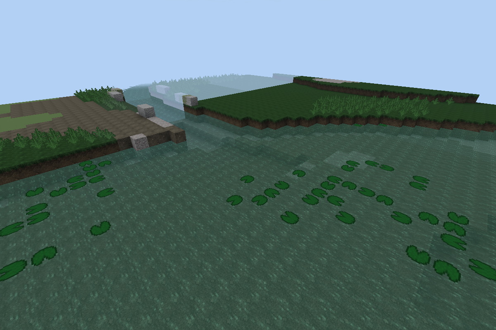

# Generated shoreline habitats

Minecraft 26.1.2, NeoForge 26.1.2.122 and Java 25. Source version `0.0.1-alpha.29-dev.133-water-habitats.1`. Both clients used Linux software OpenGL.

## Same-seed comparison

A new world created through the standard preset and an older saved generator both used seed `20261020` and channel revision 12. The native scene check read 37 × 37 columns around each center on the server thread. It inspected the actual blocks delivered to the game. Each location produced identical water coordinates, amounts, flow directions, speeds and ocean flags in both worlds.

| Habitat | Center X, Z | Water cells | Sixteenth-block units | New-world features |
| --- | --- | ---: | ---: | --- |
| Lake margin | −485, −1012 | 819 | 13,104 | 58 lily pads, 20 riffle stones and 6 bank rocks |
| Mountain watercourse | 822, 1089 | 530 | 6,634 | 39 riffle stones and 3 bank rocks |
| Warm shelf | −188, −2084 | 6,273 | 100,368 | 377 living coral bed blocks |

The older generator produced zero of the counted features at these three locations. The sampled water-state hashes were `5401011404930260349`, `-8434404955828817961` and `7667578920415433180` in both saves. The material counter for riffles includes cobblestone and mossy cobblestone. Andesite is also eligible for placement. None of these three sites contained a reed stand.

## Compatibility and reproduction

The standard and deep presets save `shoreline_habitats: true` on new worlds. A saved codec without that option keeps the previous placement in newly explored terrain. The client effects apply when a player visits existing terrain. Use the coordinates above to inspect the standard preset. The screenshot is a native client capture.

With `-PvisualValidation`, set `DEEPPRIMAL_SHORELINE_SCENE=current` or `legacy` and start the root `:runClient` with `-PcaptureWorld=<save>` and `-PcaptureDir=<output>`. The fixture expects the seed above and checks the selected save's generator option. It also exercises lily support during measured drain and bucket pickup, rejection over saltwater, pool impacts, shallow riffles, surf contact, and curtain visibility across a mesh-page boundary. Each completed run writes three screenshots and a `shoreline-<mode>.txt` survey.

The mountain capture still shows triangular patches along a steep water–rock contact. Natural waterfall continuity across terrain seeds and frame times on Windows hardware remain open.
